# Modelagem de Casos de Uso

## 1. Diagrama de Casos de Uso

### 1.1. Atores

| Ator | Descrição e responsabilidades no Sistema AP |
|---|---|
| **Recepcionista** | Localiza solicitações, confere material e dados, registra o recebimento no Sistema AP, confirma a entrada, identifica o material, classifica a rota, registra não conformidades e consulta o andamento. O recebimento oficial no AGHU continua sendo realizado conforme a rotina institucional. |
| **Técnico de Macroscopia** | Recebe o material na macroscopia, registra achados, clivagem, fragmentos/cassetes, laudo macroscópico e eventuais correções. |
| **Técnico de Processamento** | Recebe materiais no processamento técnico, registra a rota e as subetapas executadas, quantidades de blocos/lâminas, colorações e conclusão do processamento. |
| **Técnico de IHQ** | Registra recebimento da IHQ, anticorpos, rodadas, execução interna, envio/retorno de laboratório externo e resultado técnico. |
| **Médico Residente** | Consulta casos e histórico, registra parecer preliminar, solicita complementos diagnósticos e participa da avaliação com a preceptoria. Também pode solicitar IHQ no AGHU, conforme a rotina institucional. |
| **Patologista/Preceptor** | Avalia os achados, valida o diagnóstico, decide pelo fechamento ou por complementos, aprova/libera o diagnóstico e realiza as ações que exigem responsabilidade médica. |
| **Citotécnico** | Executa e registra a triagem citotécnica quando aplicável, especialmente no fluxo de CCV. A inclusão deste perfil específico na matriz de permissões deve ser confirmada com o SAP. |
| **Técnico do Arquivo** | Registra o arquivamento de fichas, lâminas, blocos e demais materiais, bem como movimentações de retirada/devolução quando habilitado. |
| **Coordenação/Administrador** | Consulta e gerencia o painel geral, acompanha urgências, administra usuários/perfis/configurações e executa ações restritas, como cancelamento de casos. |
| **AGHU** *(sistema externo)* | Fornece dados de solicitações e paciente por integração autorizada. Continua sendo o sistema institucional para registro oficial de recebimento e digitação/liberação do laudo. |
| **Serviço de autenticação institucional** *(sistema externo)* | Valida as credenciais institucionais dos usuários quando a integração estiver disponível. |
| **Laboratório externo** *(sistema/ator externo)* | Executa rodadas de IHQ encaminhadas pelo SAP e fornece o resultado/laudo para anexação ao caso. |
| **Unidade assistencial / Bloco Cirúrgico** *(ator externo)* | Origina e encaminha materiais, recebe devoluções e, no caso de congelação, recebe a comunicação do resultado intraoperatório. Não é usuário interno do Sistema AP nesta proposta. |

### 1.2. Diagrama geral

```mermaid
flowchart LR
    REC([Recepcionista SAP])
    MAC([Profissional de Macroscopia])
    PROC([Técnico de Processamento])
    IHQ([Técnico de IHQ])
    RES([Médico Residente])
    PAT([Patologista / Preceptor])
    CITO([Citotécnico])
    ARQ([Técnico do Arquivo])
    ADM([Coordenação / Administrador])
    AGHU[[AGHU]]
    AUTH[[Autenticação institucional]]
    EXT[[Laboratório externo]]
    ORIG([Unidade assistencial / Bloco cirúrgico])

    subgraph SAP[ Sistema AP ]
        UC001([Autenticar usuário])
        UC002([Importar/atualizar solicitações AGHU])
        UC003([Consultar fila e casos])
        UC004([Buscar caso por código])
        UC005([Conferir e confirmar recebimento])
        UC006([Gerar identificação interna e etiqueta])
        UC007([Definir fluxo e etapa inicial])
        UC008([Registrar movimentação entre setores])
        UC009([Registrar urgência])
        UC010([Registrar macroscopia])
        UC011([Gerar e versionar laudo macroscópico])
        UC012([Registrar processamento HP])
        UC013([Registrar processamento CG/CCV])
        UC014([Registrar congelação e resultado])
        UC015([Relacionar casos CO e HP])
        UC016([Solicitar complemento diagnóstico])
        UC017([Solicitar e acompanhar IHQ])
        UC018([Executar IHQ internamente])
        UC019([Registrar IHQ externa])
        UC020([Registrar parecer preliminar])
        UC021([Validar e fechar diagnóstico])
        UC022([Registrar conclusão e gerar documento])
        UC023([Confirmar liberação oficial no AGHU])
        UC024([Registrar etapas concluídas externamente])
        UC025([Registrar não conformidade e correção])
        UC026([Devolver material])
        UC027([Cancelar caso])
        UC028([Consultar histórico e rastreabilidade])
        UC029([Acompanhar pendências e estagnação])
        UC030([Visualizar painel de andamento])
        UC031([Registrar arquivamento])
        UC032([Registrar retirada/devolução de material])
        UC033([Gerenciar usuários e permissões])
        UC034([Consultar auditoria])
        UC035([Gerenciar máscaras/modelos de texto])
        UC036([Registrar Siscan quando aplicável])
    end

    AUTH --- UC001
    AGHU --- UC002
    AGHU --- UC005
    AGHU --- UC017
    AGHU --- UC023
    EXT --- UC019
    ORIG --- UC014
    ORIG --- UC026

    REC --- UC001
    MAC --- UC001
    PROC --- UC001
    IHQ --- UC001
    RES --- UC001
    PAT --- UC001
    CITO --- UC001
    ARQ --- UC001
    ADM --- UC001

    REC --- UC003
    MAC --- UC003
    PROC --- UC003
    IHQ --- UC003
    RES --- UC003
    PAT --- UC003
    CITO --- UC003
    ARQ --- UC003
    ADM --- UC003
    REC --- UC004
    MAC --- UC004
    PROC --- UC004
    IHQ --- UC004
    RES --- UC004
    PAT --- UC004
    CITO --- UC004
    ARQ --- UC004

    REC --- UC005
    REC --- UC006
    REC --- UC007
    MAC --- UC008
    PROC --- UC008
    IHQ --- UC008
    RES --- UC008
    PAT --- UC008
    ARQ --- UC008
    REC --- UC009
    MAC --- UC009
    PROC --- UC009
    IHQ --- UC009
    RES --- UC009
    PAT --- UC009
    ADM --- UC009

    MAC --- UC010
    RES --- UC010
    MAC --- UC011
    RES --- UC011
    PROC --- UC012
    PROC --- UC013
    CITO --- UC013
    REC --- UC014
    PROC --- UC014
    RES --- UC014
    PAT --- UC014
    REC --- UC015
    RES --- UC015
    PAT --- UC015

    RES --- UC016
    PAT --- UC016
    IHQ --- UC017
    RES --- UC017
    PAT --- UC017
    IHQ --- UC018
    IHQ --- UC019
    RES --- UC020
    CITO --- UC020
    PAT --- UC020
    RES --- UC021
    PAT --- UC021
    RES --- UC022
    PAT --- UC022
    PAT --- UC023
    REC --- UC024
    MAC --- UC024
    PROC --- UC024
    IHQ --- UC024
    RES --- UC024
    PAT --- UC024

    REC --- UC025
    MAC --- UC025
    PROC --- UC025
    IHQ --- UC025
    RES --- UC025
    PAT --- UC025
    REC --- UC026
    MAC --- UC026
    PROC --- UC026
    IHQ --- UC026
    RES --- UC026
    PAT --- UC026
    ADM --- UC027

    REC --- UC028
    MAC --- UC028
    PROC --- UC028
    IHQ --- UC028
    RES --- UC028
    PAT --- UC028
    CITO --- UC028
    ARQ --- UC028
    ADM --- UC028
    ADM --- UC029
    ADM --- UC030
    ARQ --- UC031
    ARQ --- UC032
    ADM --- UC033
    ADM --- UC034
    ADM --- UC035
    REC --- UC036
    ARQ --- UC036
    ADM --- UC036
```

### 1.3. Relação resumida entre requisitos e casos de uso

| Requisito funcional | Casos de uso relacionados |
|---|---|
| RF001 — Autenticação institucional | UC001 |
| RF002 — Consulta de casos | UC003, UC028 |
| RF003 — Consulta por identificação | UC004, UC006 |
| RF004 — Importação de solicitações do AGHU | UC002 |
| RF005 — Confirmação de recebimento | UC005 |
| RF006 — Geração de identificação interna | UC006 |
| RF007 — Registro de etapas do processo | UC007, UC008, UC012, UC013, UC014, UC018, UC019, UC024 |
| RF008 — Registro de macroscopia | UC010, UC011 |
| RF009 — Registro do processamento técnico | UC012, UC013 |
| RF010 — Controle de complementos diagnósticos | UC016, UC017 |
| RF011 — Controle de imunohistoquímica | UC017, UC018, UC019 |
| RF012 — Registro de conclusão do caso | UC021, UC022, UC023 |
| RF013 — Registro de arquivamento | UC031, UC032 |
| RF014 — Controle de urgências | UC009, UC029, UC030 |
| RF015 — Histórico e rastreabilidade | UC008, UC011, UC015, UC024, UC025, UC026, UC028, UC031, UC032, UC034 |
| RF022 — Controle de devolução e cancelamento | UC025, UC026, UC027 |
| RF023 — Alertas de estagnação | UC029 |
| RF024 — Controle de pendências | UC029, UC030 |
| RF025 — Painel de processos em andamento | UC030 |
| RF026 — Geração de documento de laudo para impressão | UC022 |

---
