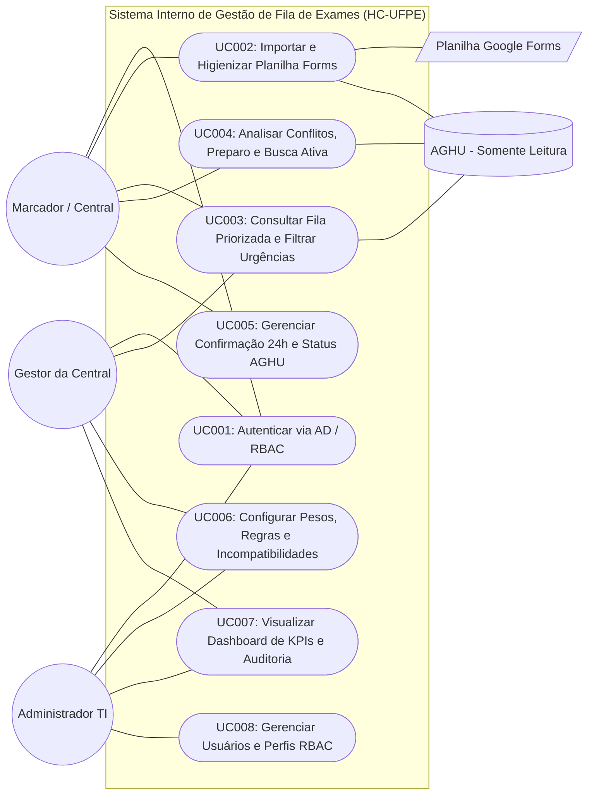
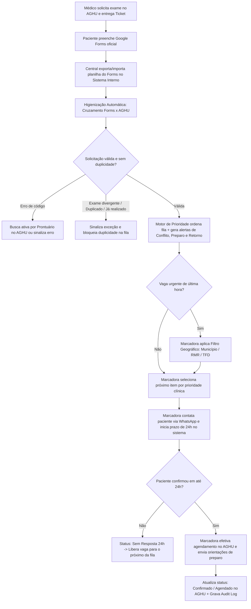

# Modelagem de Casos de Uso e Fluxo TO-BE

## 1. Diagrama de Casos de Uso

---

## 2. Fluxo Proposto (TO-BE — Alinhado nas Reuniões de 28/10 e 06/11)

> **Fora de escopo neste fluxo (conforme decisão de 06/11):** atendimentos presenciais diretos na Central, fluxos de remarcação/faltas, códigos em lote do AGHU e portal externo de pacientes.

---

## 3. Especificação Detalhada dos Casos de Uso

### UC001 — Autenticar Usuário (AD/LDAP + RBAC)
* **Atores:** Marcador, Gestor da Central, Administrador.
* **Pré-condição:** Usuário ativo no Active Directory (ou Mock em dev) e cadastrado com perfil ativo no banco local.
* **Fluxo Principal:**
  1. Usuário informa credenciais corporativas na tela `/login`.
  2. Backend autentica no AD (ou Mock) e verifica autorização na tabela local de perfis.
  3. Sistema emite JWT Access Token + Refresh Token em cookie `HttpOnly` e redireciona para o painel.
* **Fluxo Alternativo:** Credenciais inválidas ou usuário não autorizado localmente retornam `401`/`403` sem expor dados sensíveis.

### UC002 — Importar e Higienizar Planilha do Google Forms (`Forms × AGHU`)
* **Ator:** Marcador / Central.
* **Pré-condição:** Planilha exportada do Google Forms em formato CSV/XLSX disponível localmente.
* **Fluxo Principal:**
  1. Marcador acessa a tela de Importação e faz upload do arquivo do Forms.
  2. Sistema lê as linhas **sem modificar o arquivo original** e cruza cada `codigo_solicitacao` e `prontuario` com a base somente-leitura do AGHU.
  3. Sistema classifica cada linha: `VALIDA`, `DUPLICADA` (mesmo paciente/exame ou múltiplos médicos), `DIVERGENCIA_EXAME` (exame do Forms ≠ exame do AGHU) ou `SOLICITACAO_NAO_ENCONTRADA`.
  4. Sistema persiste os registros higienizados no SQLite, grava log em `audit_logs` e exibe resumo da importação.

#### [CARE-UC002] Higienização da Planilha
* **Context:** Planilha do Forms carregada e `ExameProvider` ativo (`csv` ou `postgres`).
* **Action:** Executar pipeline de validação cruzada entre planilha importada e registros do AGHU, marcando duplicidades e divergências.
* **Result:** Fila populada apenas com solicitações higienizadas e exceções separadas em aba própria para revisão.
* **Evaluation:** Teste de integração confirma detecção de 100% das duplicidades, divergências de exame e códigos inválidos em massa de teste.

### UC003 — Consultar Fila Priorizada e Aplicar Filtro Geográfico de Urgência
* **Atores:** Marcador, Gestor da Central.
* **Fluxo Principal:**
  1. Usuário abre a **Fila de Marcação** e visualiza os pedidos ordenados pelo `score_prioridade` determinístico, com tooltip/badges explicando o motivo da prioridade (ex: *Oncologia +40, Retorno próximo +15*).
  2. Usuário pode filtrar por tipo de exame, unidade/clínica solicitante, status ou pesquisar por prontuário/solicitação.
  3. Em caso de **vaga de última hora** (amanhã ou depois de amanhã), o marcador ativa o **Filtro Geográfico** (ex: Recife / RMR / município específico / TFD) para listar apenas pacientes com tempo hábil de deslocamento, sem alterar o score clínico.

#### [CARE-UC003] Priorização e Filtro Geográfico
* **Context:** Fila com solicitações válidas de diferentes especialidades e municípios.
* **Action:** Calcular pontuação determinística via `regras_prioridade` e aplicar filtros combináveis via query params na API.
* **Result:** Lista paginada ordenada por prioridade decrescente e data de solicitação crescente (desempate), mantendo os scores inalterados quando filtrada por município.
* **Evaluation:** Testes validam ordem determinística e preservação do score sob filtro geográfico.

### UC004 — Analisar Conflitos, Preparo, Retorno e Busca Ativa por Prontuário
* **Ator:** Marcador.
* **Fluxo Principal:**
  1. Ao abrir o detalhe de uma solicitação, o sistema exibe todos os exames pendentes/recentes do mesmo `prontuario`.
  2. Motor de regras sinaliza automaticamente incompatibilidades (ex: colonoscopia × sangue), janelas de retorno (espirometria ≤ 10d; INR ≤ 72h), antecedência mínima de preparo, jejum para diabéticos e orientações de preparo do exame.
  3. Caso a solicitação tenha vindo com código errado do Forms (`SOLICITACAO_NAO_ENCONTRADA`), a marcadora usa a **Busca Ativa por Prontuário** no AGHU e vincula o pedido correto.

#### [CARE-UC004] Detecção de Conflitos e Busca Ativa
* **Context:** Paciente com múltiplos exames cadastrados ou com código digitado errado no Forms.
* **Action:** Consultar todos os exames do prontuário no `ExameProvider` e confrontar com `incompatibilidades_exames` e `regras_exames`.
* **Result:** Alertas explícitos exibidos no detalhe da solicitação e possibilidade de vincular código corrigido com auditoria.
* **Evaluation:** Testes unitários cobrem conflito de preparo, violação de janela de retorno e vinculação por busca ativa.

### UC005 — Gerenciar Confirmação em 24h e Efetivação no AGHU
* **Ator:** Marcador.
* **Fluxo Principal:**
  1. Marcadora seleciona o próximo paciente da fila, contata via WhatsApp externo e clica em **"Iniciar Aguardo 24h"** no sistema.
  2. Sistema muda o status para `AGUARDANDO_CONFIRMACAO_24H` e calcula `prazo_confirmacao_em = agora + 24h`.
  3. **Se o paciente confirmar em até 24h:** marcadora realiza o agendamento na tela do **AGHU**, envia o preparo pelo WhatsApp e registra no sistema `CONFIRMADO_AGENDADO_AGHU` informando data/hora agendada no AGHU e confirmação de preparo orientado.
  4. **Se ultrapassar 24h sem resposta:** sistema destaca o vencimento; marcadora marca `SEM_RESPOSTA_24H`, liberando a vaga para o próximo da fila.
  5. Todas as transições gravam estado anterior e novo em `audit_logs`.

#### [CARE-UC005] Ciclo de Confirmação 24h
* **Context:** Solicitação em status `NA_FILA`.
* **Action:** Executar transições de estado via `PATCH /api/exames/fila/{id}/status` respeitando máquina de estados e auditoria obrigatória.
* **Result:** Status atualizado no SQLite, prazo de 24h calculado e evento gravado em `audit_logs`.
* **Evaluation:** Teste valida transições válidas, bloqueio de transições inválidas (`400`), flag de vencimento após 24h e integridade do log de auditoria.

### UC006 — Configurar Pesos de Prioridade, Regras de Exames e Incompatibilidades
* **Atores:** Gestor da Central, Administrador.
* **Fluxo Principal:**
  1. Usuário autorizado acessa **Configurações de Regras**.
  2. Edita pesos de grupos prioritários (ex: Oncologia, Transplante, Hemodiálise, Vulneráveis), cadastra/altera regras de um exame (preparo, janela de retorno em dias/horas, antecedência mínima) ou cadastra pares incompatíveis (Exame A × Exame B + intervalo em dias).
  3. Sistema valida dados, persiste no SQLite (usando soft delete para remoções), registra em `audit_logs` (`CONFIGURACAO`) e aplica imediatamente na próxima leitura da fila.

### UC007 — Visualizar Dashboard de KPIs e Trilha de Auditoria
* **Atores:** Gestor da Central, Administrador.
* **Fluxo Principal:**
  1. Gestor acessa o Dashboard e aplica filtros de período/exame.
  2. Sistema calcula e exibe KPIs: total na fila por exame/unidade, tempo médio de espera e resposta, taxa de confirmação em 24h, volume de duplicidades/divergências barradas e distribuição por município/TFD.
  3. Gestor/Admin pode consultar a trilha imutável de auditoria (`audit_logs`) filtrada por categoria, usuário e data.
