# Modelagem de Casos de Uso

## 1. Diagrama de Casos de Uso
*(Inserir imagem ou Mermaid)*

```mermaid

%%{init: {'theme': 'base', 'themeVariables': {'primaryColor': '#ffffff', 'edgeLabelBackground': '#ffffff', 'tertiaryColor': '#eeeeee'}}}%%
graph TB

    %% Definicao de Classes %%
    classDef actor fill:#f9f,stroke:#333,stroke-width:2px,rx:10,ry:10;
    classDef system fill:#bbb,stroke:#333,stroke-width:1px,stroke-dasharray:5 5;
    classDef usecase fill:#e1f5fe,stroke:#01579b,stroke-width:1px,rx:15,ry:15;

    %% Atores Externos %%
    Setor_Solicitante["Setor Solicitante<br/>(Externo)"]:::actor
    Paciente["Paciente<br/>(Externo)"]:::actor
    Regulacao["Regulacao<br/>(Externo)"]:::actor

    %% Atores Internos %%
    Recepcionista["Tecnico de Recepcao"]:::actor
    Tecnico_Macro["Tecnico de Macroscopia"]:::actor
    Tecnico_Processamento["Tecnico de Processamento"]:::actor
    Tecnico_IHQ["Tecnico de IHQ"]:::actor
    Medico_Patologista["Medico Patologista<br/>(Patologista / Residente / Preceptor)"]:::actor
    Arquivista["Arquivista"]:::actor

    %% Sistemas Externos %%
    Sistema_AGHU("Sistema AGHU"):::system
    Sistema_Siscan("Sistema Siscan"):::system

    %% Acoes feitas diretamente no AGHU, fora do sistema (RN-01) %%
    subgraph Fora_do_Sistema["Acoes fora do sistema (feitas no AGHU)"]
        UC_CadastrarPaciente(["Cadastrar Paciente no AGHU"]):::usecase
        UC_RealizarSolicitacao(["Realizar Solicitacao de Exame no AGHU"]):::usecase
        UC_GerarCodigoBarras(["Emitir Etiqueta da Solicitacao"]):::usecase
    end

    %% Fronteira do Sistema %%
    subgraph Sistema_Boundary["Sistema da Anatomia Patologica (HC UFPE)"]

        %% Recepcao e Triagem %%
        subgraph Recepcao_UCs["Subsistema Recepcao e Triagem"]
            UC_EntregarAmostra(["Entregar Amostra"]):::usecase
            UC_ConsultarSolicitacaoAGHU(["Consultar Solicitacao pelo Codigo da Etiqueta"]):::usecase
            UC_ReceberConferirAmostra(["Receber e Conferir Amostra"]):::usecase
            UC_RegistrarNaoConformidade(["Registrar Nao Conformidade"]):::usecase
            UC_GerarNumeroInterno(["Registrar Recebimento e Gerar No Interno"]):::usecase
            UC_ImprimirFichaTrabalho(["Imprimir Ficha de Trabalho"]):::usecase
            UC_RegistrarLivroProtocolo(["Registrar em Livro de Protocolo"]):::usecase
            UC_EncaminharMacro(["Encaminhar para Macroscopia"]):::usecase
        end

        %% Macroscopia e Congelamento %%
        subgraph Macro_UCs["Subsistema Macroscopia e Congelamento"]
            UC_RealizarAnaliseMacro(["Realizar Analise Macroscopica"]):::usecase
            UC_GerarCassetes(["Gerar Cassetes"]):::usecase
            UC_RegistrarAnaliseAGHU(["Registrar Analise Macroscopica no AGHU"]):::usecase
            UC_EncaminharProcessamento(["Encaminhar para Processamento Tecnico"]):::usecase
            UC_RealizarCongelamentoCortes(["Realizar Congelamento e Cortes"]):::usecase
        end

        %% Processamento Tecnico %%
        subgraph Processamento_UCs["Subsistema Processamento Tecnico"]
            UC_CentrifugarAmostra(["Centrifugar Amostra"]):::usecase
            UC_ProcessarCellBlock(["Processar Cell Block"]):::usecase
            UC_RealizarInclusao(["Realizar Inclusao"]):::usecase
            UC_RealizarCortes(["Realizar Cortes"]):::usecase
            UC_RealizarProcessamentoTecnico(["Realizar Processamento Tecnico"]):::usecase
        end

        %% Imuno-histoquimica %%
        subgraph IHQ_UCs["Subsistema Imuno-histoquimica (IHQ)"]
            UC_RealizarAnaliseIHQ(["Realizar Analise IHQ"]):::usecase
        end

        %% Microscopia %%
        subgraph Microscopia_UCs["Subsistema Microscopia"]
            UC_RevisarResidentPreceptor(["Revisar com Residente e Preceptor"]):::usecase
            UC_SolicitarExamesAdicionais(["Solicitar Exames Adicionais"]):::usecase
            UC_FinalizarDiagnostico(["Finalizar Diagnostico"]):::usecase
            UC_GerarLaudoEnviarAGHU(["Gerar Laudo e Enviar para AGHU"]):::usecase
            UC_GerarLaudoSiscan(["Gerar Laudo no Siscan"]):::usecase
        end

        %% Arquivo %%
        subgraph Arquivo_UCs["Subsistema Arquivo"]
            UC_ArquivarFichaTrabalho(["Arquivar Ficha de Trabalho"]):::usecase
        end
    end

    %% Associacoes: Recepcao %%
    Setor_Solicitante -. "Entregar" .-> UC_EntregarAmostra
    Paciente -. "Entregar" .-> UC_EntregarAmostra

    Recepcionista --- UC_EntregarAmostra
    Recepcionista --- UC_ConsultarSolicitacaoAGHU
    Recepcionista --- UC_ReceberConferirAmostra
    Recepcionista --- UC_RegistrarNaoConformidade
    Recepcionista --- UC_GerarNumeroInterno
    Recepcionista --- UC_ImprimirFichaTrabalho
    Recepcionista --- UC_RegistrarLivroProtocolo
    Recepcionista --- UC_EncaminharMacro

    %% Associacoes: Acoes fora do sistema %%
    Regulacao --- UC_CadastrarPaciente
    Regulacao --- UC_RealizarSolicitacao
    Setor_Solicitante --- UC_RealizarSolicitacao
    Setor_Solicitante --- UC_GerarCodigoBarras

    %% Associacoes: Macroscopia %%
    Tecnico_Macro --- UC_RealizarAnaliseMacro
    Tecnico_Macro --- UC_GerarCassetes
    Tecnico_Macro --- UC_RegistrarAnaliseAGHU
    Tecnico_Macro --- UC_EncaminharProcessamento
    Tecnico_Macro --- UC_RealizarCongelamentoCortes

    %% Associacoes: Processamento Tecnico %%
    Tecnico_Processamento --- UC_CentrifugarAmostra
    Tecnico_Processamento --- UC_ProcessarCellBlock
    Tecnico_Processamento --- UC_RealizarInclusao
    Tecnico_Processamento --- UC_RealizarCortes
    Tecnico_Processamento --- UC_RealizarProcessamentoTecnico

    %% Associacoes: IHQ %%
    Tecnico_IHQ --- UC_RealizarAnaliseIHQ

    %% Associacoes: Microscopia %%
    Medico_Patologista --- UC_RevisarResidentPreceptor
    Medico_Patologista --- UC_SolicitarExamesAdicionais
    Medico_Patologista --- UC_FinalizarDiagnostico
    Medico_Patologista --- UC_GerarLaudoEnviarAGHU
    Medico_Patologista --- UC_GerarLaudoSiscan

    %% Associacoes: Arquivo %%
    Arquivista --- UC_ArquivarFichaTrabalho

    %% Integracoes com Sistemas Externos %%
    Sistema_AGHU -- "somente leitura" --> UC_ConsultarSolicitacaoAGHU
    UC_CadastrarPaciente --> Sistema_AGHU
    UC_RealizarSolicitacao --> Sistema_AGHU
    UC_GerarCodigoBarras --> Sistema_AGHU
    UC_RegistrarAnaliseAGHU <--> Sistema_AGHU
    UC_GerarLaudoEnviarAGHU <--> Sistema_AGHU
    UC_GerarLaudoSiscan <--> Sistema_Siscan

    %% Relacionamentos entre Casos de Uso %%
    UC_ReceberConferirAmostra -.-> UC_ConsultarSolicitacaoAGHU
    UC_ReceberConferirAmostra -.-> UC_GerarNumeroInterno
    UC_ReceberConferirAmostra -.-> UC_RegistrarNaoConformidade
    UC_FinalizarDiagnostico -.-> UC_GerarLaudoEnviarAGHU
    UC_FinalizarDiagnostico -.-> UC_GerarLaudoSiscan
    UC_FinalizarDiagnostico -.-> UC_SolicitarExamesAdicionais
```

## 2. Especificação (Exemplo)
# Especificação Detalhada de Casos de Uso (UC) e SDD (CARE) - Anatomia Patológica / HC-UFPE
---

## 1. Sub-sistema: Recepção & Triagem

> **Regra de leitura desta seção:** o sistema nunca grava no AGHU (RN-01). Cadastro do paciente, criação da solicitação e emissão da etiqueta acontecem no AGHU, fora do sistema (UC003 a UC005).

### UC001 - Entregar Amostra
- Ator: Setor Solicitante / Paciente / Técnico de Recepção.
- Fluxo: Apresentar amostra física com a etiqueta do AGHU na recepção -> Recepcionista inicia a conferência no sistema (UC006).

[CARE-UC001] Entrega Física da Amostra
- Context: Amostra entregue na recepção física da Anatomia Patológica.
- Action: Entregar o material ao recepcionista. Esta etapa é física e não gera registro; o registro acontece no UC006.
- Result: Amostra pronta para a conferência.
- Evaluation: Não há teste de software. O comportamento do sistema é avaliado no UC006.

### UC002 - Consultar Solicitação pelo Código da Etiqueta
- Ator: Técnico de Recepção.
- Fluxo: Bipar ou digitar o código da etiqueta -> Sistema lê a solicitação pelo provider de leitura -> Sistema mostra paciente, origem e amostras das 5 bancadas.

[CARE-UC002] Leitura da Solicitação no AGHU
- Context: Operador com a amostra etiquetada na recepção.
- Action: Enviar `GET /api/recebimento/solicitacoes/{codigo}`. O backend lê os dados pela `SolicitacaoProviderInterface`, sem nenhuma escrita no AGHU.
- Result: Iniciais, prontuário, nascimento e idade do paciente, origem, clínica, unidade, informações clínicas e amostras das bancadas HP, CO, IHQ, CG e CCV exibidos em uma só tela. A bancada vem de `codigo_lab`, e a sigla do exame só o descreve.
- Evaluation: Testes de resposta com sucesso (HTTP 200), código inválido (HTTP 422), código inexistente (HTTP 404) e laboratório sem mapeamento, que não é recebível.

### UC003 - Cadastrar Paciente no AGHU (fora do sistema)
- Ator: Regulação.
- Fluxo: Identificar paciente externo sem cadastro -> Cadastrar diretamente no AGHU.

[CARE-UC003] Cadastro do Paciente Externo
- Context: Paciente externo sem cadastro prévio no AGHU.
- Action: A Regulação faz o cadastro diretamente no AGHU. O sistema não participa desta ação.
- Result: Paciente disponível no AGHU; o sistema passa a enxergá-lo pela leitura da solicitação.
- Evaluation: Revisão de código: o sistema não tem endpoint, método ou SQL de escrita no AGHU.

### UC004 - Realizar Solicitação de Exame no AGHU (fora do sistema)
- Ator: Setor Solicitante / Regulação.
- Fluxo: Selecionar o paciente no AGHU -> Escolher o exame -> Confirmar a solicitação no AGHU.

[CARE-UC004] Criação da Solicitação
- Context: Paciente cadastrado no AGHU e sem solicitação para o material.
- Action: Criar a solicitação diretamente no AGHU. O sistema não participa desta ação.
- Result: Solicitação disponível para leitura no UC002.
- Evaluation: Revisão de código: o sistema não tem endpoint, método ou SQL de escrita no AGHU.

### UC005 - Emitir Etiqueta da Solicitação (fora do sistema)
- Ator: Setor Solicitante, usando o AGHU.
- Fluxo: Confirmar a solicitação -> Imprimir no AGHU a etiqueta com o código da solicitação e o número da amostra -> Colar a etiqueta no frasco.

[CARE-UC005] Etiqueta do AGHU
- Context: Solicitação confirmada no AGHU.
- Action: O AGHU emite a etiqueta. O sistema apenas reconhece o código lido (RNF002) e não gera este código de barras.
- Result: Frasco com etiqueta que o leitor do setor consegue ler.
- Evaluation: Uma etiqueta com o número da amostra, ao ser lida, abre a solicitação correta e destaca a amostra. Os formatos aceitos estão em `05-interfaces.md`.

### UC006 - Receber e Conferir Amostra (RF003, RF004, RN-04)
- Ator: Técnico de Recepção.
- Pré-condição: Usuário autenticado e amostra etiquetada em mãos.

**Fluxo principal**
1. O técnico bipa ou digita o código da etiqueta (UC002), ou abre a solicitação pela lista inicial.
2. O sistema mostra o paciente, a origem, a clínica, a unidade, as informações clínicas e as amostras das 5 bancadas, com o status no AGHU e o checklist do recebimento desmarcado.
3. O técnico mantém marcadas as amostras que vai receber.
4. O técnico confere as amostras marcadas e preenche uma única vez o checklist do recebimento: siglas × conteúdo, descrições × frascos e nº de recipientes.
5. Se recebe HP, o técnico informa a quantidade de peças, a urgência (Sim ou Não) e o procedimento. Se recebe IHQ, pode informar o HP de origem (`HP-AAAA/N`).
6. O técnico aciona "Concluir recebimento", habilitado só com o checklist e os dados obrigatórios completos.
7. O sistema executa o UC007 e mostra o nº interno em destaque.
8. A lista volta atualizada, e o foco retorna ao campo de código.

**Fluxos alternativos**
- **A1. Solicitação não encontrada:** o sistema mostra a mensagem e mantém o foco no campo, sem gravar nada (HTTP 404). Um código em formato não aceito, como o prontuário bipado por engano, recebe mensagem própria (HTTP 422).
- **A2. Solicitação sem itens de laboratório mapeado:** o sistema informa que não há itens da Anatomia Patológica e não mostra amostras (HTTP 422). O CSV atual já vem filtrado para os 5 laboratórios; a regra protege contra mudanças na view e laboratórios desativados.
- **A3. Checklist incompleto, ou amostra marcada depois de confirmá-lo:** "Concluir recebimento" fica desabilitado. Se o pedido chegar à API mesmo assim, ele é recusado, e nenhum número é consumido (HTTP 422).
- **A4. Algo não confere no frasco:** o técnico aciona "Registrar não conformidade" e segue para o UC011A.
- **A5. Item sem descrição no AGHU (hoje, só a sigla CITO):** a tela pede o material do frasco. O recebimento só é aceito com esse campo preenchido (HTTP 422), e o texto fica separado da descrição do AGHU.
- **A6. Solicitação já recebida:** o sistema mostra o nº interno existente e não gera outro (HTTP 409).
- **A7. Só parte das amostras chegou:** o técnico desmarca as ausentes. Elas ficam registradas como não recebidas.
- **A8. Status do item não permite o recebimento (`EXECUTANDO`, `LIBERADO`, `CANCELADO` ou status não configurado):** a linha mostra o status e fica bloqueada, e as demais amostras seguem liberadas (HTTP 422 se o pedido chegar à API). Se o frasco chegou mesmo assim, o técnico segue para o UC011A.
- **A9. Paciente Externo sem prontuário ou sem clínica:** a tela mostra "Sem prontuário" e "Não informada", e o recebimento segue normalmente. Sem prontuário em outra origem, a amostra é bloqueada.
- **A10. Numeração com lacunas:** as amostras aparecem com o número do AGHU (ex.: 3 e 5), sem exigir sequência contínua.
- **A11. Dados de HP ausentes ou fora da lista:** o recebimento é recusado, sem consumir número (HTTP 422 ou 400).
- **A12. Referência da IHQ fora do formato `HP-AAAA/N`:** o recebimento é recusado (HTTP 422). O campo é opcional.
- **A13. Técnico desiste da conferência:** "Voltar para a lista" encerra a conferência sem gravar nada.

[CARE-UC006] Conferência na Recepção
- Context: Solicitação lida do AGHU e exibida na tela de recebimento.
- Action: Validar o checklist do recebimento, único para as amostras marcadas, antes de concluir.
- Result: Exame criado com as amostras recebidas, data, hora e usuário do token (RNF007). Itens de laboratórios sem mapeamento são ignorados. Nome do paciente e informações clínicas não são gravados.
- Evaluation: Recebimento bloqueado com item pendente e liberado com checklist completo; recebendo 2 de 3 amostras, o exame fica com 2; cada um dos 8 status do AGHU segue a regra configurada.

### UC007 - Registrar Recebimento e Gerar Nº Interno (RF006, RN-07)
- Ator: Técnico de Recepção / Sistema.
- Fluxo: Concluir o recebimento (UC006) -> Gerar um exame por bancada, com nº interno -> Gravar o registro no sistema, que substitui a planilha de controle interno.

[CARE-UC007] Registro do Recebimento no Sistema
- Context: Checklist do recebimento completo.
- Action: Em uma única transação, incrementar a sequência por tipo e ano e gravar exame, amostras e conferências. Depois do commit, registrar a auditoria na categoria `NEGOCIO_CLINICO`.
- Result: Nº interno no formato sigla + sequencial (ex.: `HP 4757`). A bancada IHQ usa o prefixo `IH` (RF006, RF022). O ano segue o fuso do hospital.
- Evaluation: 50 recebimentos simultâneos sem números repetidos nem pulados (RNF013); teste da virada de ano; sequências independentes por tipo; solicitação com duas ou três bancadas gera um número por bancada; CO entra urgente (CARE-RF007).

### UC011A - Registrar Não Conformidade e Devolver à Origem (RF005)
- Ator: Técnico de Recepção.
- Fluxo: Abrir o registro de não conformidade -> Selecionar o motivo padronizado -> Informar a observação e, se houver, o nº no CMCE e o médico solicitante -> Confirmar -> Devolver fisicamente o material ao setor de origem.

**Fluxos alternativos**
- **A1. Motivo inválido ou observação vazia:** o registro é recusado (HTTP 422).
- **A2. Todos os tipos já recebidos:** não há o que devolver, e o sistema informa o nº existente (HTTP 409).
- **A3. Material corrigido volta à recepção:** a solicitação pode ser recebida novamente. A não conformidade da mesma bancada é marcada como resolvida ("Resolveu?" da planilha), e o histórico é preservado.
- **A4. Item bloqueado pelo status do AGHU:** a devolução é permitida em qualquer status.

[CARE-UC011A] Devolução sem Consumo de Número
- Context: Um dos 14 motivos oficiais, listados em `04-modelo-dados.md`.
- Action: Gravar a não conformidade para as bancadas da solicitação ainda não recebidas. Prontuário, origem, clínica e exame vêm do AGHU, sem redigitar. Nenhum alerta é gravado no AGHU; a comunicação é a devolução física ao setor.
- Result: Exame com status `DEVOLVIDO`, sem nº interno, com motivo, observação, usuário, data e hora.
- Evaluation: Após uma devolução, o status, o motivo e a sequência de números ficam corretos, e toda mutação gera registro em `audit_logs`.

### UC008 - Imprimir Ficha de Trabalho
- Ator: Técnico de Recepção.
- Fluxo: Selecionar amostra triada -> Enviar comando de impressão -> Obter Ficha de Trabalho física.

[CARE-UC008] Emissão da Ficha de Trabalho
- Context: Amostra validada e triada com sucesso.
- Action: Gerar documento formatado com dados da requisição, topografia e código de barras.
- Result: Spool de impressão enviado para a impressora térmica/padronizada do setor.
- Evaluation: Teste visual/integrado garantindo que todos os dados do paciente e requisição constam no Layout.

### UC009 - Registrar em Livro de Protocolo Eletrônico (LPE)
- Ator: Técnico de Recepção / Sistema.
- Fluxo: Confirmar triagem -> Gravar dados no Livro Eletrônico -> Selar registro com assinatura eletrônica institucional.

[CARE-UC009] Registro Imutável no Livro Eletrônico (RN-02)
- Context: Amostra pronta para entrar no fluxo analítico.
- Action: Criar entrada no Livro Eletrônico e aplicar assinatura digital institucional.
- Result: Protocolo oficial assinado, imutável e substituindo integralmente o livro físico.
- Evaluation: Tentativa de alteração direta sem rito de retificação deve retornar HTTP 403 Forbidden.

### UC010 - Encaminhar para Macroscopia
- Ator: Técnico de Recepção.
- Fluxo: Juntar amostra física com Ficha de Trabalho -> Colocar na bandeja de transporte -> Mover física e logicamente para a sala de Macroscopia.

[CARE-UC010] Transição de Fase (Recepção -> Macroscopia)
- Context: Livro eletrônico assinado e ficha impressa.
- Action: Atualizar status do protocolo para "ENVIADO_MACROSCOPIA" e disparar cronômetro de SLA da fase.
- Result: Amostra visível na fila de trabalho da Macroscopia no painel de TAT.
- Evaluation: Teste de banco de dados confirmando alteração de status e gravação do timestamp de saída da recepção.

---

## 2. Sub-sistema: Macroscopia / Congelamento

### UC011 - Realizar Análise Macroscópica
- Ator: Técnico de Macroscopia / Médico Patologista.
- Fluxo: Receber amostra com Ficha de Trabalho -> Avaliar peça física -> Identificar se requer congelamento prévio -> Ditar/Digitar relatório macroscópico.

[CARE-UC011] Registro da Descrição Macroscópica
- Context: Amostra disponível na bancada de macroscopia.
- Action: Capturar texto de descrição macroscópica e dimensões da peça.
- Result: Descrição gravada e associada ao protocolo do exame.
- Evaluation: Validar exigência de texto mínimo de 10 caracteres no campo de descrição macroscópica.

### UC012 - Realizar Congelamento e Cortes
- Ator: Técnico de Macroscopia / Médico Patologista.
- Fluxo: Identificar amostra para exame intraoperatório/congelamento -> Resfriar peça em criostato -> Realizar cortes histológicos rápidos -> Encaminhar para análise imediata.

[CARE-UC012] Processamento Rápido de Congelamento
- Context: Amostra assinalada com prioridade de "Congelamento/Intraoperatório".
- Action: Registrar horário de início e fim do corte no criostato com flag de urgência máxima.
- Result: Lâmina de congelamento gerada para leitura imediata com alerta de SLA crítico.
- Evaluation: Validar se o tempo do processo aciona alerta vermelho se exceder 30 minutos.

### UC013 - Gerar Cassetes
- Ator: Técnico de Macroscopia.
- Fluxo: Definir fragmentos da clivagem -> Definir quantidade de fragmentos/blocos -> Imprimir etiquetas com código do cassete.

[CARE-UC013] Clivagem e Identificação de Cassetes
- Context: Exame macroscópico concluído.
- Action: Informar quantidade N de blocos e acionar impressora de cassetes.
- Result: Cassetes identificados e vinculados como filhos do protocolo pai.
- Evaluation: Teste unitário confirmando a criação de N registros na tabela CASSETE vinculados ao id_protocolo.

### UC014 - Registrar Análise Macroscópica no AGHU
- Ator: Técnico de Macroscopia / Sistema.
- Fluxo: Finalizar clivagem -> Sincronizar descrição e quantidade de cassetes com o sistema AGHU.

[CARE-UC014] Sincronização de Macroscopia com AGHU
- Context: Análise macroscópica e cassetes finalizados no SAP.
- Action: Enviar payload com a descrição e número de blocos para a API do AGHU.
- Result: AGHU atualizado com as informações da fase macroscópica.
- Evaluation: Teste de integração verificando retorno HTTP 200 da API do AGHU.

### UC015 - Encaminhar para Processamento Técnico
- Ator: Técnico de Macroscopia.
- Fluxo: Acomodar cassetes no cesto do processador -> Mover Ficha de Trabalho -> Atualizar status no painel.

[CARE-UC015] Transição de Fase (Macroscopia -> Processamento)
- Context: Cassetes produzidos e registrados.
- Action: Atualizar status do exame para "EM_PROCESSAMENTO_TECNICO".
- Result: Fim da contagem de SLA da Macroscopia e início do SLA do Processamento Técnico.
- Evaluation: Confirmar se o tempo de permanência na macroscopia foi gravado na tabela de métricas de TAT.

---

## 3. Sub-sistema: Processamento Técnico

### UC016 - Centrifugar Amostra
- Ator: Técnico de Processamento.
- Fluxo: Identificar amostra líquida (citologia/efusões) -> Acomodar na centrífuga -> Executar ciclo de centrifugação -> Separar sedimento.

[CARE-UC016] Processamento de Amostras Líquidas
- Context: Amostra recebida identificada com flag "Líquido/Citologia".
- Action: Iniciar etapa de centrifugação e separar o botão celular.
- Result: Amostra preparada para confecção de lâmina citológica ou Cell Block.
- Evaluation: Validar alteração no fluxo para ramificação de Citopatologia.

### UC017 - Processar Cell Block
- Ator: Técnico de Processamento.
- Fluxo: Recuperar sedimento centrifugado -> Adicionar meio de inclusão (ágar/formol) -> Solidificar sedimento -> Acomodar em cassete histológico.

[CARE-UC017] Confecção de Cell Block (Bloco de Células)
- Context: Sedimento celular obtido no UC016.
- Action: Converter amostra líquida em um bloco histológico manipulável.
- Result: Cassete de Cell Block gerado e integrado ao fluxo de histologia tradicional.
- Evaluation: Teste unitário confirmando a conversão do tipo da amostra de "Líquida" para "Cell Block".

### UC018 - Realizar Inclusão
- Ator: Técnico de Processamento.
- Fluxo: Retirar cassetes do processador de tecidos -> Despejar parafina líquida em molde -> Posicionar o tecido -> Esfriar para formar o bloco de parafina.

[CARE-UC018] Etapa de Inclusão em Parafina
- Context: Cassetes desidratados e diafanizados.
- Action: Registrar a conclusão do ciclo no processador de tecidos e montagem dos blocos de parafina.
- Result: Blocos rígidos prontos para microtomia (corte).
- Evaluation: Validar se a etapa é concluída sem erros no log de fluxo.

### UC019 - Realizar Cortes
- Ator: Técnico de Processamento.
- Fluxo: Fixar bloco de parafina no micrótomo -> Ajustar espessura de corte (micras) -> Obter fita de tecido -> Pescar fita na água e fixar na lâmina de vidro.

[CARE-UC019] Etapa de Microtomia (Corte)
- Context: Blocos de parafina consolidados.
- Action: Registrar a confecção da lâmina não corada a partir do bloco.
- Result: Lâmina histológica física preparada para coloração.
- Evaluation: Confirmar associação entre o ID do bloco e a lâmina numerada gerada.

### UC020 - Realizar Processamento Técnico
- Ator: Técnico de Processamento.
- Fluxo: Submeter lâminas à bateria de coloração (H&E / Especiais) -> Aplicar resina e lamínula (montagem) -> Organizar lâminas em pranchas -> Distribuir aos médicos patologistas.

[CARE-UC020] Finalização do Processamento Histológico
- Context: Lâminas cortadas disponíveis.
- Action: Executar rotina de coloração/montagem e alterar status para "LÂMINAS_PRONTAS".
- Result: Lâminas físicas entregues aos patologistas e notificação enviada para a fase de Microscopia.
- Evaluation: Validar encerramento do SLA da fase de Processamento Técnico no painel de TAT.

---

## 4. Sub-sistema: Imunohistoquímica (IHQ)

### UC021 - Realizar Análise IHQ
- Ator: Técnico de IHQ / Médico Patologista.
- Fluxo: Receber solicitação de painel de marcadores -> Recuperar bloco de parafina -> Aplicar anticorpos específicos -> Processar revelação -> Entregar lâminas coradas ao Patologista.

[CARE-UC021] Fluxo de Exame Complementar IHQ
- Context: Pedido de ampliação de painel IHQ emitido na Microscopia.
- Action: Registrar a recepção do bloco no setor de IHQ, aplicação dos reagentes e disponibilização da nova lâmina.
- Result: Status do protocolo atualizado com extensão de prazo configurada e lâminas de IHQ vinculadas.
- Evaluation: Teste unitário validando a adição automática do tempo de extensão no SLA global do exame.

---

## 5. Sub-sistema: Microscopia

### UC022 - Revisar com Residente e Preceptor
- Ator: Médico Patologista / Residente.
- Fluxo: Receber lâminas e Ficha de Trabalho -> Analisar achados histológicos no microscópio -> Discutir hipóteses entre residente e preceptor -> Definir conduta.

[CARE-UC022] Sessão de Revisão de Lâminas
- Context: Lâminas físicas e Ficha de Trabalho na bancada médica.
- Action: Registrar impressões diagnósticas preliminares do residente e anotações do preceptor.
- Result: Rascunho de laudo preenchido em ambiente colaborativo.
- Evaluation: Validar permissão de escrita de rascunho para residentes e restrição de assinatura apenas para o preceptor.

### UC023 - Solicitar Exames Adicionais
- Ator: Médico Patologista.
- Fluxo: Identificar incerteza diagnóstica -> Solicitar coloração especial, novos cortes ou painel IHQ -> Enviar amostra de volta para a fase correspondente.

[CARE-UC023] Recuo de Fluxo para Exames Adicionais
- Context: Análise microscópica inconclusiva sem exames complementares.
- Action: Disparar evento de solicitação de re-corte, coloração especial ou IHQ com justificativa médica.
- Result: Amostra reencaminhada para a fila técnica com indicação visual de retorno no painel.
- Evaluation: Teste automatizado garantindo que o status retorna para "EM_PROCESSAMENTO" ou "EM_IHQ" mantendo a rastreabilidade original.

---

## 6. Sub-sistema: Pós-Analítica (Laudos, Notificação & Arquivo)

### UC024 - Finalizar Diagnóstico
- Ator: Médico Patologista.
- Fluxo: Concluir análise histológica -> Inserir texto final do laudo -> Validar adequação dos códigos topográficos/morfológicos -> Aprovar laudo para liberação.

[CARE-UC024] Encerramento da Análise Médica
- Context: Discussão e exames complementares concluídos.
- Action: Inserir texto conclusivo no campo de laudo e acionar botão "Finalizar Diagnóstico".
- Result: Diagnóstico travado para edições diretas e pronto para assinatura/transmissão.
- Evaluation: Validar se todos os campos obrigatórios do laudo foram preenchidos antes de permitir a finalização.

### UC025 - Gerar Laudo e Enviar para AGHU
- Ator: Médico Patologista / Sistema.
- Fluxo: Acionar assinatura eletrônica -> Gerar arquivo PDF do laudo final -> Transmitir laudo assinado para a base do AGHU.

[CARE-UC025] Transmissão Eletrônica de Laudo Assinado
- Context: Diagnóstico finalizado e assinado eletronicamente.
- Action: Gerar PDF/A com marca d'água/hash e invocar webservice de recepção de laudos do AGHU.
- Result: Laudo disponível imediatamente no prontuário eletrônico do paciente no AGHU e cronômetro total de TAT encerrado.
- Evaluation: Executar npm test tests/aghu_laudo.spec.ts validando o upload e confirmação de recebimento pelo AGHU.

### UC026 - Gerar Laudo no Siscan
- Ator: Médico Patologista.
- Fluxo: Identificar se o exame é de notificação obrigatória no Siscan (ex: Colo do Útero/Mama) -> Acessar módulo Siscan -> Inserir formulário específico de laudo -> Confirmar liberação.

[CARE-UC026] Notificação e Laudo para o Siscan
- Context: Exame com topografia/tipo coberto pelo programa Siscan/MS.
- Action: Preencher campos padronizados do formulário do Ministério da Saúde e transmitir ao Siscan.
- Result: Registro de laudo oncológico publicado no sistema federal Siscan.
- Evaluation: Teste de integração validando o preenchimento de todos os códigos de lesão exigidos pelo Siscan.

### UC027 - Arquivar Ficha de Trabalho e Amostras
- Ator: Arquivista / Técnico de Apoio.
- Fluxo: Recolher lâminas e blocos processados e laudados -> Recolher Ficha de Trabalho -> Escanear/Bipar localização de gaveta/caixa -> Armazenar nos arquivos físicos correspondentes.

[CARE-UC027] Rastreabilidade de Arquivo Físico
- Context: Exame laudado e finalizado em todas as fases.
- Action: Vincular o id_protocolo, blocos e lâminas ao código da gaveta/caixa de arquivo físico no sistema.
- Result: Localização exata do material histológico mapeada para futuras consultas, revisões ou amostras judiciais.
- Evaluation: Teste de consulta buscando id_protocolo e validando o retorno do endereço exato do arquivo (Ex: Armário 2, Gaveta B, Caixa 15).
