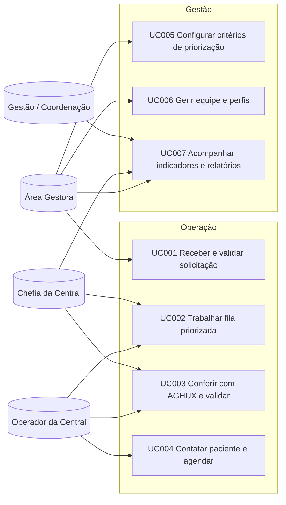

# Modelagem de Casos de Uso — SAE-HC

## 1. Diagrama de Casos de Uso

## 2. Especificação dos Casos de Uso

### UC001 — Receber e validar solicitação
- **Ator:** Área Gestora (representante do processo).
- **Fluxo:** receber respostas do formulário externo → checar obrigatoriedade e coerência → gerar alertas por campo → classificar a solicitação na fila.
- **Regras:** RN-01 (identificação por CNS/CPF), RN-05 (bloqueio de duplicidade), RN-06 (assinatura eletrônica das ações).
- **Resultado:** solicitação com status `RECEBIDA`, alertas anexados e posição calculada na fila.

#### [CARE-UC001]
- **Context:** formulário externo enviado e regras de validação disponíveis.
- **Action:** processar os campos e vincular alertas à solicitação.
- **Result:** alertas visíveis no painel de conferência; bloqueio de avanço enquanto houver erro não tratado.
- **Evaluation:** `pytest tests/test_validacao.py`.

### UC002 — Trabalhar fila priorizada
- **Ator:** Operador da Central; Chefia (visualização e tratativa de exceções).
- **Fluxo:** abrir fila → filtrar por exame/status/período → selecionar primeiro item da ordem automática → abrir painel de conferência.
- **Regras:** RN-02 (o operador não altera prioridade manualmente), RN-03 (exceção só pela Área Gestora, com justificativa).
- **Result:** fila ordenada por pontuação dos critérios ativos, desempate por data de envio.

#### [CARE-UC002]
- **Context:** critérios de priorização cadastrados e solicitações recebidas.
- **Action:** calcular a pontuação e ordenar a fila.
- **Result:** `GET /api/fila` retorna a ordem correta; tempo de resposta até 3 s (RNF007).
- **Evaluation:** `pytest tests/test_fila.py`.

### UC003 — Conferir com AGHUX e validar
- **Ator:** Operador da Central; Chefia (aprovação de exceções).
- **Fluxo:** abrir solicitação → comparar formulário × cadastro AGHUX → destacar divergências → corrigir ou justificar → validar com assinatura eletrônica.
- **Regras:** RN-04 (divergência não pode ser ignorada), RN-06, RN-08 (histórico imutável).
- **Result:** solicitação pronta para contato; `dados_anteriores`/`dados_novos` registrados.

#### [CARE-UC003]
- **Context:** integração AGHUX disponível e solicitação em conferência.
- **Action:** comparar campo a campo e persistir correções com autor.
- **Result:** validação bloqueada enquanto houver divergência sem tratamento; falha de integração não perde a solicitação.
- **Evaluation:** `pytest tests/test_aghux_conferencia.py` e `tests/test_validacao_operador.py`.

### UC004 — Contatar paciente e agendar
- **Ator:** Operador da Central.
- **Fluxo:** registrar contato (aceite, recusa ou sem resposta) → com aceite, efetivar marcação no AGHUX → registrar data/hora e responsável.
- **Regras:** RN-05 (choque de horário), RN-07 (aceite antes da efetivação).
- **Result:** solicitação com status `AGENDADA` e trilha completa.

#### [CARE-UC004]
- **Context:** solicitação validada sem divergências pendentes.
- **Action:** registrar contato e confirmar agendamento.
- **Result:** `422` sem aceite registrado; `409` em duplicidade/conflito; histórico atualizado.
- **Evaluation:** `pytest tests/test_contato.py` e `tests/test_agendamento.py`.

### UC005 — Configurar critérios de priorização
- **Ator:** Área Gestora.
- **Fluxo:** visualizar critérios ativos → alterar nome, descrição, peso, ordem e situação → informar justificativa → salvar nova versão.
- **Regras:** RN-02/RN-03; somente a Área Gestora altera critérios; versões antigas permanecem consultáveis.
- **Result:** nova versão vigente; auditoria na categoria `CONFIGURACAO`; fila recalculada.

#### [CARE-UC005]
- **Context:** usuário autenticado com perfil `AREA_GESTORA`.
- **Action:** persistir nova versão dos critérios com justificativa obrigatória.
- **Result:** `403` para outros perfis; `400` sem justificativa; histórico de versões disponível.
- **Evaluation:** `pytest tests/test_criterios.py`.

### UC006 — Gerir equipe e perfis
- **Ator:** Área Gestora; Administrador TI.
- **Fluxo:** informar login de rede → "Consultar AD" para preencher nome/e-mail/lotação → atribuir perfil local → ativar/inativar (soft delete).
- **Regras:** RN-06; autorização local complementa a autenticação no AD; perfis: `AREA_GESTORA`, `OPERADOR`, `CHEFIA`, `COORDENACAO`, `ADMIN_TI`.
- **Result:** usuário apto a entrar somente com conta AD ativa e perfil local ativo.

#### [CARE-UC006]
- **Context:** login corporativo existente no AD e perfil local selecionado.
- **Action:** validar no AD e salvar o vínculo local com perfil.
- **Result:** consulta ao AD preenche os dados; alterações geram auditoria de segurança.
- **Evaluation:** `pytest tests/test_rbac.py` e `tests/test_auth_ad_search.py`.

### UC007 — Acompanhar indicadores e relatórios
- **Ator:** Gestão/Coordenação (somente leitura), Área Gestora e Chefia.
- **Fluxo:** abrir painel → filtrar período/tipo de exame → explorar KPIs e gargalos → abrir relatório filtrado → exportar CSV.
- **Regras:** acesso estritamente gerencial para `COORDENACAO`; nenhuma edição operacional.
- **Result:** indicadores da Seção 8 de `00-validacao-negocio.md` atualizados; detalhamento por solicitação.

#### [CARE-UC007]
- **Context:** solicitações e agendamentos registrados; perfil com permissão de leitura gerencial.
- **Action:** consolidar indicadores e séries históricas.
- **Result:** painel e relatórios refletem o período selecionado; nenhuma mutação permitida.
- **Evaluation:** `pytest tests/test_painel.py` e verificação manual das telas com mocks.
