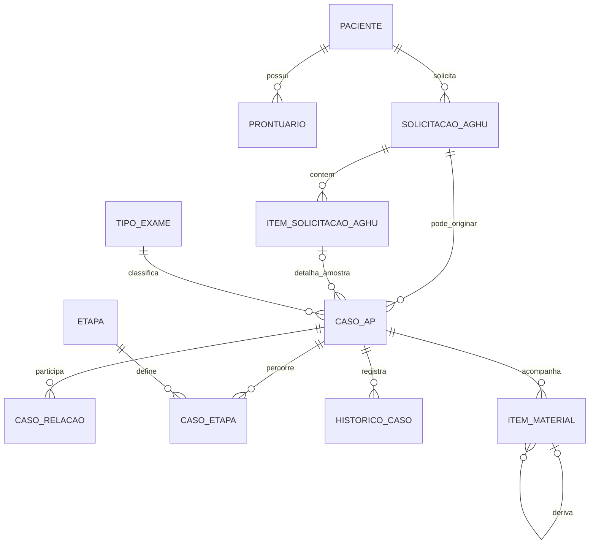
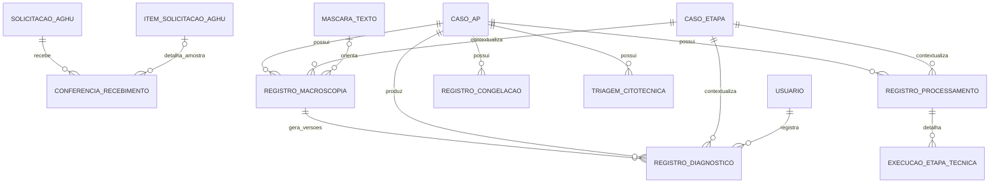
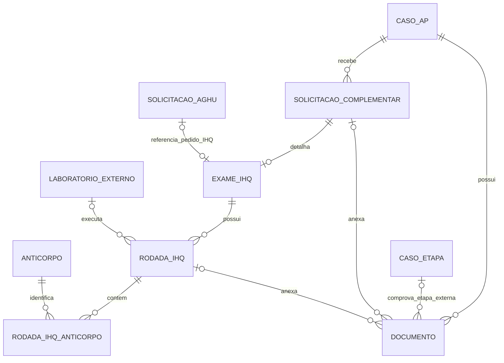
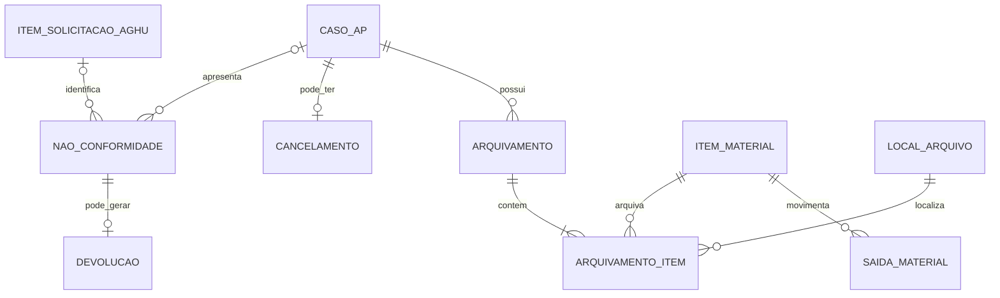
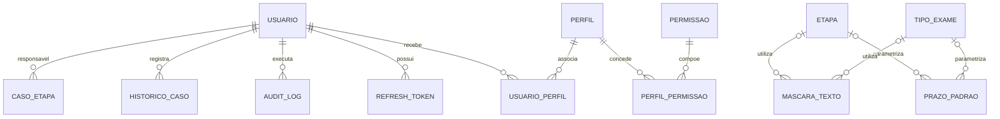

# Modelo de Dados e Dicionário

## 1. Modelo Entidade-Relacionamento

Os diagramas estão divididos por módulo para facilitar leitura. As cardinalidades representam a proposta lógica, não necessariamente a cardinalidade final da API do AGHU.

### 1.1. Paciente, AGHU e caso AP

### 1.2. Etapas e registros técnicos/diagnósticos

### 1.3. Solicitações complementares e IHQ

### 1.4. Não conformidades, devoluções e arquivo

### 1.5. Usuários, perfis, auditoria e configurações

## 2. Dicionário de Dados

### 2.1. Paciente, prontuário e solicitação AGHU

#### Tabela `paciente`

Representa a pessoa atendida. Os dados clínicos e anatomopatológicos ficam associados aos casos, não em uma evolução médica genérica. O cadastro padrão utiliza os identificadores e dados recuperáveis do AGHU; CPF e CNS não são campos previstos nesta versão.

| Campo | Tipo | Obrigatório | Chave/Regra | Descrição |
|---|---|---:|---|---|
| `id` | INTEGER | Sim | PK | Identificador interno. |
| `nome_completo` | VARCHAR(200) | Sim | — | Nome conforme registro institucional. |
| `data_nascimento` | DATE | Não | — | Data de nascimento recebida do AGHU, quando disponível. |
| `sexo_biologico` | VARCHAR(20) | Não | Domínio a validar | Informação necessária em alguns registros, como congelação, quando fornecida pelo AGHU. |
| `created_at` | DATETIME | Sim | — | Data/hora de criação do registro local. |
| `updated_at` | DATETIME | Sim | — | Última atualização local. |

#### Tabela `prontuario`
 
Representa o número de registro/prontuário do paciente no hospital. É diferente do código da solicitação AGHU.

| Campo | Tipo | Obrigatório | Chave/Regra | Descrição |
|---|---|---:|---|---|
| `id` | INTEGER | Sim | PK | Identificador interno. |
| `paciente_id` | INTEGER | Sim | FK → `paciente.id` | Paciente ao qual o prontuário pertence. |
| `numero` | VARCHAR(40) | Sim | UNIQUE | Número de prontuário/registro no HC. |
| `instituicao` | VARCHAR(120) | Não | — | Instituição à qual o número pertence, se houver mais de uma origem. |
| `origem_dado` | VARCHAR(30) | Sim | `AGHU`, `MANUAL_VALIDADO`, `OUTRO` | Origem do identificador. |
| `principal` | BOOLEAN | Sim | DEFAULT FALSE | Indica o prontuário principal para exibição. |
| `created_at` | DATETIME | Sim | — | Data/hora de criação. |

#### Tabela `solicitacao_aghu`

Representa a solicitação institucional importada/consultada no AGHU. O Sistema AP mantém uma representação local dos dados necessários ao processo, sem se tornar o sistema oficial da solicitação.

| Campo | Tipo | Obrigatório | Chave/Regra | Descrição |
|---|---|---:|---|---|
| `id` | INTEGER | Sim | PK | Identificador interno. |
| `codigo_solicitacao` | VARCHAR(60) | Sim | UNIQUE | Identificador da solicitação no AGHU. |
| `tipo_exame_id` | INTEGER | Não | FK → `tipo_exame.id` | Modalidade associada à solicitação, quando identificável no retorno do AGHU (inclusive IHQ). |
| `paciente_id` | INTEGER | Sim | FK → `paciente.id` | Paciente da solicitação. |
| `data_solicitacao` | DATETIME | Não | — | Data/hora em que a solicitação foi criada no AGHU. |
| `codigo_lab` | VARCHAR(40) | Não | — | Código da bancada/unidade executora no AGHU. |
| `sigla_exame` | VARCHAR(30) | Não | — | Sigla/código de exame recebido do AGHU. |
| `nome_exame` | VARCHAR(160) | Não | — | Nome do exame no AGHU. |
| `especialidade` | VARCHAR(120) | Não | — | Especialidade solicitante. |
| `nome_solicitante` | VARCHAR(160) | Não | — | Profissional solicitante, se disponibilizado. |
| `origem` | VARCHAR(40) | Não | Domínio a validar | Origem do atendimento/material (ex.: ambulatório, internação, bloco cirúrgico, externo). |
| `unidade` | VARCHAR(160) | Não | — | Unidade/setor solicitante. |
| `informacoes_clinicas` | TEXT | Não | Dado sensível | Informações clínicas fornecidas na solicitação. A exibição depende do perfil e da necessidade de uso. |
| `status_aghu_codigo` | VARCHAR(40) | Não | — | Código do status institucional. |
| `status_aghu_descricao` | VARCHAR(100) | Não | — | Texto do status institucional. |
| `data_atualizacao_aghu` | DATETIME | Não | — | Última atualização conhecida no AGHU, quando fornecida. |
| `importado_em` | DATETIME | Sim | — | Data/hora da última importação/consulta bem-sucedida. |
| `created_at` | DATETIME | Sim | — | Criação local. |
| `updated_at` | DATETIME | Sim | — | Última atualização local. |

#### Tabela `item_solicitacao_aghu`

Representa cada amostra/item de uma solicitação. É separada de `solicitacao_aghu` porque o AGHU pode identificar itens/amostras dentro de uma mesma solicitação.

| Campo | Tipo | Obrigatório | Chave/Regra | Descrição |
|---|---|---:|---|---|
| `id` | INTEGER | Sim | PK | Identificador interno. |
| `solicitacao_aghu_id` | INTEGER | Sim | FK → `solicitacao_aghu.id` | Solicitação à qual o item pertence. |
| `numero_amostra` | VARCHAR(40) | Não | UNIQUE com solicitação, se fornecido | Número de amostra retornado pelo AGHU, se existir. A análise disponível não comprovou que a planilha interna o registre individualmente. |
| `sequencia_item_local` | INTEGER | Não | UNIQUE com solicitação, quando usado | Sequência interna auxiliar para distinguir itens quando o AGHU não fornecer `numero_amostra`; não deve ser apresentada como número oficial AGHU. |
| `descricao_material` | TEXT | Não | — | Descrição do material biológico enviado. |
| `quantidade_informada` | INTEGER | Não | >= 0 | Quantidade disponível na solicitação, se fornecida. Não confundir com quantidade física conferida na recepção. |
| `status_item_codigo` | VARCHAR(40) | Não | — | `cod_status_item` recebido do AGHU. |
| `status_item_descricao` | VARCHAR(100) | Não | — | `status_item_exame` recebido do AGHU. |
| `created_at` | DATETIME | Sim | — | Criação local. |
| `updated_at` | DATETIME | Sim | — | Última atualização local. |

**Regra:** `codigo_solicitacao`, `numero_amostra` e `prontuario.numero` nunca devem ser armazenados no mesmo campo. São identificadores com finalidades diferentes.

#### Tabela `log_integracao_aghu`

Registra tentativas de importação/consulta para diagnóstico técnico da integração, sem guardar credenciais nem copiar indiscriminadamente payloads clínicos.

| Campo | Tipo | Obrigatório | Chave/Regra | Descrição |
|---|---|---:|---|---|
| `id` | INTEGER | Sim | PK | Identificador interno. |
| `codigo_solicitacao` | VARCHAR(60) | Não | — | Solicitação envolvida, se conhecida. |
| `operacao` | VARCHAR(40) | Sim | `CONSULTA`, `IMPORTACAO`, `ATUALIZACAO` | Tipo da operação. |
| `status` | VARCHAR(20) | Sim | `SUCESSO`, `FALHA` | Resultado. |
| `iniciado_em` | DATETIME | Sim | — | Início da tentativa. |
| `finalizado_em` | DATETIME | Não | — | Fim da tentativa. |
| `codigo_erro` | VARCHAR(80) | Não | — | Código técnico, se houver. |
| `mensagem_erro` | TEXT | Não | Sem dados sensíveis | Resumo técnico da falha. |
| `correlacao_id` | VARCHAR(100) | Não | — | Identificador técnico para rastrear a chamada na integração. |

---

### 2.2. Tipos de exame, etapas e caso AP

#### Tabela `tipo_exame`

Catálogo das cinco modalidades de exames do SAP. A tabela registra as cinco modalidades para padronizar a classificação, mas nem todas geram um `caso_ap` independente.

| Código | Nome | Natureza no modelo | Observação |
|---|---|---|---|
| `HP` | Histopatológico | Caso principal | Fluxo de rotina com macroscopia, processamento, microscopia e arquivo. Inclui a modalidade dermatológica se não houver regra institucional diferente. |
| `CG` | Citologia geral | Caso principal | Inclui materiais líquidos e PAAF conforme classificação do SAP. |
| `CCV` | Citologia cérvico-vaginal | Caso principal | Pode conter triagem citotécnica antes da validação médica. |
| `CO` | Congelação | Caso principal | Fluxo intraoperatório reduzido. Pode ser relacionado a um caso HP do mesmo procedimento. |
| `IHQ` | Imuno-histoquímica | Complemento | Sempre associada ao caso de origem; não gera conclusão diagnóstica independente. |

Campos da tabela:

| Campo | Tipo | Obrigatório | Chave/Regra | Descrição |
|---|---|---:|---|---|
| `id` | INTEGER | Sim | PK | Identificador interno. |
| `codigo` | VARCHAR(20) | Sim | UNIQUE | Sigla padronizada. |
| `nome` | VARCHAR(120) | Sim | — | Nome do tipo de exame. |
| `prefixo_identificador` | VARCHAR(10) | Sim | UNIQUE | Prefixo do número interno, se aplicável. |
| `natureza` | VARCHAR(30) | Sim | `CASO_PRINCIPAL`, `COMPLEMENTAR` | Distingue HP/CG/CCV/CO de IHQ. |
| `ativo` | BOOLEAN | Sim | DEFAULT TRUE | Permite desativar sem apagar histórico. |
| `descricao` | TEXT | Não | — | Observações sobre a modalidade. |

#### Tabela `etapa`

Catálogo de etapas que podem compor o fluxo.

| Código inicial | Nome |
|---|---|
| `RECEPCAO` | Recepção |
| `MACROSCOPIA` | Macroscopia |
| `CONGELACAO` | Congelação |
| `PROCESSAMENTO` | Processamento técnico |
| `IHQ` | Imuno-histoquímica |
| `TRIAGEM_CITO` | Triagem citotécnica |
| `MICROSCOPIA` | Microscopia |
| `APROVACAO` | Aprovação/validação do laudo |
| `ARQUIVO` | Arquivo |
| `EXTERNO` | Aguardando laboratório/rede externa, quando aplicável |

Campos: `id` (PK), `codigo` (UNIQUE), `nome`, `descricao`, `ativo`.

#### Tabela `config_fluxo_etapa`

Define as etapas esperadas para cada tipo de exame e permite manter variações de fluxo sem misturar as etapas com as execuções reais de cada caso.

| Campo | Tipo | Obrigatório | Chave/Regra | Descrição |
|---|---|---:|---|---|
| `id` | INTEGER | Sim | PK | Identificador. |
| `tipo_exame_id` | INTEGER | Sim | FK → `tipo_exame.id` | Tipo do exame. |
| `etapa_id` | INTEGER | Sim | FK → `etapa.id` | Etapa do fluxo. |
| `ordem` | INTEGER | Sim | UNIQUE por tipo e fluxo | Ordem padrão. |
| `obrigatoria` | BOOLEAN | Sim | DEFAULT TRUE | Indica se a etapa faz parte do caminho padrão. |
| `condicao_codigo` | VARCHAR(60) | Não | — | Condição para etapa opcional/ramificada (ex.: material líquido, cell-block). |
| `ativo` | BOOLEAN | Sim | DEFAULT TRUE | Ativa/desativa a configuração. |

**Observação:** no processamento citológico, a sequência muda conforme o material é líquido e conforme há material para cell-block. O caminho não deve ser reduzido a uma lista linear obrigatória para todos os casos.

#### Tabela `caso_ap`

Representa o caso interno acompanhado pelo SAP.

| Campo | Tipo | Obrigatório | Chave/Regra | Descrição |
|---|---|---:|---|---|
| `id` | INTEGER | Sim | PK | Identificador interno. |
| `solicitacao_aghu_id` | INTEGER | Sim | FK → `solicitacao_aghu.id` | Solicitação AGHU que originou o caso. |
| `item_solicitacao_aghu_id` | INTEGER | Não | FK → `item_solicitacao_aghu.id` | Item/amostra específico, quando a solicitação tiver essa identificação. Nulo quando o caso for controlado no nível da solicitação inteira. |
| `tipo_exame_id` | INTEGER | Sim | FK → `tipo_exame.id` | Modalidade do exame. |
| `numero_interno` | VARCHAR(30) | Sim | UNIQUE | Código interno, por exemplo `HP-0001/26`. |
| `status` | VARCHAR(40) | Sim | Domínio controlado | Estado operacional do caso. |
| `etapa_atual_id` | INTEGER | Não | FK → `etapa.id` | Etapa atual. Nulo após encerramento definitivo, se adotado. |
| `data_entrada_sap` | DATETIME | Sim | — | Data/hora de confirmação da entrada no SAP. |
| `etapa_atual_desde` | DATETIME | Não | — | Início da permanência na etapa atual. |
| `urgente` | BOOLEAN | Sim | DEFAULT FALSE | Indica prioridade urgente. |
| `motivo_urgencia` | TEXT | Não | Obrigatório se urgente | Justificativa da urgência. |
| `procedimento` | VARCHAR(160) | Não | — | Procedimento associado, se informado. |
| `responsavel_atual_id` | INTEGER | Não | FK → `usuario.id` | Responsável atual, quando designado. |
| `caso_encerrado_em` | DATETIME | Não | — | Data/hora de conclusão/encerramento. |
| `created_at` | DATETIME | Sim | — | Criação do caso. |
| `updated_at` | DATETIME | Sim | — | Última atualização. |

**Status operacionais sugeridos:**

- `RECEBIDO`
- `EM_MACROSCOPIA`
- `EM_CONGELACAO`
- `EM_PROCESSAMENTO`
- `EM_IHQ`
- `IHQ_AGUARDANDO_EXTERNO`
- `EM_MICROSCOPIA`
- `AGUARDANDO_APROVACAO`
- `LAUDO_CONCLUIDO`
- `EM_ARQUIVAMENTO`
- `ARQUIVADO`
- `DEVOLVIDO`
- `CANCELADO`

O status é o estado operacional resumido; as execuções de etapas em `caso_etapa` guardam o histórico completo e os retornos.

#### Tabela `sequencial_interno`

Garante geração concorrente e sem duplicação dos códigos internos por tipo de exame e ano.

| Campo | Tipo | Obrigatório | Chave/Regra | Descrição |
|---|---|---:|---|---|
| `id` | INTEGER | Sim | PK | Identificador. |
| `tipo_exame_id` | INTEGER | Sim | FK → `tipo_exame.id` | Tipo do exame. |
| `ano` | INTEGER | Sim | UNIQUE com tipo | Ano de referência. |
| `ultimo_numero` | INTEGER | Sim | >= 0 | Último número emitido. |
| `updated_at` | DATETIME | Sim | — | Última atualização. |

A geração deve ocorrer em transação, garantindo que duas entradas simultâneas não recebam o mesmo número.

#### Tabela `caso_relacao`

Relaciona casos diferentes que pertencem ao mesmo procedimento ou que possuem vínculo diagnóstico. É útil, por exemplo, para relacionar uma congelação e o histopatológico de rotina do mesmo ato cirúrgico, ou uma revisão ao caso original.

| Campo | Tipo | Obrigatório | Chave/Regra | Descrição |
|---|---|---:|---|---|
| `id` | INTEGER | Sim | PK | Identificador. |
| `caso_origem_id` | INTEGER | Sim | FK → `caso_ap.id` | Caso de origem. |
| `caso_relacionado_id` | INTEGER | Sim | FK → `caso_ap.id`; diferente da origem | Caso relacionado. |
| `tipo_relacao` | VARCHAR(30) | Sim | Domínio controlado | `MESMO_PROCEDIMENTO`, `SEGUIMENTO_DE`, `OUTRO`. Revisões de peça/lâmina são registradas em `solicitacao_complementar`, não como modalidade/caso autônomo. |
| `descricao` | TEXT | Não | — | Explicação do vínculo. |
| `created_by` | INTEGER | Sim | FK → `usuario.id` | Usuário que relacionou. |
| `created_at` | DATETIME | Sim | — | Data/hora. |

#### Tabela `caso_etapa`

Registra cada passagem do caso por uma etapa. A mesma etapa pode aparecer mais de uma vez quando há retorno, revisão ou complementação.

| Campo | Tipo | Obrigatório | Chave/Regra | Descrição |
|---|---|---:|---|---|
| `id` | INTEGER | Sim | PK | Identificador. |
| `caso_id` | INTEGER | Sim | FK → `caso_ap.id` | Caso acompanhado. |
| `etapa_id` | INTEGER | Sim | FK → `etapa.id` | Etapa executada. |
| `sequencia` | INTEGER | Sim | UNIQUE por caso | Ordem desta ocorrência no histórico. |
| `status` | VARCHAR(30) | Sim | Domínio controlado | `PENDENTE`, `EM_ANDAMENTO`, `CONCLUIDA`, `CONCLUIDA_EXTERNAMENTE`, `DISPENSADA`. |
| `origem_execucao` | VARCHAR(20) | Sim | `INTERNA`, `EXTERNA` | Onde a etapa foi executada. |
| `iniciada_em` | DATETIME | Não | — | Data/hora de chegada/início. |
| `concluida_em` | DATETIME | Não | — | Data/hora de conclusão. |
| `responsavel_inicio_id` | INTEGER | Não | FK → `usuario.id` | Usuário que registrou o recebimento/início. |
| `responsavel_fim_id` | INTEGER | Não | FK → `usuario.id` | Usuário que concluiu/registrou a etapa. |
| `data_execucao_externa` | DATETIME | Não | — | Data informada da execução externa, quando conhecida. |
| `instituicao_origem_externa` | VARCHAR(180) | Não | — | Laboratório/instituição onde a etapa já foi executada antes de o material chegar ao HC. Opcional. |
| `documento_comprobatorio_id` | INTEGER | Não | FK → `documento.id` | Laudo/relatório da etapa externa, quando fornecido. Opcional. |
| `observacao` | TEXT | Não | — | Observações da passagem. |
| `created_at` | DATETIME | Sim | — | Criação do registro. |

**Exames recebidos de fora:** as etapas já realizadas fora do HC podem ser registradas como `CONCLUIDA_EXTERNAMENTE`, com `origem_execucao = EXTERNA`. A primeira etapa interna fica como etapa inicial ativa do caso. Laboratório/instituição de origem, data da execução e laudo/relatório comprobatório são opcionais. Esse cenário descreve etapas feitas antes da chegada ao HC; não é terceirização de uma etapa pelo SAP.

#### Tabela `historico_caso`

É a linha do tempo legível do caso, apresentada no protótipo. Não substitui `audit_log`.

| Campo | Tipo | Obrigatório | Chave/Regra | Descrição |
|---|---|---:|---|---|
| `id` | INTEGER | Sim | PK | Identificador. |
| `caso_id` | INTEGER | Sim | FK → `caso_ap.id` | Caso. |
| `caso_etapa_id` | INTEGER | Não | FK → `caso_etapa.id` | Etapa relacionada, se houver. |
| `usuario_id` | INTEGER | Não | FK → `usuario.id` | Responsável pela ação. |
| `evento` | VARCHAR(60) | Sim | Domínio controlado | Ex.: entrada confirmada, etapa recebida, macroscopia concluída, IHQ solicitada, resultado externo recebido, laudo concluído, material arquivado. |
| `descricao` | TEXT | Não | — | Texto apresentado na linha do tempo. |
| `ocorrido_em` | DATETIME | Sim | — | Data/hora do evento. |
| `metadados` | JSON | Não | Sem duplicar dados sensíveis | Referências adicionais para exibição/diagnóstico. |

---

### 2.3. Amostras, blocos, cell-blocks e lâminas

#### Tabela `item_material`

Representa a árvore de materiais físicos vinculados ao caso. Um item pode ter itens-filhos: amostra → bloco → lâmina; amostra → cell-block → lâmina; ou outras relações permitidas pelo protocolo.

| Campo | Tipo | Obrigatório | Chave/Regra | Descrição |
|---|---|---:|---|---|
| `id` | INTEGER | Sim | PK | Identificador interno. |
| `caso_id` | INTEGER | Sim | FK → `caso_ap.id` | Caso ao qual o material pertence. |
| `item_pai_id` | INTEGER | Não | FK → `item_material.id` | Item que originou este material. Nulo para amostras-raiz. |
| `codigo_item` | VARCHAR(50) | Sim | UNIQUE | Identificador interno opaco e único do item material. Pode ser usado no QR Code individual se a decisão de etiquetagem por item for confirmada. |
| `tipo_item` | VARCHAR(20) | Sim | Domínio controlado | `AMOSTRA`, `FRAGMENTO`, `BLOCO`, `CELL_BLOCK`, `LAMINA`. |
| `rotulo` | VARCHAR(160) | Sim | — | Nome exibido na árvore/lista de materiais. |
| `descricao` | TEXT | Não | — | Descrição complementar. |
| `quantidade` | INTEGER | Não | >= 0 | Quantidade de unidades/fragmentos representados. |
| `origem` | VARCHAR(30) | Sim | Domínio controlado | `ROTINA`, `COMPLEMENTAR`, `EXTERNA`, `CONGELACAO`. |
| `status` | VARCHAR(30) | Sim | Domínio controlado | `DISPONIVEL`, `EM_PROCESSAMENTO`, `EM_USO`, `ARQUIVADO`, `EMPRESTADO`, `DESCARTADO_CONFORME_REGRA`. |
| `criado_por_id` | INTEGER | Não | FK → `usuario.id` | Usuário que cadastrou o item. |
| `created_at` | DATETIME | Sim | — | Data/hora de criação. |
| `updated_at` | DATETIME | Sim | — | Última atualização. |

**Regras:**

- Cada item pertence a um único caso.
- Um item-filho deve pertencer ao mesmo caso do item-pai.
- A estrutura deve permitir vários recipientes/amostras para um caso.
- O identificador interno de cada item é único, mesmo que não seja impresso em etiqueta física.
- **A confirmar** cada recipiente/amostra, bloco e lâmina pode receber QR Code próprio; quando a amostra for desmembrada em itens-filhos, o Sistema AP gera identificadores para os novos itens e permite imprimir as novas etiquetas. A necessidade e o momento da reetiquetagem ainda dependem de confirmação da rotina do SAP.
- O código interno do item existe mesmo que o SAP decida não imprimir etiqueta para cada nível; assim, a estrutura de dados não depende da decisão física de rotulagem.
- A geração/impressão de etiqueta deve evitar expor nome, prontuário ou outros dados pessoais no QR Code. O código deve ser um identificador opaco consultado mediante autenticação.
- Não presumir que todo bloco gera exatamente uma lâmina ou que toda lâmina deriva de apenas um bloco; essa regra precisa seguir a rotina técnica validada.

---

### 2.4. Recepção e conferência

#### Tabela `conferencia_recebimento`

Registra a conferência física da amostra com a solicitação. Pode existir antes da criação do caso quando o material é rejeitado ainda na recepção. Como a granularidade AGHU ainda será validada, a conferência sempre se vincula à solicitação e, quando conhecido, também ao item/amostra.

| Campo | Tipo | Obrigatório | Chave/Regra | Descrição |
|---|---|---:|---|---|
| `id` | INTEGER | Sim | PK | Identificador. |
| `solicitacao_aghu_id` | INTEGER | Sim | FK → `solicitacao_aghu.id` | Solicitação AGHU conferida. |
| `item_solicitacao_aghu_id` | INTEGER | Não | FK → `item_solicitacao_aghu.id` | Item/amostra específico, quando aplicável. |
| `caso_id` | INTEGER | Não | FK → `caso_ap.id` | Caso criado após a aceitação, quando houver. |
| `resultado` | VARCHAR(20) | Sim | `ACEITA`, `REJEITADA`, `PENDENTE` | Resultado da conferência. |
| `identificacao_confere` | BOOLEAN | Sim | — | Identificação física confere com a requisição. |
| `material_confere` | BOOLEAN | Sim | — | Material confere com a descrição da solicitação. |
| `quantidade_confere` | BOOLEAN | Sim | — | Quantidade de frascos/unidades confere. |
| `recipiente_adequado` | BOOLEAN | Sim | — | Recipiente íntegro e adequado. |
| `observacao` | TEXT | Não | — | Observações da conferência. |
| `conferido_por_id` | INTEGER | Sim | FK → `usuario.id` | Recepcionista responsável. |
| `conferido_em` | DATETIME | Sim | — | Data/hora da conferência. |

#### Confirmação de entrada

A confirmação de entrada efetiva é representada por:

1. criação do registro `caso_ap`;
2. geração do `numero_interno`;
3. criação da primeira `caso_etapa` (recepção);
4. criação dos itens-raiz em `item_material`;
5. registro do evento correspondente em `historico_caso`;
6. registro da operação em `audit_log`.

A atualização oficial do status de recebimento no AGHU continua sendo feita na rotina própria do AGHU.

---

### 2.5. Macroscopia

#### Tabela `registro_macroscopia`

Armazena uma execução/versão de macroscopia. A tabela é separada de `caso_ap` porque pode haver revisão da peça ou nova descrição.

| Campo | Tipo | Obrigatório | Chave/Regra | Descrição |
|---|---|---:|---|---|
| `id` | INTEGER | Sim | PK | Identificador. |
| `caso_id` | INTEGER | Sim | FK → `caso_ap.id` | Caso. |
| `caso_etapa_id` | INTEGER | Sim | FK → `caso_etapa.id` | Ocorrência da etapa de macroscopia. |
| `mascara_texto_id` | INTEGER | Não | FK → `mascara_texto.id` | Máscara usada como ponto de partida. |
| `tipo_material` | VARCHAR(120) | Não | — | Classificação do material descrito. |
| `descricao_macroscopica` | TEXT | Sim | — | Texto descritivo final da macroscopia. |
| `quantidade_fragmentos` | INTEGER | Não | >= 0 | Quantidade de fragmentos descritos. |
| `quantidade_cassetes` | INTEGER | Não | >= 0 | Total de cassetes/blocos gerados, compatível com os itens de material criados. |
| `sobra_em_fixador` | BOOLEAN | Não | — | Indica se restou material em fixador. |
| `peso_gramas` | DECIMAL(10,2) | Não | >= 0 | Peso, quando aplicável. |
| `medidas` | TEXT | Não | — | Medidas, quando aplicáveis, preferencialmente em unidade padronizada. |
| `coloracao_especial_solicitada` | TEXT | Não | — | Coloração especial indicada, se houver. |
| `rota_processamento` | VARCHAR(20) | Não | `HISTOTECNICO`, `MANUAL` | Rota inicialmente indicada para processamento. |
| `responsavel_id` | INTEGER | Sim | FK → `usuario.id` | Residente/técnico responsável, conforme perfil e rotina. |
| `registrado_em` | DATETIME | Sim | — | Data/hora de registro. |

Os cassetes/blocos produzidos na macroscopia são registrados em `item_material` como itens-filhos da amostra correspondente. A relação evita duplicar a árvore de materiais em campos textuais.

A macroscopia também pode gerar um registro diagnóstico/documental em `registro_diagnostico` com tipo `LAUDO_MACROSCOPICO`.

---

### 2.6. Processamento técnico e citologia

#### Tabela `registro_processamento`

Armazena o resumo de uma execução de processamento técnico.

| Campo | Tipo | Obrigatório | Chave/Regra | Descrição |
|---|---|---:|---|---|
| `id` | INTEGER | Sim | PK | Identificador. |
| `caso_id` | INTEGER | Sim | FK → `caso_ap.id` | Caso. |
| `caso_etapa_id` | INTEGER | Sim | FK → `caso_etapa.id` | Ocorrência de processamento. |
| `rota` | VARCHAR(20) | Não | `HISTOTECNICO`, `MANUAL`, `CITOLOGIA_DIRETA` | Rota utilizada. |
| `material_liquido` | BOOLEAN | Não | — | Indica se o material é líquido. |
| `centrifugado` | BOOLEAN | Não | — | Indica se ocorreu centrifugação. |
| `possui_cell_block` | BOOLEAN | Não | — | Indica existência/produção de cell-block. |
| `observacao` | TEXT | Não | — | Observações técnicas. |
| `responsavel_id` | INTEGER | Sim | FK → `usuario.id` | Técnico responsável pelo registro/conclusão. |
| `iniciado_em` | DATETIME | Não | — | Início da execução. |
| `concluido_em` | DATETIME | Não | — | Conclusão da execução. |

#### Tabela `execucao_etapa_tecnica`

Registra subetapas e atividades técnicas, permitindo representar caminhos diferentes para HP, CG e CCV.

| Campo | Tipo | Obrigatório | Chave/Regra | Descrição |
|---|---|---:|---|---|
| `id` | INTEGER | Sim | PK | Identificador. |
| `registro_processamento_id` | INTEGER | Sim | FK → `registro_processamento.id` | Execução de processamento à qual pertence. |
| `codigo_etapa` | VARCHAR(40) | Sim | Domínio controlado | `PREPARO_MANUAL`, `HISTOTECNICO`, `CENTRIFUGACAO`, `INCLUSAO`, `CORTE`, `COLORACAO`, `MONTAGEM`, `DISTRIBUICAO`. |
| `status` | VARCHAR(20) | Sim | `PENDENTE`, `EM_ANDAMENTO`, `CONCLUIDA`, `DISPENSADA` | Estado da subetapa. |
| `ordem` | INTEGER | Sim | — | Ordem dentro daquela execução. |
| `responsavel_id` | INTEGER | Não | FK → `usuario.id` | Profissional responsável. |
| `iniciada_em` | DATETIME | Não | — | Início. |
| `concluida_em` | DATETIME | Não | — | Fim. |
| `quantidade_blocos` | INTEGER | Não | >= 0 | Quantidade de blocos envolvidos, quando aplicável. |
| `quantidade_laminas` | INTEGER | Não | >= 0 | Quantidade de lâminas produzidas, quando aplicável. |
| `coloracao` | VARCHAR(80) | Não | — | Coloração utilizada. |
| `observacao` | TEXT | Não | — | Observações. |

#### Tabela `registro_congelacao`

Guarda os dados específicos do ciclo intraoperatório, incluindo análise macroscópica preliminar e comunicação do diagnóstico.

| Campo | Tipo | Obrigatório | Chave/Regra | Descrição |
|---|---|---:|---|---|
| `id` | INTEGER | Sim | PK | Identificador. |
| `caso_id` | INTEGER | Sim | FK → `caso_ap.id` | Caso de congelação. |
| `caso_etapa_id` | INTEGER | Sim | FK → `caso_etapa.id` | Ocorrência da etapa. |
| `descricao_macroscopica_preliminar` | TEXT | Não | — | Análise macroscópica preliminar, realizada na etapa de congelação. |
| `quantidade_laminas` | INTEGER | Não | >= 0 | Lâminas preparadas no criostato. |
| `residente_id` | INTEGER | Não | FK → `usuario.id` | Residente envolvido, se aplicável. |
| `patologista_id` | INTEGER | Sim | FK → `usuario.id` | Patologista responsável pelo diagnóstico intraoperatório. |
| `diagnostico_intraoperatorio` | TEXT | Sim | — | Diagnóstico/parecer comunicado. |
| `comunicado_em` | DATETIME | Sim | — | Data/hora da comunicação ao bloco cirúrgico. |
| `destinatario_comunicacao` | VARCHAR(160) | Não | — | Profissional/setor que recebeu a comunicação. |
| `registrado_em` | DATETIME | Sim | — | Data/hora do registro no Sistema AP. |

A liberação institucional do laudo da congelação no AGHU permanece externa ao Sistema AP. Quando o material também seguir para HP de rotina, será criado/associado outro caso a partir da respectiva solicitação AGHU.

#### Tabela `triagem_citotecnica`

Registra a triagem citotécnica nos casos em que ela se aplica, especialmente CCV.

| Campo | Tipo | Obrigatório | Chave/Regra | Descrição |
|---|---|---:|---|---|
| `id` | INTEGER | Sim | PK | Identificador. |
| `caso_id` | INTEGER | Sim | FK → `caso_ap.id` | Caso de citologia. |
| `caso_etapa_id` | INTEGER | Sim | FK → `caso_etapa.id` | Ocorrência da triagem. |
| `adequacao` | VARCHAR(30) | Sim | Domínio do SAP | Ex.: satisfatória/insatisfatória, a validar. |
| `resultado_triagem` | VARCHAR(160) | Não | Domínio do SAP | Classificação/resultado da triagem. |
| `observacao` | TEXT | Não | — | Achados ou observações da triagem. |
| `citotecnico_id` | INTEGER | Sim | FK → `usuario.id` | Profissional que executou a triagem. |
| `enviado_patologista_em` | DATETIME | Não | — | Data/hora de encaminhamento ao citopatologista. |
| `created_at` | DATETIME | Sim | — | Data/hora do registro. |

---

### 2.7. Diagnóstico, parecer e laudo

#### Tabela `registro_diagnostico`

Centraliza os registros de texto diagnóstico produzidos ao longo do processo. O tipo do registro diferencia laudo macroscópico, parecer preliminar, resultado intraoperatório e laudo final.

| Campo | Tipo | Obrigatório | Chave/Regra | Descrição |
|---|---|---:|---|---|
| `id` | INTEGER | Sim | PK | Identificador. |
| `caso_id` | INTEGER | Sim | FK → `caso_ap.id` | Caso relacionado. |
| `caso_etapa_id` | INTEGER | Não | FK → `caso_etapa.id` | Etapa que originou o registro. |
| `registro_macroscopia_id` | INTEGER | Não | FK → `registro_macroscopia.id` | Execução de macroscopia à qual o laudo macroscópico corresponde. Preenchido quando `tipo_registro = LAUDO_MACROSCOPICO`. |
| `tipo_registro` | VARCHAR(30) | Sim | `LAUDO_MACROSCOPICO`, `PARECER_PRELIMINAR`, `RESULTADO_CONGELACAO`, `LAUDO_FINAL` | Natureza do texto. |
| `versao` | INTEGER | Sim | UNIQUE por caso/tipo | Número sequencial da versão do registro. |
| `versao_anterior_id` | INTEGER | Não | FK → `registro_diagnostico.id` | Versão imediatamente anterior substituída por esta versão. Nulo na primeira versão. |
| `motivo_correcao` | TEXT | Não | Obrigatório em nova versão corretiva | Motivo da correção/alteração, quando aplicável. |
| `conteudo` | TEXT | Sim | — | Texto do parecer/laudo. |
| `status` | VARCHAR(30) | Sim | `RASCUNHO`, `EM_REVISAO`, `APROVADO`, `CONCLUIDO`, `LIBERADO_AGHU`, `SUBSTITUIDO` | Situação desta versão. Uma versão corrigida fica `SUBSTITUIDO`; a nova versão passa a ser a vigente. |
| `autor_id` | INTEGER | Sim | FK → `usuario.id` | Usuário que elaborou esta versão; pode ser diferente do autor da versão anterior. |
| `aprovador_id` | INTEGER | Não | FK → `usuario.id` | Patologista/preceptor que aprovou, quando aplicável. |
| `criado_em` | DATETIME | Sim | — | Data/hora de criação. |
| `aprovado_em` | DATETIME | Não | — | Data/hora da aprovação. |
| `liberado_aghu_em` | DATETIME | Não | — | Data/hora informada da liberação manual no AGHU. |
| `liberado_aghu_por_id` | INTEGER | Não | FK → `usuario.id` | Usuário que informa/confirmou a liberação manual no AGHU. |
| `observacao` | TEXT | Não | — | Observações. |

**Regras de versão e correção:**

- A primeira elaboração cria a versão 1.
- Uma correção posterior cria uma nova linha/versão; não sobrescreve o texto anterior.
- A correção pode ser registrada por outro técnico autorizado. `autor_id` identifica quem elaborou a versão nova; a auditoria também registra quem efetuou a operação.
- Toda nova versão deve apontar para `versao_anterior_id` e informar `motivo_correcao`.
- A versão anterior fica preservada com status `SUBSTITUIDO`; apenas a versão vigente pode ser apresentada como texto atual.
- Esse versionamento vale especialmente para `LAUDO_MACROSCOPICO`, mas a estrutura também suporta versionamento dos demais registros diagnósticos.

**Regra institucional:** o Sistema AP pode armazenar o texto preparado e apoiar a cópia para o AGHU, mas a liberação oficial continua no AGHU.

---

### 2.8. Solicitações complementares e IHQ

#### Tabela `solicitacao_complementar`

Registra as solicitações abertas durante a análise do caso, por exemplo revisão da peça, recorte, coloração especial, painel/ampliação de IHQ e material complementar.

| Campo | Tipo | Obrigatório | Chave/Regra | Descrição |
|---|---|---:|---|---|
| `id` | INTEGER | Sim | PK | Identificador. |
| `caso_id` | INTEGER | Sim | FK → `caso_ap.id` | Caso de origem. |
| `tipo` | VARCHAR(40) | Sim | Domínio controlado | `REVISAO_PECA`, `REVISAO_LAMINA`, `RECORTE`, `COLORACAO_ESPECIAL`, `RECOLORACAO`, `NOVA_LAMINACAO`, `IHQ`, `MATERIAL_COMPLEMENTAR`. O envio para laboratório externo não é uma solicitação complementar genérica: ocorre dentro da execução da IHQ. |
| `descricao` | TEXT | Não | — | Detalhamento do pedido. |
| `justificativa` | TEXT | Sim | — | Justificativa diagnóstica/operacional. |
| `etapa_origem_id` | INTEGER | Sim | FK → `etapa.id` | Etapa que solicitou o complemento. |
| `etapa_destino_id` | INTEGER | Não | FK → `etapa.id` | Etapa de execução. |
| `solicitante_id` | INTEGER | Sim | FK → `usuario.id` | Residente/patologista solicitante, conforme permissão. |
| `solicitada_em` | DATETIME | Sim | — | Data/hora do pedido. |
| `status` | VARCHAR(20) | Sim | `ABERTA`, `EM_EXECUCAO`, `AGUARDANDO_EXTERNO`, `CONCLUIDA`, `CANCELADA` | Situação do complemento. |
| `concluida_em` | DATETIME | Não | — | Data/hora de conclusão. |
| `observacao` | TEXT | Não | — | Observações. |

#### Tabela `exame_ihq`

Detalha a IHQ vinculada à solicitação complementar. Não representa um caso independente nem um diagnóstico final autônomo.

| Campo | Tipo | Obrigatório | Chave/Regra | Descrição |
|---|---|---:|---|---|
| `id` | INTEGER | Sim | PK | Identificador. |
| `solicitacao_complementar_id` | INTEGER | Sim | FK UNIQUE → `solicitacao_complementar.id` | Solicitação complementar do tipo IHQ. |
| `codigo_interno_ihq` | VARCHAR(30) | Sim | UNIQUE | Identificador de rastreio, por exemplo `IH-0001/26`. |
| `solicitacao_ihq_aghu_id` | INTEGER | Não | FK → `solicitacao_aghu.id` | Solicitação AGHU própria da IHQ, separada da solicitação do caso de origem. Preencher quando o pedido for registrado no AGHU; o código é consultado por essa relação, sem duplicá-lo na tabela de IHQ. |
| `status` | VARCHAR(30) | Sim | Domínio controlado | `SOLICITADA`, `EM_EXECUCAO_INTERNA`, `AGUARDANDO_EXTERNO`, `RESULTADO_RECEBIDO`, `RESULTADO_REGISTRADO`, `RETORNADA_MICROSCOPIA`. |
| `resultado_tecnico` | TEXT | Não | — | Resultado/observação técnica, se houver. |
| `concluida_tecnicamente_em` | DATETIME | Não | — | Data/hora da conclusão técnica. |
| `registrada_por_id` | INTEGER | Não | FK → `usuario.id` | Responsável pelo registro. |
| `created_at` | DATETIME | Sim | — | Criação. |

#### Tabela `anticorpo`

Catálogo de anticorpos/marcadores disponíveis para seleção. A disponibilidade pode mudar e não deve ser assumida como permanente apenas pelo cadastro do anticorpo.

| Campo | Tipo | Obrigatório | Chave/Regra | Descrição |
|---|---|---:|---|---|
| `id` | INTEGER | Sim | PK | Identificador. |
| `nome` | VARCHAR(80) | Sim | UNIQUE | Nome do marcador (ex.: HER2, PMS2, MLH1). |
| `descricao` | TEXT | Não | — | Descrição, quando necessária. |
| `ativo` | BOOLEAN | Sim | DEFAULT TRUE | Indica se pode ser selecionado. |

#### Tabela `laboratorio_externo`

Catálogo de laboratórios/serviços externos usados exclusivamente para a execução terceirizada de rodadas de IHQ, conforme decisão atual do grupo. Não representa a instituição que executou etapas antes de um exame externo ser recebido no HC; essa origem é registrada opcionalmente em `caso_etapa.instituicao_origem_externa`.

| Campo | Tipo | Obrigatório | Chave/Regra | Descrição |
|---|---|---:|---|---|
| `id` | INTEGER | Sim | PK | Identificador. |
| `nome` | VARCHAR(160) | Sim | UNIQUE | Nome do laboratório/serviço. |
| `tipo_servico` | VARCHAR(40) | Não | — | Tipo de serviço prestado. |
| `contato` | VARCHAR(160) | Não | — | Contato institucional, se necessário. |
| `ativo` | BOOLEAN | Sim | DEFAULT TRUE | Disponibilidade de uso. |

#### Tabela `rodada_ihq`

Permite acompanhar painéis, ampliações ou rodadas sucessivas da mesma IHQ. Cada rodada pode ser executada internamente ou, quando anticorpos não estiverem disponíveis, enviada para laboratório externo. **Este é o único fluxo de encaminhamento externo previsto pelo grupo nesta versão.**

| Campo | Tipo | Obrigatório | Chave/Regra | Descrição |
|---|---|---:|---|---|
| `id` | INTEGER | Sim | PK | Identificador. |
| `exame_ihq_id` | INTEGER | Sim | FK → `exame_ihq.id` | IHQ de origem. |
| `numero_rodada` | INTEGER | Sim | UNIQUE por IHQ | Ordem da rodada. |
| `via_execucao` | VARCHAR(20) | Sim | `INTERNA`, `EXTERNA` | Onde será executada. |
| `laboratorio_externo_id` | INTEGER | Não | FK → `laboratorio_externo.id` | Laboratório, obrigatório quando externa. |
| `status` | VARCHAR(30) | Sim | `PLANEJADA`, `EM_EXECUCAO`, `ENVIADA`, `AGUARDANDO_RESULTADO`, `RESULTADO_RECEBIDO`, `CONCLUIDA` | Situação. |
| `responsavel_id` | INTEGER | Não | FK → `usuario.id` | Técnico/responsável interno. |
| `enviada_em` | DATETIME | Não | — | Data de envio externo. |
| `recebida_em` | DATETIME | Não | — | Data de retorno externo. |
| `iniciada_em` | DATETIME | Não | — | Início da execução. |
| `concluida_em` | DATETIME | Não | — | Conclusão da rodada. |
| `observacao` | TEXT | Não | — | Observações. |

#### Tabela `rodada_ihq_anticorpo`

Relaciona os anticorpos utilizados em cada rodada, incluindo o local de execução e a disponibilidade verificada na ocasião.

| Campo | Tipo | Obrigatório | Chave/Regra | Descrição |
|---|---|---:|---|---|
| `id` | INTEGER | Sim | PK | Identificador. |
| `rodada_ihq_id` | INTEGER | Sim | FK → `rodada_ihq.id` | Rodada. |
| `anticorpo_id` | INTEGER | Sim | FK → `anticorpo.id` | Anticorpo/marcador. |
| `disponibilidade_verificada` | VARCHAR(20) | Sim | `INTERNO`, `EXTERNO` | Disponibilidade no momento da seleção. |
| `resultado` | TEXT | Não | — | Resultado/observação por marcador, se registrado individualmente. |
| `status` | VARCHAR(20) | Sim | `SOLICITADO`, `EXECUTADO`, `PENDENTE`, `CANCELADO` | Situação do marcador. |

#### Tabela `documento`

Armazena metadados de arquivos anexados ao caso ou aos complementos, por exemplo PDF de resultado externo da IHQ. O arquivo binário deve ficar em armazenamento de documentos controlado; o banco guarda a referência e seus metadados.

| Campo | Tipo | Obrigatório | Chave/Regra | Descrição |
|---|---|---:|---|---|
| `id` | INTEGER | Sim | PK | Identificador. |
| `caso_id` | INTEGER | Sim | FK → `caso_ap.id` | Caso ao qual o documento pertence. |
| `solicitacao_complementar_id` | INTEGER | Não | FK → `solicitacao_complementar.id` | Complemento relacionado, se houver. |
| `rodada_ihq_id` | INTEGER | Não | FK → `rodada_ihq.id` | Rodada IHQ relacionada, se houver. |
| `caso_etapa_id` | INTEGER | Não | FK → `caso_etapa.id` | Etapa executada externamente cujo laudo/relatório está sendo anexado. |
| `tipo_documento` | VARCHAR(40) | Sim | Domínio controlado | `RESULTADO_IHQ_EXTERNA`, `LAUDO_MACROSCOPIA`, `RELATORIO_ETAPA_EXTERNA`, `LAUDO`, `COMPROVANTE_ENVIO`, `OUTRO`. |
| `nome_arquivo` | VARCHAR(255) | Sim | — | Nome original. |
| `storage_key` | VARCHAR(500) | Sim | UNIQUE | Caminho/chave no armazenamento controlado. |
| `mime_type` | VARCHAR(120) | Sim | — | Tipo MIME. |
| `tamanho_bytes` | INTEGER | Não | >= 0 | Tamanho. |
| `hash_sha256` | VARCHAR(64) | Não | — | Integridade do arquivo. |
| `enviado_por_id` | INTEGER | Sim | FK → `usuario.id` | Usuário responsável pelo anexo. |
| `enviado_em` | DATETIME | Sim | — | Data/hora do envio. |

**Regra:** o PDF do resultado externo da IHQ deve ficar associado ao caso de origem e à rodada correspondente. Laudos/relatórios de etapas concluídas fora do HC podem ser associados a `caso_etapa`; esse anexo é opcional. Anexar o arquivo ao Sistema AP não equivale a anexá-lo automaticamente ao AGHU.

---

### 2.9. Não conformidades, devolução e cancelamento

#### Tabela `tipo_nao_conformidade`

Catálogo de motivos estruturados para padronizar os registros.

| Código sugerido | Descrição |
|---|---|
| `SEM_ETIQUETA_AGHU` | Ausência da etiqueta/identificação institucional. |
| `IDENTIFICACAO_DIVERGENTE` | Divergência entre identificação física e solicitação, principalmente na recepção. |
| `QUANTIDADE_DIVERGENTE` | Quantidade diferente da informada. |
| `MATERIAL_INADEQUADO` | Material inadequado/insuficiente. |
| `RECIPIENTE_DANIFICADO` | Recipiente danificado ou com vazamento. |
| `FIXACAO_INADEQUADA` | Ausência de fixador ou fixação inadequada. |
| `REQUISICAO_INCOMPLETA` | Requisição com informação obrigatória ausente. |
| `OUTRO` | Outra inconformidade, detalhada em texto. |

Campos: `id` (PK), `codigo` (UNIQUE), `descricao`, `ativo`.

#### Tabela `nao_conformidade`

| Campo | Tipo | Obrigatório | Chave/Regra | Descrição |
|---|---|---:|---|---|
| `id` | INTEGER | Sim | PK | Identificador. |
| `caso_id` | INTEGER | Não | FK → `caso_ap.id` | Caso, quando já existir. |
| `item_solicitacao_aghu_id` | INTEGER | Não | FK → `item_solicitacao_aghu.id` | Item AGHU, útil para inconformidade detectada antes da criação do caso. |
| `caso_etapa_id` | INTEGER | Não | FK → `caso_etapa.id` | Etapa em que a inconformidade foi identificada. |
| `tipo_nao_conformidade_id` | INTEGER | Sim | FK → `tipo_nao_conformidade.id` | Motivo estruturado. |
| `descricao` | TEXT | Sim | — | Detalhamento. |
| `registrado_por_id` | INTEGER | Sim | FK → `usuario.id` | Usuário responsável. |
| `registrado_em` | DATETIME | Sim | — | Data/hora. |
| `status` | VARCHAR(20) | Sim | `ABERTA`, `EM_TRATAMENTO`, `RESOLVIDA`, `CANCELADA` | Estado da inconformidade. |

#### Tabela `devolucao`

Registra a devolução física de material à unidade de origem. Pode ocorrer na recepção ou em etapa posterior.

| Campo | Tipo | Obrigatório | Chave/Regra | Descrição |
|---|---|---:|---|---|
| `id` | INTEGER | Sim | PK | Identificador. |
| `nao_conformidade_id` | INTEGER | Sim | FK UNIQUE → `nao_conformidade.id` | Inconformidade que motivou a devolução. |
| `caso_id` | INTEGER | Não | FK → `caso_ap.id` | Caso, quando já criado. |
| `item_solicitacao_aghu_id` | INTEGER | Não | FK → `item_solicitacao_aghu.id` | Solicitação/amostra devolvida quando ainda não há caso. |
| `unidade_origem` | VARCHAR(160) | Sim | — | Setor/unidade para onde o material retorna. |
| `devolvido_por_id` | INTEGER | Sim | FK → `usuario.id` | Profissional SAP que devolveu. |
| `recebido_por_nome` | VARCHAR(160) | Sim | — | Nome do profissional que recebeu na unidade de origem. |
| `nova_amostra_solicitada` | BOOLEAN | Sim | — | Indica se foi solicitada nova amostra. |
| `nova_amostra_recebida` | BOOLEAN | Não | — | Indica se a nova amostra já chegou. |
| `novo_caso_id` | INTEGER | Não | FK → `caso_ap.id` | Caso aberto para o reenvio, quando houver. |
| `devolvida_em` | DATETIME | Sim | — | Data/hora da devolução. |
| `acompanhamento` | TEXT | Não | — | Acompanhamento da pendência. |
| `status` | VARCHAR(20) | Sim | `AGUARDANDO_NOVA_AMOSTRA`, `NOVA_AMOSTRA_RECEBIDA`, `ENCERRADA` | Estado da devolução. |

#### Tabela `cancelamento`

Registra cancelamento administrativo de um caso. Não exclui o caso nem seus materiais/histórico.

| Campo | Tipo | Obrigatório | Chave/Regra | Descrição |
|---|---|---:|---|---|
| `id` | INTEGER | Sim | PK | Identificador. |
| `caso_id` | INTEGER | Sim | FK UNIQUE → `caso_ap.id` | Caso cancelado. |
| `motivo` | TEXT | Sim | — | Justificativa obrigatória. |
| `cancelado_por_id` | INTEGER | Sim | FK → `usuario.id` | Usuário com permissão de chefia/administração. |
| `cancelado_em` | DATETIME | Sim | — | Data/hora do cancelamento. |

---

### 2.10. Arquivo, localização e saída de materiais

#### Tabela `local_arquivo`

Permite representar posições físicas em níveis hierárquicos (ex.: armário → estante → gaveta → caixa). A estrutura exata pode ser simplificada se o SAP não utilizar todos esses níveis.

| Campo | Tipo | Obrigatório | Chave/Regra | Descrição |
|---|---|---:|---|---|
| `id` | INTEGER | Sim | PK | Identificador. |
| `local_pai_id` | INTEGER | Não | FK → `local_arquivo.id` | Local superior. |
| `tipo_local` | VARCHAR(30) | Sim | `ARMARIO`, `ESTANTE`, `GAVETA`, `CAIXA`, `OUTRO` | Tipo da posição. |
| `codigo` | VARCHAR(80) | Sim | UNIQUE ou único no pai | Código da posição. |
| `descricao` | VARCHAR(160) | Não | — | Descrição legível. |
| `ativo` | BOOLEAN | Sim | DEFAULT TRUE | Indica uso atual. |

#### Tabela `arquivamento`

Representa uma operação de arquivamento de um caso.

| Campo | Tipo | Obrigatório | Chave/Regra | Descrição |
|---|---|---:|---|---|
| `id` | INTEGER | Sim | PK | Identificador. |
| `caso_id` | INTEGER | Sim | FK → `caso_ap.id` | Caso arquivado. |
| `registrado_por_id` | INTEGER | Sim | FK → `usuario.id` | Técnico do arquivo responsável. |
| `arquivado_em` | DATETIME | Sim | — | Data/hora. |
| `observacao` | TEXT | Não | — | Observações. |

#### Tabela `arquivamento_item`

Relaciona cada material físico arquivado à operação e à sua posição de guarda.

| Campo | Tipo | Obrigatório | Chave/Regra | Descrição |
|---|---|---:|---|---|
| `id` | INTEGER | Sim | PK | Identificador. |
| `arquivamento_id` | INTEGER | Sim | FK → `arquivamento.id` | Operação de arquivamento. |
| `item_material_id` | INTEGER | Sim | FK → `item_material.id` | Amostra, bloco, cell-block ou lâmina. |
| `local_arquivo_id` | INTEGER | Não | FK → `local_arquivo.id` | Posição física. |
| `arquivado_em` | DATETIME | Sim | — | Data/hora de guarda do item. |
| `observacao` | TEXT | Não | — | Observações. |

#### Tabela `saida_material`

Registra retirada/empréstimo ou saída de um material já arquivado.

| Campo | Tipo | Obrigatório | Chave/Regra | Descrição |
|---|---|---:|---|---|
| `id` | INTEGER | Sim | PK | Identificador. |
| `item_material_id` | INTEGER | Sim | FK → `item_material.id` | Material retirado. |
| `retirado_por_nome` | VARCHAR(160) | Sim | — | Pessoa que retirou, se externa ao SAP. |
| `registrado_por_id` | INTEGER | Sim | FK → `usuario.id` | Profissional do arquivo que registrou a saída. |
| `destino` | VARCHAR(160) | Não | — | Setor/destino. |
| `motivo` | TEXT | Não | — | Justificativa. |
| `retirado_em` | DATETIME | Sim | — | Data/hora de saída. |
| `devolucao_prevista_em` | DATETIME | Não | — | Data prevista, se houver. |
| `devolvido_em` | DATETIME | Não | — | Data/hora de retorno. |
| `status` | VARCHAR(20) | Sim | `RETIRADO`, `DEVOLVIDO`, `NAO_LOCALIZADO` | Situação. |

---

### 2.11. Usuários, perfis e permissões

#### Tabela `usuario`

Representa o usuário autorizado a acessar o Sistema AP. A autenticação institucional será feita pelo serviço definido pelo HC; o Sistema AP mantém o cadastro local de autorização/perfil.

| Campo | Tipo | Obrigatório | Chave/Regra | Descrição |
|---|---|---:|---|---|
| `id` | INTEGER | Sim | PK | Identificador local. |
| `login_institucional` | VARCHAR(100) | Sim | UNIQUE | Login recebido do AD/LDAP ou mock no desenvolvimento. |
| `nome` | VARCHAR(160) | Sim | — | Nome de exibição. |
| `email` | VARCHAR(160) | Não | — | E-mail institucional. |
| `lotacao` | VARCHAR(160) | Não | — | Unidade/setor. |
| `registro_profissional` | VARCHAR(40) | Não | — | CRM ou registro profissional, se necessário. |
| `conselho_profissional` | VARCHAR(30) | Não | — | Conselho, se aplicável. |
| `ativo` | BOOLEAN | Sim | DEFAULT TRUE | Permite bloquear usuário sem apagar histórico. |
| `created_at` | DATETIME | Sim | — | Criação. |
| `updated_at` | DATETIME | Sim | — | Atualização. |

#### Tabela `perfil`

| Campo | Tipo | Obrigatório | Chave/Regra | Descrição |
|---|---|---:|---|---|
| `id` | INTEGER | Sim | PK | Identificador. |
| `codigo` | VARCHAR(40) | Sim | UNIQUE | Ex.: `RECEPCAO`, `MACROSCOPIA`, `PROCESSAMENTO`, `IHQ`, `CITOTECNICO`, `RESIDENTE`, `PATOLOGISTA`, `ARQUIVO`, `GESTOR`, `ADMIN`. |
| `nome` | VARCHAR(100) | Sim | — | Nome do perfil. |
| `descricao` | TEXT | Não | — | Responsabilidades do perfil. |
| `ativo` | BOOLEAN | Sim | DEFAULT TRUE | Ativo/inativo. |

#### Tabela `usuario_perfil`

Um usuário pode possuir mais de um perfil, conforme as atribuições institucionais.

| Campo | Tipo | Obrigatório | Chave/Regra | Descrição |
|---|---|---:|---|---|
| `id` | INTEGER | Sim | PK | Identificador. |
| `usuario_id` | INTEGER | Sim | FK → `usuario.id` | Usuário. |
| `perfil_id` | INTEGER | Sim | FK → `perfil.id` | Perfil. |
| `atribuido_por_id` | INTEGER | Não | FK → `usuario.id` | Administrador/gestor responsável. |
| `atribuido_em` | DATETIME | Sim | — | Data/hora da atribuição. |

UNIQUE (`usuario_id`, `perfil_id`).

#### Tabela `permissao`

| Campo | Tipo | Obrigatório | Chave/Regra | Descrição |
|---|---|---:|---|---|
| `id` | INTEGER | Sim | PK | Identificador. |
| `codigo` | VARCHAR(80) | Sim | UNIQUE | Código da permissão, ex.: `CASO_CONSULTAR`, `CASO_RECEBER`, `MACROSCOPIA_REGISTRAR`, `IHQ_EXECUTAR`, `DIAGNOSTICO_APROVAR`, `ARQUIVO_REGISTRAR`. |
| `descricao` | TEXT | Sim | — | Ação permitida. |

#### Tabela `perfil_permissao`

| Campo | Tipo | Obrigatório | Chave/Regra | Descrição |
|---|---|---:|---|---|
| `id` | INTEGER | Sim | PK | Identificador. |
| `perfil_id` | INTEGER | Sim | FK → `perfil.id` | Perfil. |
| `permissao_id` | INTEGER | Sim | FK → `permissao.id` | Permissão. |

UNIQUE (`perfil_id`, `permissao_id`).

#### Tabela `refresh_token`

Mantida do modelo inicial para sessões renováveis, caso essa estratégia permaneça na arquitetura. Guardar somente hash do token, nunca o valor em texto puro.

| Campo | Tipo | Obrigatório | Chave/Regra | Descrição |
|---|---|---:|---|---|
| `id` | INTEGER | Sim | PK | Identificador. |
| `usuario_id` | INTEGER | Sim | FK → `usuario.id` | Dono da sessão. |
| `token_hash` | VARCHAR(255) | Sim | UNIQUE | Hash do refresh token. |
| `criado_em` | DATETIME | Sim | — | Criação. |
| `expira_em` | DATETIME | Sim | — | Expiração. |
| `revogado_em` | DATETIME | Não | — | Revogação, se houver. |
| `ip_origem` | VARCHAR(64) | Não | — | IP de origem, se coletado conforme política. |
| `user_agent` | VARCHAR(255) | Não | — | Identificação do cliente, se necessária. |

#### Tabela `audit_log`

Trilha técnica de auditoria para mutações relevantes, segurança e configurações.

| Campo | Tipo | Obrigatório | Chave/Regra | Descrição |
|---|---|---:|---|---|
| `id` | INTEGER | Sim | PK | Identificador. |
| `usuario_id` | INTEGER | Não | FK → `usuario.id` | Usuário responsável; nulo apenas para eventos técnicos sem sessão. |
| `categoria` | VARCHAR(30) | Sim | `SEGURANCA`, `NEGOCIO_CLINICO`, `CONFIGURACAO` | Categoria. |
| `acao` | VARCHAR(100) | Sim | — | Ação realizada. |
| `recurso` | VARCHAR(160) | Sim | — | Entidade/registro afetado, sem inserir dados pessoais desnecessários. |
| `recurso_id` | VARCHAR(80) | Não | — | Identificador do recurso afetado. |
| `dados_anteriores` | JSON | Não | — | Valores anteriores, quando aplicável. |
| `dados_novos` | JSON | Não | — | Valores novos, quando aplicável. |
| `ip_origem` | VARCHAR(64) | Não | — | IP, se permitido pela política. |
| `created_at` | DATETIME | Sim | — | Data/hora. |

---

### 2.12. Máscaras, prazos e configurações

#### Tabela `mascara_texto`

Armazena modelos de texto usados na descrição macroscópica, parecer e outros textos padronizados. A aplicação de uma máscara deve copiar o texto para o registro clínico, sem manter vínculo dinâmico que altere textos já salvos quando a máscara mudar.

| Campo | Tipo | Obrigatório | Chave/Regra | Descrição |
|---|---|---:|---|---|
| `id` | INTEGER | Sim | PK | Identificador. |
| `nome` | VARCHAR(160) | Sim | — | Nome da máscara. |
| `tipo_exame_id` | INTEGER | Não | FK → `tipo_exame.id` | Tipo de exame, se específica. |
| `etapa_id` | INTEGER | Sim | FK → `etapa.id` | Etapa de uso. |
| `material_referencia` | VARCHAR(160) | Não | — | Material ao qual se aplica, se específico. |
| `texto_modelo` | TEXT | Sim | — | Texto-base com campos editáveis. |
| `versao` | INTEGER | Sim | >= 1 | Versão da máscara. |
| `ativa` | BOOLEAN | Sim | DEFAULT TRUE | Disponível para novos registros. |
| `criada_por_id` | INTEGER | Não | FK → `usuario.id` | Usuário que cadastrou. |
| `created_at` | DATETIME | Sim | — | Criação. |
| `updated_at` | DATETIME | Sim | — | Atualização. |

#### Tabela `prazo_padrao`

Configura o tempo esperado por etapa e/ou tipo de exame para cálculo de estagnação e alertas.

| Campo | Tipo | Obrigatório | Chave/Regra | Descrição |
|---|---|---:|---|---|
| `id` | INTEGER | Sim | PK | Identificador. |
| `etapa_id` | INTEGER | Não | FK → `etapa.id` | Etapa; nulo para prazo total do exame. |
| `tipo_exame_id` | INTEGER | Não | FK → `tipo_exame.id` | Tipo; nulo para regra geral. |
| `escopo` | VARCHAR(20) | Sim | `ETAPA`, `TOTAL` | Prazo por etapa ou total. |
| `valor` | DECIMAL(8,2) | Sim | > 0 | Valor do prazo. |
| `unidade` | VARCHAR(10) | Sim | `MINUTO`, `HORA`, `DIA` | Unidade do prazo. |
| `ativo` | BOOLEAN | Sim | DEFAULT TRUE | Regra ativa. |
| `atualizado_por_id` | INTEGER | Não | FK → `usuario.id` | Usuário que alterou. |
| `updated_at` | DATETIME | Sim | — | Última atualização. |

Os alertas podem ser calculados comparando `caso_etapa.iniciada_em` com `prazo_padrao`. Não é necessário armazenar o tempo decorrido como dado definitivo.

---

## 3. Regras de integridade e negócio

### 3.1. Identificação e vínculo AGHU

1. `codigo_solicitacao` identifica a solicitação AGHU.
2. `numero_amostra` identifica o item/amostra no contexto da solicitação.
3. `prontuario.numero` identifica o paciente no HC.
4. `caso_ap.numero_interno` identifica o caso no Sistema AP.
5. O Sistema AP não deve usar nome do paciente como chave de relacionamento.
6. A combinação que identifica unicamente um item AGHU deve ser validada com a interface oficial do AGHU. Como proposta, usar `codigo_solicitacao + numero_amostra`.
7. A importação deve ser idempotente: reimportar a mesma solicitação/item não pode criar casos duplicados.

### 3.2. Criação e encerramento de casos

1. O caso só deve ser criado/ativado após a conferência e confirmação do recebimento físico, conforme o fluxo adotado.
2. A geração do número interno ocorre em transação e não pode repetir combinação de prefixo, sequência e ano.
3. A confirmação de entrada registra usuário, data e hora.
4. Um caso devolvido ou cancelado sai das filas de trabalho ativas, mas continua disponível para consulta e auditoria.
5. Cancelamento exige motivo e usuário com permissão de chefia/administração.
6. Reenvio de material não deve apagar o registro da devolução anterior. Deve ser registrado como nova entrada/caso ou vínculo de reenvio, conforme a regra validada.

### 3.3. Etapas e rastreabilidade

1. Cada passagem por uma etapa gera uma linha em `caso_etapa`.
2. Retornos podem criar nova ocorrência da mesma etapa; não se sobrescreve a passagem anterior.
3. Toda ação relevante gera evento em `historico_caso`.
4. A conclusão da etapa informa usuário e data/hora.
5. Para exame externo, etapas já executadas fora do HC são marcadas `CONCLUIDA_EXTERNAMENTE`; a primeira etapa interna é registrada normalmente.
6. A ordem e a obrigatoriedade das etapas dependem do tipo de exame e das condições do material.

### 3.4. Materiais

1. Cada amostra, bloco, cell-block ou lâmina deve permanecer vinculada ao caso.
2. Um item derivado deve referenciar seu item-pai.
3. A criação de bloco na macroscopia e de lâmina no processamento deve atualizar a árvore de materiais.
4. A identificação física não deve conter dados pessoais desnecessários.
5. A transferência, retirada, arquivamento e devolução de material devem gerar histórico.

### 3.5. Macroscopia e processamento

1. A macroscopia deve permitir registro textual e dados estruturados que sejam efetivamente utilizados.
2. A revisão da peça pode gerar nova execução de macroscopia e novos materiais, sem apagar a execução anterior.
3. O processamento técnico registra rota histotécnica ou manual.
4. Em citologia, centrifugação e cell-block são condicionais ao material; a execução das etapas deve refletir o caminho realizado.
5. Quantidade de blocos e lâminas deve ser coerente com os itens de materiais criados, permitindo correção auditada.

### 3.6. IHQ e complementos

1. Toda IHQ deve apontar para um caso de origem.
2. A IHQ integra o catálogo das cinco modalidades do SAP, mas não deve ser criada como `caso_ap` independente.
3. A matriz e a planilha indicam uma solicitação IHQ no AGHU e um campo AGHU próprio na aba IHQ, distinto do campo `N° HISTO`. O modelo prevê, portanto, uma referência à solicitação AGHU própria da IHQ (`solicitacao_ihq_aghu_id`), separada da solicitação do caso de origem. A obrigatoriedade em 100% das situações ainda deve ser confirmada com o SAP.
4. Uma IHQ pode conter múltiplas rodadas/painéis.
5. Cada rodada pode conter vários anticorpos.
6. A disponibilidade interna/externa do anticorpo deve ser guardada no momento da decisão; não depender apenas de uma informação fixa do catálogo.
7. Somente IHQ pode ser encaminhada a laboratório externo no escopo atual. O envio, laboratório, datas e retorno são registrados em `rodada_ihq`.
8. Resultado externo deve ser anexado como documento e associado à rodada e ao caso de origem.
9. Conclusão técnica da IHQ encerra a execução do complemento, não o caso principal.
10. Após resultado, o caso principal retorna à microscopia.
11. O patologista/preceptor decide se o diagnóstico está fechado ou se solicita novo complemento.

### 3.7. Laudo e AGHU

1. O Sistema AP registra pareceres, textos e status internos.
2. A conclusão diagnóstica deve guardar responsável e data/hora.
3. O laudo macroscópico é registro formal versionado. Uma correção cria nova versão, que pode ser elaborada por outro técnico autorizado; versões anteriores permanecem consultáveis.
4. Cada correção informa seu autor, data/hora e motivo, e referencia a versão substituída.
5. A liberação oficial no AGHU é uma ação externa/manual, salvo futura autorização de integração.
6. O campo `liberado_aghu_em` deve significar que um usuário registrou a confirmação da liberação institucional, e não que o Sistema AP a executou.

### 3.8. Não conformidades, devoluções e correções

1. A não conformidade deve indicar tipo, descrição, etapa e responsável.
2. A devolução deve registrar quem devolveu, quem recebeu na origem, motivo, unidade de origem e se foi solicitada nova amostra.
3. Divergência de identificação é tratada na recepção conforme decisão anterior do projeto; correções posteriores de dados são rastreadas no `audit_log`.
4. A correção de informação não deve apagar o valor anterior.
5. O cancelamento é restrito aos perfis autorizados.
6. Devolução e cancelamento são estados/ocorrências do caso, não exclusão física.

### 3.9. Arquivo

1. O arquivamento pode ocorrer em várias operações (por exemplo, materiais guardados em momentos diferentes).
2. O modelo suporta tanto vários materiais guardados juntos na mesma posição quanto materiais em posições diferentes. A regra operacional sobre se lâminas e blocos podem se separar ainda será confirmada.
3. Cada item físico pode ter posição de guarda registrada; vários itens podem compartilhar a mesma localização.
4. Saída/empréstimo deve registrar pessoa, destino, responsável do arquivo, data e retorno, quando houver.
5. Arquivamento não substitui a conclusão/liberação do laudo.

### 3.10. Auditoria e segurança

1. Mutação relevante deve produzir registro em `audit_log`.
2. O log deve conter usuário, data/hora, ação, recurso e valores anteriores/novos quando aplicável.
3. Registros de auditoria não podem ser alterados ou excluídos por usuários comuns.
4. Perfis e permissões devem ser mantidos por RBAC.
5. Um usuário pode ter vários perfis, se autorizado.
6. Senhas institucionais não são armazenadas no banco.
7. Dados pessoais e clínicos devem ser exibidos conforme necessidade/perfil; o modelo não autoriza exibição irrestrita.

---

## 4. Requisitos atendidos pelo modelo

| Requisito | Entidades/campos relacionados |
|---|---|
| RF001 — Autenticação institucional | `usuario`, `refresh_token` e integração com autenticação institucional. |
| RF002 — Consulta de casos | `caso_ap`, `solicitacao_aghu`, `item_solicitacao_aghu`. |
| RF003 — Consulta por identificação | `caso_ap.numero_interno`, `item_material.codigo_item` e identificadores AGHU. |
| RF004 — Importação de solicitações AGHU | `solicitacao_aghu`, `item_solicitacao_aghu`, `log_integracao_aghu`. |
| RF005 — Confirmação de recebimento | `conferencia_recebimento`, `caso_ap`, `caso_etapa`, `historico_caso`. |
| RF006 — Geração de identificação interna | `sequencial_interno`, `caso_ap.numero_interno`, `exame_ihq.codigo_interno_ihq`. |
| RF007 — Registro de etapas | `etapa`, `config_fluxo_etapa`, `caso_etapa`. |
| RF008 — Registro de macroscopia | `registro_macroscopia`, `item_material`, `mascara_texto`. |
| RF009 — Processamento técnico | `registro_processamento`, `execucao_etapa_tecnica`, `item_material`. |
| RF010 — Complementos diagnósticos | `solicitacao_complementar`, `encaminhamento_externo`. |
| RF011 — Controle de IHQ | `exame_ihq`, `rodada_ihq`, `rodada_ihq_anticorpo`, `documento`. |
| RF012 — Conclusão do caso | `registro_diagnostico`, `caso_ap.status`. |
| RF013 — Arquivamento | `arquivamento`, `arquivamento_item`, `local_arquivo`, `saida_material`. |
| RF014 — Urgências | `caso_ap.urgente`, `caso_ap.motivo_urgencia`. |
| RF015 — Histórico e rastreabilidade | `caso_etapa`, `historico_caso`, `audit_log`. |
| RF022 — Devolução/cancelamento | `nao_conformidade`, `devolucao`, `cancelamento`. |
| RF023/RF024/RF025 — Estagnação, pendências e painel | `caso_etapa`, `prazo_padrao`, `caso_ap.status`. Indicadores calculados a partir dos dados. |
| RNF002/RNF003 — Auditoria | `audit_log`. |
| RNF004/RNF005 — LGPD e confidencialidade | minimização de dados, RBAC, `usuario_perfil`, `perfil_permissao`. |
| RNF006 — Integridade dos dados | FKs, constraints, `item_material`, `caso_etapa`, transações. |
| RNF007/RNF013 — Interoperabilidade | `solicitacao_aghu`, `item_solicitacao_aghu`, `log_integracao_aghu`. |
| RNF008/RNF012 — Usabilidade/desempenho | dados indexáveis de fila e etapa; formulários estruturados. |
| RNF010/RNF011 — Recuperação e backup | política operacional de banco/arquivos; não é resolvida apenas por tabelas. |
| RNF015 — Manutenibilidade | catálogos, configurações de fluxo, máscaras e prazos. |

---
