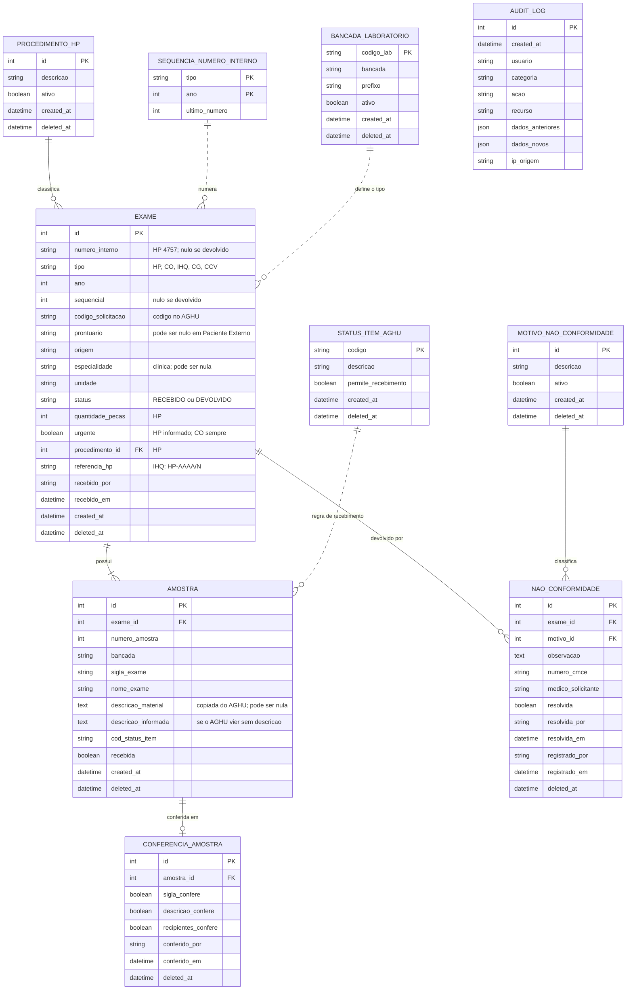

# Modelo de Dados e Dicionário

O paciente, a solicitação e as amostras vêm do AGHU por leitura (RN-01) e não são tabelas deste sistema. O paciente é identificado pelo **prontuário**, quando existe. O nome e as informações clínicas **não são gravados** no banco local nem na auditoria: são lidos do AGHU quando a tela precisa mostrá-los.

## 1. Dicionário da view do AGHU (`vw_solicitacao`)

Somente leitura, com uma linha por amostra. Os valores são os do CSV exportado; as contagens servem para orientar as regras e mudam a cada exportação. O CSV real tem dados de pacientes e fica fora do Git.

| Coluna | Formato | Vazio no CSV | Uso no sistema |
| :--- | :--- | :---: | :--- |
| `codigo_solicitacao` | 6 ou 7 dígitos | Nunca | Código da solicitação; guardado em `exames` |
| `numero_amostra` | Inteiro de 1 a 30, sem zeros à esquerda | Nunca | Número da amostra. Pode ter lacunas e não começar em 1 |
| `cod_status_item` | `AC`, `EC`, `CO`, `AE`, `EX`, `LI`, `CA` ou `PE` | Nunca | Regra de recebimento, por item (`status_item_aghu`) |
| `status_item_exame` | Nome do status no AGHU | Nunca | Exibido na tela (RNF003) |
| `data_solicitacao` | `DD/MM/AAAA` | Nunca | Exibida na tela |
| `nome_paciente` | Só iniciais (`A.B.C.`) | Nunca | Exibido na tela; não gravado |
| `data_nascimento` | `DD/MM/AAAA` | Nunca | Cálculo da idade; não gravada |
| `prontuario` | 8 dígitos | Só em Paciente Externo, em parte dos casos | Guardado em `exames` |
| `especialidade` | Texto (clínica) | Em todo Paciente Externo | Guardada em `exames` |
| `convenio` | Sempre `SUS` no CSV | Nunca | Exibido nos detalhes; não gravado |
| `origem` | `Ambulatório`, `Internação`, `Cirurgia` ou `Paciente Externo` | Nunca | Guardada em `exames` |
| `unidade` | Texto (andar ou ambulatório) | Nunca | Guardada em `exames`. Traz caracteres invisíveis e espaços repetidos, removidos na leitura |
| `codigo_lab` | `207`, `203`, `139`, `205` ou `209` | Nunca | Define a bancada (`bancadas_laboratorio`) |
| `informacoes_clinica` | Texto clínico, até 500 caracteres, muitas vezes com quebras de linha | Raramente | Exibidas nos detalhes, com as quebras preservadas; não gravadas nem auditadas |
| `sigla_exame` | 12 siglas no CSV (ex.: `APECR`, `CCVM`, `CONGE`, `IMUHI`) | Nunca | Descreve o exame; guardada em `amostras` |
| `nome_exame` | Texto | Nunca | Descreve o exame; guardado em `amostras` |
| `descricao_material` | Texto, até 100 caracteres | Só na sigla `CITO`, sempre | Guardada em `amostras`. Se vazia, a recepção informa o material |

## 2. Modelo Entidade-Relacionamento


`AUDIT_LOG` não tem chave estrangeira: ele aponta para o exame pelo campo `recurso` (ex.: `exame:12`). As linhas pontilhadas são vínculos por valor, sem chave estrangeira.

## 3. Dicionário do banco local

Tabelas: `exames`, `amostras`, `conferencias_amostra`, `nao_conformidades`, `motivos_nao_conformidade`, `procedimentos_hp`, `bancadas_laboratorio`, `status_item_aghu`, `sequencias_numero_interno`, `refresh_tokens`, `audit_logs`. Todas as datas são gravadas em UTC.

### `exames`
Um exame por bancada de cada solicitação. Uma solicitação com HP e CO gera dois exames e dois números.

| Campo | Tipo | Nulo | Descrição |
| :--- | :--- | :---: | :--- |
| `id` | Integer | Não | Chave primária |
| `numero_interno` | String | Sim | Prefixo + sequencial (ex.: `HP 4757`, `IH 12`). Nulo se `DEVOLVIDO` |
| `tipo` | String | Não | Bancada: `HP`, `CO`, `IHQ`, `CG` ou `CCV` |
| `ano` | Integer | Não | Ano do registro no fuso do hospital (`America/Recife`) |
| `sequencial` | Integer | Sim | Número dentro do tipo e do ano. Nulo se `DEVOLVIDO` |
| `codigo_solicitacao` | String | Não | Código da solicitação no AGHU |
| `prontuario` | String | Sim | Prontuário no AGHU. Pode ser nulo só em Paciente Externo |
| `origem` | String | Não | Origem no AGHU. Base da coluna "A/E" da planilha |
| `especialidade` | String | Sim | Clínica no AGHU. Nula em Paciente Externo |
| `unidade` | String | Sim | Andar ou ambulatório no AGHU |
| `status` | String | Não | `RECEBIDO` ou `DEVOLVIDO` |
| `quantidade_pecas` | Integer | Sim | Quantidade de peças, a partir de 1. Obrigatória ao receber HP |
| `urgente` | Boolean | Sim | Informado ao receber HP; sempre verdadeiro em CO (CARE-RF007); nulo nas demais bancadas |
| `procedimento_id` | Integer | Sim | Procedimento. Obrigatório ao receber HP |
| `referencia_hp` | String | Sim | HP de origem da IHQ, no formato `HP-AAAA/N`. Opcional |
| `recebido_por` | String | Não | Login do usuário, vindo do token JWT |
| `recebido_em` | DateTime | Não | Data e hora do registro; é a "data de entrada" da planilha |
| `created_at` | DateTime | Não | Criação da linha |
| `deleted_at` | DateTime | Sim | Exclusão lógica |

### `amostras`

| Campo | Tipo | Nulo | Descrição |
| :--- | :--- | :---: | :--- |
| `id` | Integer | Não | Chave primária |
| `exame_id` | Integer | Não | Exame ao qual a amostra pertence |
| `numero_amostra` | Integer | Não | `numero_amostra` do AGHU |
| `bancada` | String | Não | Bancada, definida por `codigo_lab` |
| `sigla_exame` | String | Não | Sigla do exame no AGHU |
| `nome_exame` | String | Não | Nome do exame no AGHU |
| `descricao_material` | Text | Sim | Descrição copiada do AGHU pelo servidor. Nula se vier vazia |
| `descricao_informada` | Text | Sim | Material informado na recepção, só quando o AGHU vem sem descrição |
| `cod_status_item` | String | Não | Status do item no AGHU no momento do registro |
| `recebida` | Boolean | Não | Se a amostra foi recebida |
| `created_at` | DateTime | Não | Criação da linha |
| `deleted_at` | DateTime | Sim | Exclusão lógica |

### `conferencias_amostra`
Existe só para amostras recebidas. O checklist é único por recebimento, e cada amostra recebida guarda o resultado dele, com usuário, data e hora (RF004).

| Campo | Tipo | Nulo | Descrição |
| :--- | :--- | :---: | :--- |
| `id` | Integer | Não | Chave primária |
| `amostra_id` | Integer | Não | Amostra conferida (no máximo uma conferência por amostra) |
| `sigla_confere` | Boolean | Não | Siglas × conteúdo dos frascos, no checklist do recebimento |
| `descricao_confere` | Boolean | Não | Descrições × frascos, no checklist do recebimento |
| `recipientes_confere` | Boolean | Não | Nº de recipientes, no checklist do recebimento |
| `conferido_por` | String | Não | Login do usuário |
| `conferido_em` | DateTime | Não | Data e hora da conferência |
| `deleted_at` | DateTime | Sim | Exclusão lógica |

### `nao_conformidades`
Substitui o registro de rejeição da planilha. O que vem do AGHU não é redigitado: fica em `exames` e `amostras`.

| Campo | Tipo | Nulo | Descrição |
| :--- | :--- | :---: | :--- |
| `id` | Integer | Não | Chave primária |
| `exame_id` | Integer | Não | Exame devolvido |
| `motivo_id` | Integer | Não | Motivo padronizado |
| `observacao` | Text | Não | Detalhamento, obrigatório (RNF009) |
| `numero_cmce` | String | Sim | Nº da solicitação no CMCE. Não vem do AGHU |
| `medico_solicitante` | String | Sim | Médico solicitante. Não vem do AGHU e pode estar ilegível |
| `resolvida` | Boolean | Não | "Resolveu?" da planilha. Marcado ao receber de novo a solicitação e a bancada |
| `resolvida_por` | String | Sim | Login de quem fez o novo recebimento |
| `resolvida_em` | DateTime | Sim | Data e hora do novo recebimento |
| `registrado_por` | String | Não | Login do usuário |
| `registrado_em` | DateTime | Não | Data e hora do registro |
| `deleted_at` | DateTime | Sim | Exclusão lógica |

### `motivos_nao_conformidade`
Lista configurável pelo banco, sem regra no código. Esta feature não inclui tela de manutenção.

| Campo | Tipo | Nulo | Descrição |
| :--- | :--- | :---: | :--- |
| `id` | Integer | Não | Chave primária |
| `descricao` | String | Não | Texto do motivo (único) |
| `ativo` | Boolean | Não | Se aparece para seleção |
| `created_at` | DateTime | Não | Criação da linha |
| `deleted_at` | DateTime | Sim | Exclusão lógica |

Motivos iniciais, da planilha do setor:
1. Amostra sem solicitação ou sem etiqueta do AGHU
2. Solicitação do exame não corresponde ao tipo de material enviado
3. Falta descrição do material no frasco
4. Etiqueta, identificação do paciente na peça ou requisição ilegível(is)
5. Numeração dos frascos não corresponde à numeração do AGHU
6. Quantidade de material não confere com a solicitação do AGHU
7. Informações do material divergentes no frasco e no AGHU
8. Falta carimbo e/ou assinatura do médico responsável
9. Acondicionamento inadequado ou sem fixador
10. Várias solicitações do mesmo exame em códigos diferentes
11. Peças não descritas no campo de informações clínicas
12. Formulário do SISCAN incompleto ou ausente
13. Sem agendamento no sistema CMCE (SES-PE)
14. Outra

### `procedimentos_hp`
Lista configurável, com a mesma estrutura de `motivos_nao_conformidade`. Valores iniciais: peça de mama; biópsia de mama; peça de colo uterino; biópsia de colo uterino; anatomopatológico geral.

### `bancadas_laboratorio`
Mapeamento configurável do laboratório do AGHU. Os valores iniciais estão em `05-interfaces.md`.

| Campo | Tipo | Nulo | Descrição |
| :--- | :--- | :---: | :--- |
| `codigo_lab` | String | Não | Chave primária: código do laboratório no AGHU |
| `bancada` | String | Não | `HP`, `CO`, `IHQ`, `CG` ou `CCV` (único) |
| `prefixo` | String | Não | Prefixo do nº interno (RF006); `IH` para IHQ |
| `ativo` | Boolean | Não | Inativo deixa o laboratório fora do recebimento |
| `created_at` | DateTime | Não | Criação da linha |
| `deleted_at` | DateTime | Sim | Exclusão lógica |

### `status_item_aghu`
Regra configurável de recebimento por status. Os valores iniciais estão em `05-interfaces.md`.

| Campo | Tipo | Nulo | Descrição |
| :--- | :--- | :---: | :--- |
| `codigo` | String | Não | Chave primária: `cod_status_item` do AGHU |
| `descricao` | String | Não | Nome no AGHU (RNF003) |
| `permite_recebimento` | Boolean | Não | Se o item pode ser recebido |
| `created_at` | DateTime | Não | Criação da linha |
| `deleted_at` | DateTime | Sim | Exclusão lógica |

### `sequencias_numero_interno`
Cada bancada tem sequência própria, por ano.

| Campo | Tipo | Nulo | Descrição |
| :--- | :--- | :---: | :--- |
| `tipo` | String | Não | Bancada (parte da chave primária) |
| `ano` | Integer | Não | Ano (parte da chave primária) |
| `ultimo_numero` | Integer | Não | Último número usado |

### [SCHEMA] Esquema JSON - AuditLog
```json
{
  "$schema": "http://json-schema.org/draft-07/schema#",
  "title": "AuditLog",
  "type": "object",
  "properties": {
    "usuario": { "type": "string" },
    "categoria": { "type": "string", "enum": ["SEGURANCA", "NEGOCIO_CLINICO", "CONFIGURACAO"] },
    "acao": { "type": "string" },
    "recurso": { "type": "string" },
    "dados_anteriores": { "type": ["object", "null"] },
    "dados_novos": { "type": ["object", "null"] },
    "ip_origem": { "type": ["string", "null"] }
  },
  "required": ["usuario", "categoria", "acao", "recurso"]
}
```

### [SCHEMA] Saída - Lista de solicitações
`GET /api/recebimento/solicitacoes?pagina=1&por_pagina=10&somente_recebiveis=true`

Não traz informações clínicas. A situação é calculada a cada consulta, sem coluna própria no banco.
```json
{
  "$schema": "http://json-schema.org/draft-07/schema#",
  "title": "ListaSolicitacoes",
  "type": "object",
  "properties": {
    "pagina": { "type": "integer", "minimum": 1 },
    "por_pagina": { "type": "integer", "minimum": 1, "maximum": 100 },
    "total": { "type": "integer" },
    "total_paginas": { "type": "integer" },
    "solicitacoes": {
      "type": "array",
      "items": {
        "type": "object",
        "properties": {
          "codigo": { "type": "string" },
          "data_solicitacao": { "type": ["string", "null"], "format": "date" },
          "paciente": {
            "type": "object",
            "properties": {
              "nome": { "type": "string", "description": "Só iniciais" },
              "prontuario": { "type": ["string", "null"] },
              "idade": { "type": ["integer", "null"] }
            },
            "required": ["nome", "prontuario", "idade"]
          },
          "origem": { "type": "string" },
          "especialidade": { "type": ["string", "null"] },
          "unidade": { "type": ["string", "null"] },
          "bancadas": { "type": "array", "items": { "type": "string" } },
          "total_amostras": { "type": "integer" },
          "amostras_recebiveis": { "type": "integer" },
          "numeros_internos": { "type": "array", "items": { "type": "string" } },
          "situacao": { "type": "string", "enum": ["AGUARDANDO", "PARCIAL", "RECEBIDA", "DEVOLVIDA", "BLOQUEADA"] }
        },
        "required": ["codigo", "data_solicitacao", "paciente", "origem", "especialidade", "unidade", "bancadas", "total_amostras", "amostras_recebiveis", "numeros_internos", "situacao"]
      }
    }
  },
  "required": ["pagina", "por_pagina", "total", "total_paginas", "solicitacoes"]
}
```

### [SCHEMA] Saída - Solicitação para conferência
`GET /api/recebimento/solicitacoes/{codigo}`
```json
{
  "$schema": "http://json-schema.org/draft-07/schema#",
  "title": "SolicitacaoConferencia",
  "type": "object",
  "properties": {
    "codigo": { "type": "string" },
    "situacao": { "type": "string", "enum": ["AGUARDANDO", "PARCIAL", "RECEBIDA", "DEVOLVIDA", "BLOQUEADA"] },
    "urgente": { "type": "boolean" },
    "numero_amostra_lida": { "type": ["integer", "null"] },
    "data_solicitacao": { "type": ["string", "null"], "format": "date" },
    "paciente": {
      "type": "object",
      "properties": {
        "nome": { "type": "string", "description": "Só iniciais" },
        "prontuario": { "type": ["string", "null"] },
        "data_nascimento": { "type": ["string", "null"], "format": "date" },
        "idade": { "type": ["integer", "null"] }
      },
      "required": ["nome", "prontuario", "data_nascimento", "idade"]
    },
    "origem": { "type": "string" },
    "especialidade": { "type": ["string", "null"] },
    "convenio": { "type": ["string", "null"] },
    "unidade": { "type": ["string", "null"] },
    "informacoes_clinica": { "type": ["string", "null"] },
    "amostras": {
      "type": "array",
      "items": {
        "type": "object",
        "properties": {
          "numero_amostra": { "type": "integer" },
          "bancada": { "type": "string", "enum": ["HP", "CO", "IHQ", "CG", "CCV"] },
          "codigo_lab": { "type": "string" },
          "sigla_exame": { "type": "string" },
          "nome_exame": { "type": "string" },
          "descricao_material": { "type": ["string", "null"] },
          "exige_descricao": { "type": "boolean" },
          "cod_status_item": { "type": "string" },
          "status_item_exame": { "type": "string" },
          "recebivel": { "type": "boolean" },
          "motivo_bloqueio": { "type": ["string", "null"] },
          "recebida": { "type": "boolean" },
          "material_informado": { "type": ["string", "null"] },
          "conferencia": { "oneOf": [{ "type": "null" }, { "$ref": "#/definitions/conferencia" }] }
        },
        "required": ["numero_amostra", "bancada", "codigo_lab", "sigla_exame", "nome_exame", "descricao_material", "exige_descricao", "cod_status_item", "status_item_exame", "recebivel", "motivo_bloqueio", "recebida", "material_informado", "conferencia"]
      }
    },
    "exames": { "type": "array", "items": { "$ref": "#/definitions/exame" } }
  },
  "required": ["codigo", "situacao", "urgente", "numero_amostra_lida", "data_solicitacao", "paciente", "origem", "especialidade", "convenio", "unidade", "informacoes_clinica", "amostras", "exames"],
  "definitions": {
    "conferencia": {
      "type": "object",
      "properties": {
        "conferido_por": { "type": "string" },
        "conferido_em": { "type": "string", "format": "date-time" }
      },
      "required": ["conferido_por", "conferido_em"]
    },
    "exame": {
      "type": "object",
      "properties": {
        "numero_interno": { "type": ["string", "null"] },
        "tipo": { "type": "string" },
        "status": { "type": "string", "enum": ["RECEBIDO", "DEVOLVIDO"] },
        "urgente": { "type": ["boolean", "null"] },
        "recebido_por": { "type": "string" },
        "recebido_em": { "type": "string", "format": "date-time" },
        "quantidade_pecas": { "type": ["integer", "null"] },
        "procedimento": { "type": ["string", "null"] },
        "referencia_hp": { "type": ["string", "null"] },
        "amostras": {
          "type": "array",
          "items": {
            "type": "object",
            "properties": {
              "numero_amostra": { "type": "integer" },
              "sigla_exame": { "type": "string" },
              "descricao_material": { "type": ["string", "null"] },
              "descricao_informada": { "type": ["string", "null"] },
              "recebida": { "type": "boolean" },
              "conferencia": { "oneOf": [{ "type": "null" }, { "$ref": "#/definitions/conferencia" }] }
            },
            "required": ["numero_amostra", "sigla_exame", "descricao_material", "descricao_informada", "recebida", "conferencia"]
          }
        },
        "nao_conformidades": {
          "type": "array",
          "items": {
            "type": "object",
            "properties": {
              "motivo": { "type": "string" },
              "observacao": { "type": "string" },
              "numero_cmce": { "type": ["string", "null"] },
              "medico_solicitante": { "type": ["string", "null"] },
              "resolvida": { "type": "boolean" },
              "resolvida_por": { "type": ["string", "null"] },
              "resolvida_em": { "type": ["string", "null"], "format": "date-time" },
              "registrado_por": { "type": "string" },
              "registrado_em": { "type": "string", "format": "date-time" }
            },
            "required": ["motivo", "observacao", "numero_cmce", "medico_solicitante", "resolvida", "resolvida_por", "resolvida_em", "registrado_por", "registrado_em"]
          }
        }
      },
      "required": ["numero_interno", "tipo", "status", "urgente", "recebido_por", "recebido_em", "quantidade_pecas", "procedimento", "referencia_hp", "amostras", "nao_conformidades"]
    }
  }
}
```

### [SCHEMA] Entrada - Recebimento
`POST /api/recebimento/solicitacoes/{codigo}/recebimentos`

Os três itens do checklist valem para todo o recebimento e têm valor padrão `false`. Uma amostra omitida é registrada como não recebida. `dados_hp` é exigido quando há amostra HP marcada: sem ele, a resposta é 422. `descricao_informada` é exigida só quando o AGHU vem sem descrição.
```json
{
  "$schema": "http://json-schema.org/draft-07/schema#",
  "title": "RecebimentoEntrada",
  "type": "object",
  "properties": {
    "amostras": {
      "type": "array",
      "minItems": 1,
      "items": {
        "type": "object",
        "properties": {
          "numero_amostra": { "type": "integer", "minimum": 1 },
          "receber": { "type": "boolean" },
          "descricao_informada": { "type": ["string", "null"], "maxLength": 200 }
        },
        "required": ["numero_amostra", "receber"]
      }
    },
    "sigla_confere": { "type": "boolean", "default": false },
    "descricao_confere": { "type": "boolean", "default": false },
    "recipientes_confere": { "type": "boolean", "default": false },
    "dados_hp": {
      "type": ["object", "null"],
      "properties": {
        "quantidade_pecas": { "type": "integer", "minimum": 1 },
        "urgente": { "type": "boolean" },
        "procedimento_id": { "type": "integer" }
      },
      "required": ["quantidade_pecas", "urgente", "procedimento_id"]
    },
    "referencia_hp": { "type": ["string", "null"], "maxLength": 30, "description": "Formato HP-AAAA/N" }
  },
  "required": ["amostras"]
}
```

### [SCHEMA] Saída - Recebimento
```json
{
  "$schema": "http://json-schema.org/draft-07/schema#",
  "title": "RecebimentoSaida",
  "type": "object",
  "properties": {
    "codigo": { "type": "string" },
    "exames": {
      "type": "array",
      "items": {
        "type": "object",
        "properties": {
          "numero_interno": { "type": "string", "pattern": "^(HP|CO|IH|CG|CCV) [0-9]+$" },
          "tipo": { "type": "string" },
          "status": { "const": "RECEBIDO" },
          "urgente": { "type": ["boolean", "null"] },
          "recebido_por": { "type": "string" },
          "recebido_em": { "type": "string", "format": "date-time" },
          "amostras": {
            "type": "array",
            "items": {
              "type": "object",
              "properties": {
                "numero_amostra": { "type": "integer" },
                "bancada": { "type": "string" },
                "sigla_exame": { "type": "string" },
                "nome_exame": { "type": "string" },
                "descricao_material": { "type": ["string", "null"] },
                "descricao_informada": { "type": ["string", "null"] },
                "recebida": { "type": "boolean" }
              },
              "required": ["numero_amostra", "bancada", "sigla_exame", "nome_exame", "descricao_material", "descricao_informada", "recebida"]
            }
          }
        },
        "required": ["numero_interno", "tipo", "status", "urgente", "recebido_por", "recebido_em", "amostras"]
      }
    }
  },
  "required": ["codigo", "exames"]
}
```

### [SCHEMA] Entrada - Não conformidade
`POST /api/recebimento/solicitacoes/{codigo}/nao-conformidades`
```json
{
  "$schema": "http://json-schema.org/draft-07/schema#",
  "title": "NaoConformidadeEntrada",
  "type": "object",
  "properties": {
    "motivo_id": { "type": "integer" },
    "observacao": { "type": "string", "minLength": 1, "maxLength": 2000 },
    "numero_cmce": { "type": ["string", "null"], "maxLength": 30 },
    "medico_solicitante": { "type": ["string", "null"], "maxLength": 200 }
  },
  "required": ["motivo_id", "observacao"]
}
```

### [SCHEMA] Saída - Não conformidade
```json
{
  "$schema": "http://json-schema.org/draft-07/schema#",
  "title": "NaoConformidadeSaida",
  "type": "object",
  "properties": {
    "codigo": { "type": "string" },
    "motivo": { "type": "string" },
    "observacao": { "type": "string" },
    "exames": {
      "type": "array",
      "items": {
        "type": "object",
        "properties": {
          "numero_interno": { "type": "null" },
          "tipo": { "type": "string" },
          "status": { "const": "DEVOLVIDO" },
          "urgente": { "type": "null" },
          "recebido_por": { "type": "string" },
          "recebido_em": { "type": "string", "format": "date-time" },
          "amostras": { "type": "array" }
        },
        "required": ["numero_interno", "tipo", "status", "urgente", "recebido_por", "recebido_em", "amostras"]
      }
    }
  },
  "required": ["codigo", "motivo", "observacao", "exames"]
}
```

### [SCHEMA] Saída - Listas controladas
`GET /api/recebimento/motivos-nao-conformidade` e `GET /api/recebimento/procedimentos-hp`
```json
{
  "$schema": "http://json-schema.org/draft-07/schema#",
  "title": "ListaControlada",
  "type": "array",
  "items": {
    "type": "object",
    "properties": {
      "id": { "type": "integer" },
      "descricao": { "type": "string" }
    },
    "required": ["id", "descricao"]
  }
}
```

## 4. Regras de Integridade
* **Unicidade do número:** `tipo` + `ano` + `sequencial` são únicos em `exames`.
* **Número por status:** um exame `RECEBIDO` sempre tem número; um exame `DEVOLVIDO` nunca tem.
* **Recebimento único:** há no máximo um exame `RECEBIDO` e não excluído por `codigo_solicitacao` + `tipo` (índice único parcial). Exames `DEVOLVIDO` não bloqueiam um novo recebimento e ficam como histórico.
* **Geração do número:** a sequência é incrementada por um único comando dentro da transação do exame. Um rollback desfaz o incremento, então não há número repetido nem pulado (RF006, RNF013).
* **Amostras:** `exame_id` + `numero_amostra` são únicos em `amostras`.
* **Valores controlados (RNF009):** urgência é booleana, sem texto livre; procedimento e motivo vêm de listas; `quantidade_pecas` é ao menos 1.
* **Dados do AGHU:** o servidor relê a solicitação antes de gravar. Do cliente vêm só as marcações, o checklist e os dados que a recepção acrescenta.
* **Sem exclusão física:** os registros do domínio usam `deleted_at`, e os de `audit_logs` não são excluídos.
* **Trilha de auditoria:** toda mutação gera registro em `audit_logs`, na categoria `NEGOCIO_CLINICO`, com `dados_anteriores`, `dados_novos` e IP. A auditoria é gravada logo depois do commit do negócio, porque `registrar_auditoria()` faz commit próprio; as duas gravações não são atômicas.
* **Preparação para as próximas features:** etapas, faturamento e demais dados podem ser acrescentados em colunas ou tabelas ligadas a `exames` sem mudar o que existe aqui.

## 5. Migração
A migração `b7d4c1e9a2f0` cria estas tabelas e carrega as listas iniciais: motivos, procedimentos, bancadas e status. A aplicação também cria as tabelas ausentes no startup (`create_all`), com as mesmas cargas. O `create_all` não altera tabelas já existentes.
