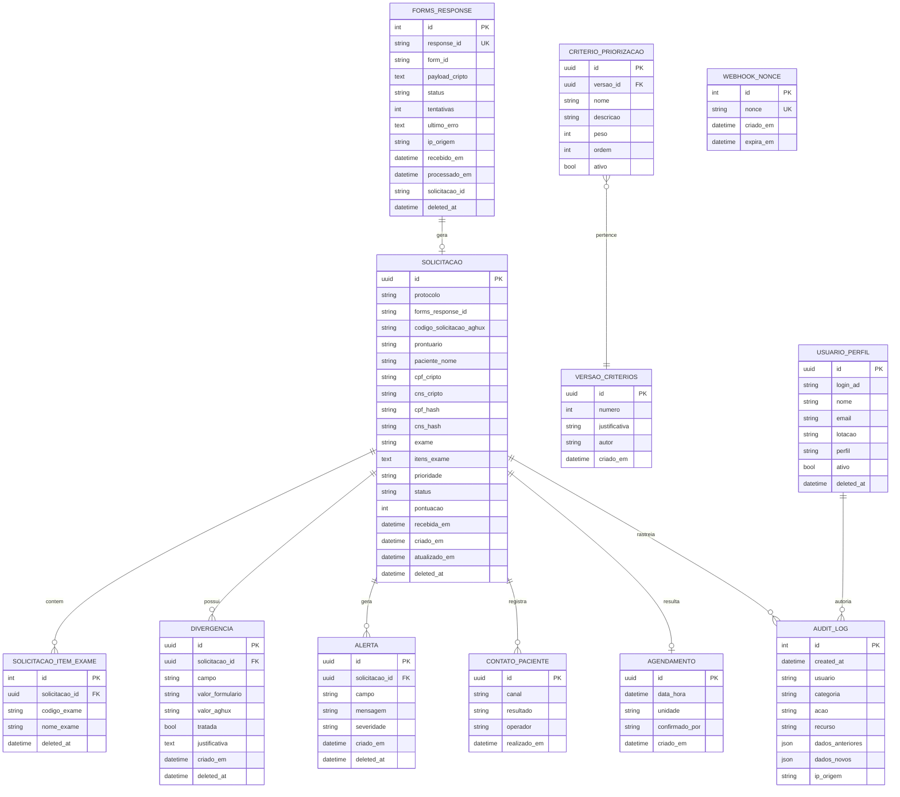

# Modelo de Dados e Dicionário — SAE-HC

## 1. Modelo Entidade-Relacionamento



## 2. Dicionário de Dados

| Entidade | Finalidade | Regras principais |
| :--- | :--- | :--- |
| `FORMS_RESPONSE` | Evento idempotente do webhook do Microsoft Forms via Power Automate. | `response_id` único; payload bruto criptografado em `payload_cripto`; status `PENDENTE`, `PROCESSADA`, `DUPLICADA` ou `ERRO`; `tentativas`, `ultimo_erro`, `ip_origem`, `recebido_em`, `processado_em` e `solicitacao_id`; `deleted_at` para exclusão lógica. |
| `WEBHOOK_NONCE` | Nonce já consumido pelo webhook. | `nonce` único, com `criado_em` e `expira_em`; impede replay mesmo quando a assinatura HMAC é válida. Não tem `deleted_at` (controle de segurança). |
| `SOLICITACAO` | Uma requisição de exame recebida do formulário externo. | `id` UUID, `protocolo` no formato `FORMS-<responseId>` e `forms_response_id` único; CPF/CNS criptografados com AES-GCM e hashes HMAC para deduplicação; `deleted_at` para exclusão lógica; status controlado por máquina de estados em `05-interfaces.md`. No mock atual, a identificação de origem é `codigoSolicitacaoAghux` + `prontuario`, pois o export não contém CPF/CNS. |
| `SOLICITACAO_ITEM_EXAME` | Um exame por linha da solicitação. | FK para `solicitacoes.id`; código e nome do exame; `deleted_at` para exclusão lógica (reprocessamento desativa os itens anteriores). |
| `DIVERGENCIA` | Diferença entre formulário e cadastro AGHUX. | FK para `solicitacoes.id`; `tratada`, `justificativa`, `criado_em` e `deleted_at`. Não pode ser ignorada; exige correção ou justificativa antes da validação (RN-04). |
| `ALERTA` | Inconsistência detectada no recebimento (RF004). | FK para `solicitacoes.id`; `campo`, `mensagem`, `severidade`, `criado_em` e `deleted_at`. Orienta notificação ao paciente (RF019). |
| `CONTATO_PACIENTE` | Registro de aceite, recusa ou sem resposta. | Impede contatos duplicados; aceite é pré-condição do agendamento (RN-07). |
| `AGENDAMENTO` | Marcação efetivada no AGHUX. | Só existe após aceite; bloqueia choque de horário (RN-05). |
| `CRITERIO_PRIORIZACAO` | Regra que compõe a pontuação da fila. | Peso inteiro, ordem e situação ativa/inativa. |
| `VERSAO_CRITERIOS` | Conjunto versionado de critérios. | Toda alteração cria nova versão com justificativa; versões anteriores não são apagadas. |
| `USUARIO_PERFIL` | Autorização local complementar ao AD. | Login corporativo ativo + perfil ativo; soft delete; perfis em `05-interfaces.md`. |
| `AUDIT_LOG` | Trilha imutável de mutações. | Somente inserção; antes/depois em JSON; categorias `SEGURANCA`, `NEGOCIO_CLINICO`, `CONFIGURACAO`. |

As tabelas físicas da integração são `forms_responses`, `webhook_nonces`, `solicitacoes`, `solicitacao_itens_exame`, `divergencias` e `alertas`, criadas pela migração Alembic **`c4f1a7d9e2b3`** (revises `8a2efbe37bb6`). Tabelas do framework mantidas: `REFRESH_TOKENS`, `AUDIT_LOGS` (esta última, somente inserção).

### [SCHEMA] Esquema JSON — FormsEvento (resumo sem PHI)

Contrato devolvido pelos endpoints administrativos e consumido pela tela `/integracoes`; não contém payload, CPF nem CNS.

```json
{
  "$schema": "http://json-schema.org/draft-07/schema#",
  "title": "FormsEvento",
  "type": "object",
  "properties": {
    "responseId": { "type": "string" },
    "formId": { "type": "string" },
    "status": { "type": "string", "enum": ["PENDENTE", "PROCESSADA", "DUPLICADA", "ERRO"] },
    "tentativas": { "type": "integer", "minimum": 0 },
    "ultimoErro": { "type": ["string", "null"] },
    "recebidoEm": { "type": "string", "format": "date-time" },
    "processadoEm": { "type": ["string", "null"], "format": "date-time" },
    "solicitacaoId": { "type": ["string", "null"], "format": "uuid" },
    "divergencias": { "type": "integer", "minimum": 0 },
    "alertas": { "type": "integer", "minimum": 0 }
  },
  "required": ["responseId", "formId", "status", "tentativas", "recebidoEm", "divergencias", "alertas"]
}
```

### [SCHEMA] Esquema JSON — Solicitacao (resumo para a API)

```json
{
  "$schema": "http://json-schema.org/draft-07/schema#",
  "title": "Solicitacao",
  "type": "object",
  "properties": {
    "id": { "type": "string", "format": "uuid" },
    "protocolo": { "type": "string" },
    "pacienteNome": { "type": "string" },
    "codigoSolicitacaoAghux": { "type": "string" },
    "prontuario": { "type": "string" },
    "telefone": { "type": "string" },
    "cidade": { "type": "string" },
    "estado": { "type": "string" },
    "exame": { "type": "string", "description": "Primeiro exame do grupo; ver itensExame" },
    "itensExame": {
      "type": "array",
      "items": {
        "type": "object",
        "properties": {
          "codigoExame": { "type": "string" },
          "nomeExame": { "type": "string" }
        },
        "required": ["codigoExame", "nomeExame"]
      }
    },
    "unidadeSolicitante": { "type": "string" },
    "solicitanteNome": { "type": "string" },
    "status": {
      "type": "string",
      "enum": ["RECEBIDA", "EM_CONFERENCIA", "PENDENTE_CORRECAO", "AGUARDANDO_CONTATO", "AGENDADA", "CANCELADA"]
    },
    "pontuacao": { "type": "integer", "minimum": 0 },
    "prioridade": { "type": "string", "enum": ["ALTA", "MEDIA", "BAIXA"] },
    "recebidaEm": { "type": "string", "format": "date-time" }
  },
  "required": ["id", "protocolo", "pacienteNome", "exame", "status", "pontuacao", "prioridade", "recebidaEm"]
}
```

### [SCHEMA] Esquema JSON — CriterioPriorizacao

```json
{
  "$schema": "http://json-schema.org/draft-07/schema#",
  "title": "CriterioPriorizacao",
  "type": "object",
  "properties": {
    "id": { "type": "string" },
    "chave": { "type": "string", "description": "Chave do atributo da solicitação usada no cálculo da pontuação" },
    "nome": { "type": "string", "minLength": 3 },
    "descricao": { "type": "string" },
    "peso": { "type": "integer", "minimum": 0, "maximum": 100 },
    "ordem": { "type": "integer", "minimum": 1 },
    "ativo": { "type": "boolean" }
  },
  "required": ["id", "nome", "peso", "ordem", "ativo"]
}
```

### [SCHEMA] Esquema JSON — AuditLog

```json
{
  "$schema": "http://json-schema.org/draft-07/schema#",
  "title": "AuditLog",
  "type": "object",
  "properties": {
    "usuario": { "type": "string" },
    "categoria": { "type": "string", "enum": ["SEGURANCA", "NEGOCIO_CLINICO", "CONFIGURACAO"] },
    "acao": { "type": "string" },
    "recurso": { "type": "string" },
    "dados_anteriores": { "type": ["object", "null"] },
    "dados_novos": { "type": ["object", "null"] },
    "ip_origem": { "type": ["string", "null"] }
  },
  "required": ["usuario", "categoria", "acao", "recurso"]
}
```

### [MAPEAMENTO] Export CSV do AGHUX → Solicitacao (mocks)

O fixture `frontend/src/mocks/dadosAghux.json` é gerado por `scripts/importar_dados_aghux.py` a partir do export `Documentos de Apoio/_SELECT_Dados_do_Paciente_*.csv`. Cada linha é um item de exame; linhas com o mesmo `codigo_solicitacao` são agrupadas em uma única solicitação com `itensExame[]`.

| Coluna do export | Campo da solicitação | Observação |
| :--- | :--- | :--- |
| `codigo_solicitacao` | `codigoSolicitacaoAghux`, `protocolo` | Chave de agrupamento. |
| `pac_prontuario` | `prontuario` | Identificador do paciente no AGHU. |
| `pac_nome` | `pacienteNome` | Nome já anonimizado no export. |
| `telefone` | `telefone` | Fixo `81999999999` no export; não é telefone real. |
| `cidade`, `estado` | `cidade`, `estado` | UF por extenso no export. |
| `data_solicitao` | `recebidaEm` | Data real preservada; o maior valor é `referenciaEm`. |
| `unidade_solicitante` | `setorSolicitante`, `tipoExame` | `tipoExame` é categoria derivada para filtros. |
| `codigo_exame`, `nome_exame` | `itensExame[]` | Exames de uma mesma solicitação. |
| `id_funcionario`, `nome_funcionario` | `solicitanteCodigo`, `solicitanteNome` | Solicitante no AGHU. |

`urgenciaClinica` e `idade` não existem no export e são valores neutros simulados, sinalizados em `atributosSimulados`. `tempoEspera` e `complexidadeExame` são derivados de campos reais. A data de referência do export (`2026-09-28T16:05:34.227`) é o "agora" da simulação.

### [MAPEAMENTO] Resposta do Forms → Solicitacao (v0.2.0)

O corpo `resposta` enviado pelo Power Automate é normalizado pelo mapa de apelidos `FORMS_FIELD_MAP` (`src/config.py`): `nome`, `prontuario`, `codigoSolicitacaoAghux`, `cpf`, `cns`, `telefone`, `cidade`, `estado`, `codigoExame`, `nomeExame`, `unidadeSolicitante` e `submittedAt`. O provedor `MockFormsProvider` completa campos ausentes; `PowerAutomateFormsProvider` nunca inventa valores.

| Origem | Destino | Regra |
| :--- | :--- | :--- |
| `responseId` do webhook | `forms_responses.response_id`, `solicitacoes.forms_response_id`, `protocolo` | Chave de idempotência; protocolo `FORMS-<responseId>`. |
| `resposta` (JSON bruto) | `forms_responses.payload_cripto` | AES-GCM; decifrado apenas no processamento assíncrono. |
| `submittedAt` | `solicitacoes.recebida_em` | Ausente → `recebido_em` do evento. |
| `prontuario` / `codigoSolicitacaoAghux` | Cruzamento com o AGHUX | `AghuxJsonProvider` indexa prontuário e código da solicitação da fixture versionada. |
| `cpf` / `cns` | `cpf_cripto`, `cns_cripto`, `cpf_hash`, `cns_hash` | Cifrotexto para guarda; HMAC para deduplicação; ausentes ficam nulos. |
| Exames do cadastro ou do formulário | `itens_exame` e `solicitacao_itens_exame` | Um exame por linha, com código e nome. |
| Nome, telefone, cidade/UF, unidade e exames | `divergencias`, `alertas` | Comparação normalizada com o AGHUX; sem correspondência gera alerta de severidade `ALTA`. |

A pontuação segue a mesma regra dos mocks: urgência clínica e idade neutras valem `5` até a integração com a triagem/prontuário; tempo de espera derivado de `recebida_em` (`min(10, round(horas/144))`); complexidade estimada pela sigla do exame. Pesos `40/25/20/15`, pontuação `round(soma/10)` limitada a `0..100`, com `ALTA >= 70`, `MEDIA >= 40` e `BAIXA` abaixo disso. O reprocessamento reativa o cálculo sem criar outro evento e desativa (`deleted_at`) itens, divergências e alertas anteriores.

## 3. Regras de Integridade
- CPF/CNS armazenados com AES-GCM (`cryptography`, nonce de 96 bits, chave de 32 bytes); listagens exibem somente máscara `***` nos últimos 4 dígitos. O export usado nos mocks não contém CPF/CNS e o formulário sem esses campos não inventa valores.
- Hashes HMAC-SHA256 (`cpf_hash`, `cns_hash`) existem apenas para busca/deduplicação; payload, auditoria, logs e respostas da API nunca trazem CPF/CNS em claro.
- `forms_responses.response_id`, `webhook_nonces.nonce` e `solicitacoes.forms_response_id` são únicos; nonce repetido é rejeitado antes da idempotência da resposta.
- Proibida exclusão física: todas as entidades editáveis usam `deleted_at`; `AUDIT_LOG` é somente de inserção (`WEBHOOK_NONCE` é controle de segurança e não é editável).
- Somente a Área Gestora cria versões de critérios, e toda versão exige justificativa (RN-03).
- Nenhuma solicitação pode ser agendada sem aceite de contato registrado e divergências tratadas (RN-04/RN-07); o agendamento real no AGHU permanece fora desta entrega.
- Trilha de auditoria obrigatória em `audit_logs` para todas as mutações, inclusive a importação e falhas de processamento do webhook (`webhook:microsoft-forms`, categoria `NEGOCIO_CLINICO`).
