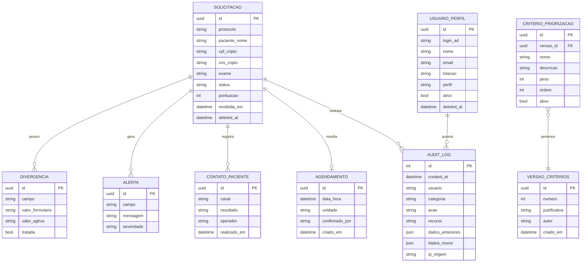

# Modelo de Dados e Dicionário — SAE-HC

## 1. Modelo Entidade-Relacionamento



## 2. Dicionário de Dados

| Entidade | Finalidade | Regras principais |
| :--- | :--- | :--- |
| `SOLICITACAO` | Uma requisição de exame recebida do formulário externo. | Identificada por CNS/CPF criptografados (AES-256) no backend; `deleted_at` para exclusão lógica; status controlado por máquina de estados em `05-interfaces.md`. No mock atual, a identificação de origem é `codigoSolicitacaoAghux` + `prontuario`, pois o export não contém CPF/CNS. |
| `DIVERGENCIA` | Diferença entre formulário e cadastro AGHUX. | Não pode ser ignorada; exige correção ou justificativa antes da validação (RN-04). |
| `ALERTA` | Inconsistência detectada no recebimento (RF004). | Vinculado a um campo; orienta notificação ao paciente (RF019). |
| `CONTATO_PACIENTE` | Registro de aceite, recusa ou sem resposta. | Impede contatos duplicados; aceite é pré-condição do agendamento (RN-07). |
| `AGENDAMENTO` | Marcação efetivada no AGHUX. | Só existe após aceite; bloqueia choque de horário (RN-05). |
| `CRITERIO_PRIORIZACAO` | Regra que compõe a pontuação da fila. | Peso inteiro, ordem e situação ativa/inativa. |
| `VERSAO_CRITERIOS` | Conjunto versionado de critérios. | Toda alteração cria nova versão com justificativa; versões anteriores não são apagadas. |
| `USUARIO_PERFIL` | Autorização local complementar ao AD. | Login corporativo ativo + perfil ativo; soft delete; perfis em `05-interfaces.md`. |
| `AUDIT_LOG` | Trilha imutável de mutações. | Somente inserção; antes/depois em JSON; categorias `SEGURANCA`, `NEGOCIO_CLINICO`, `CONFIGURACAO`. |

Tabelas do framework mantidas: `REFRESH_TOKENS`, `AUDIT_LOGS`.

### [SCHEMA] Esquema JSON — Solicitacao (resumo para a API)

```json
{
  "$schema": "http://json-schema.org/draft-07/schema#",
  "title": "Solicitacao",
  "type": "object",
  "properties": {
    "id": { "type": "string", "format": "uuid" },
    "protocolo": { "type": "string" },
    "pacienteNome": { "type": "string" },
    "codigoSolicitacaoAghux": { "type": "string" },
    "prontuario": { "type": "string" },
    "telefone": { "type": "string" },
    "cidade": { "type": "string" },
    "estado": { "type": "string" },
    "exame": { "type": "string", "description": "Primeiro exame do grupo; ver itensExame" },
    "itensExame": {
      "type": "array",
      "items": {
        "type": "object",
        "properties": {
          "codigoExame": { "type": "string" },
          "nomeExame": { "type": "string" }
        },
        "required": ["codigoExame", "nomeExame"]
      }
    },
    "unidadeSolicitante": { "type": "string" },
    "solicitanteNome": { "type": "string" },
    "status": {
      "type": "string",
      "enum": ["RECEBIDA", "EM_CONFERENCIA", "PENDENTE_CORRECAO", "AGUARDANDO_CONTATO", "AGENDADA", "CANCELADA"]
    },
    "pontuacao": { "type": "integer", "minimum": 0 },
    "prioridade": { "type": "string", "enum": ["ALTA", "MEDIA", "BAIXA"] },
    "recebidaEm": { "type": "string", "format": "date-time" }
  },
  "required": ["id", "protocolo", "pacienteNome", "exame", "status", "pontuacao", "prioridade", "recebidaEm"]
}
```

### [SCHEMA] Esquema JSON — CriterioPriorizacao

```json
{
  "$schema": "http://json-schema.org/draft-07/schema#",
  "title": "CriterioPriorizacao",
  "type": "object",
  "properties": {
    "id": { "type": "string" },
    "chave": { "type": "string", "description": "Chave do atributo da solicitação usada no cálculo da pontuação" },
    "nome": { "type": "string", "minLength": 3 },
    "descricao": { "type": "string" },
    "peso": { "type": "integer", "minimum": 0, "maximum": 100 },
    "ordem": { "type": "integer", "minimum": 1 },
    "ativo": { "type": "boolean" }
  },
  "required": ["id", "nome", "peso", "ordem", "ativo"]
}
```

### [SCHEMA] Esquema JSON — AuditLog

```json
{
  "$schema": "http://json-schema.org/draft-07/schema#",
  "title": "AuditLog",
  "type": "object",
  "properties": {
    "usuario": { "type": "string" },
    "categoria": { "type": "string", "enum": ["SEGURANCA", "NEGOCIO_CLINICO", "CONFIGURACAO"] },
    "acao": { "type": "string" },
    "recurso": { "type": "string" },
    "dados_anteriores": { "type": ["object", "null"] },
    "dados_novos": { "type": ["object", "null"] },
    "ip_origem": { "type": ["string", "null"] }
  },
  "required": ["usuario", "categoria", "acao", "recurso"]
}
```

### [MAPEAMENTO] Export CSV do AGHUX → Solicitacao (mocks)

O fixture `frontend/src/mocks/dadosAghux.json` é gerado por `scripts/importar_dados_aghux.py` a partir do export `Documentos de Apoio/_SELECT_Dados_do_Paciente_*.csv`. Cada linha é um item de exame; linhas com o mesmo `codigo_solicitacao` são agrupadas em uma única solicitação com `itensExame[]`.

| Coluna do export | Campo da solicitação | Observação |
| :--- | :--- | :--- |
| `codigo_solicitacao` | `codigoSolicitacaoAghux`, `protocolo` | Chave de agrupamento. |
| `pac_prontuario` | `prontuario` | Identificador do paciente no AGHU. |
| `pac_nome` | `pacienteNome` | Nome já anonimizado no export. |
| `telefone` | `telefone` | Fixo `81999999999` no export; não é telefone real. |
| `cidade`, `estado` | `cidade`, `estado` | UF por extenso no export. |
| `data_solicitao` | `recebidaEm` | Data real preservada; o maior valor é `referenciaEm`. |
| `unidade_solicitante` | `setorSolicitante`, `tipoExame` | `tipoExame` é categoria derivada para filtros. |
| `codigo_exame`, `nome_exame` | `itensExame[]` | Exames de uma mesma solicitação. |
| `id_funcionario`, `nome_funcionario` | `solicitanteCodigo`, `solicitanteNome` | Solicitante no AGHU. |

`urgenciaClinica` e `idade` não existem no export e são valores neutros simulados, sinalizados em `atributosSimulados`. `tempoEspera` e `complexidadeExame` são derivados de campos reais. A data de referência do export (`2026-09-28T16:05:34.227`) é o "agora" da simulação.

## 3. Regras de Integridade
- CPF/CNS armazenados criptografados (AES-256); listagens exibem somente versão mascarada. O export usado nos mocks não contém CPF/CNS, portanto nenhum valor é inventado no protótipo.
- Proibida exclusão física: todas as entidades editáveis usam `deleted_at`; `AUDIT_LOG` é somente de inserção.
- Somente a Área Gestora cria versões de critérios, e toda versão exige justificativa (RN-03).
- Nenhuma solicitação pode ser agendada sem aceite de contato registrado e divergências tratadas (RN-04/RN-07).
- Trilha de auditoria obrigatória em `audit_logs` para todas as mutações.
