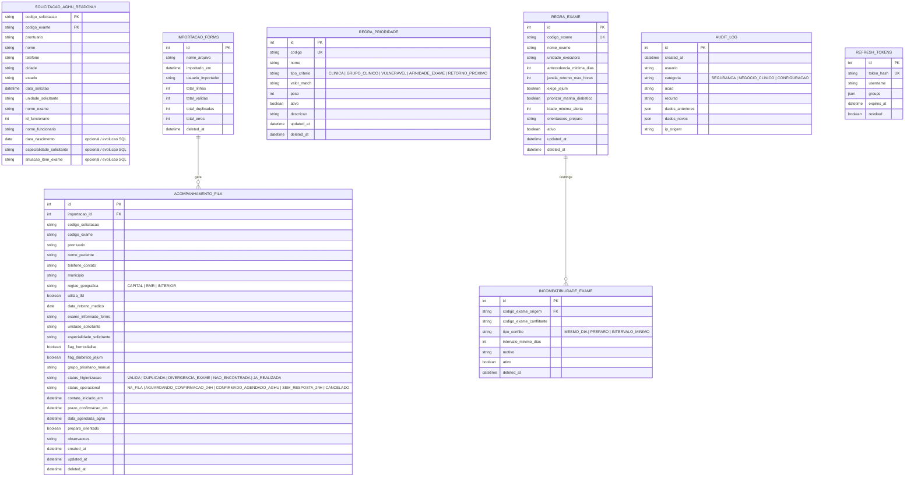

# Modelo de Dados e Dicionário

A arquitetura de dados é **híbrida**:
1. **Base Externa Somente Leitura (AGHU — PostgreSQL em produção / CSV oficial do Drive em desenvolvimento):** fornece as solicitações médicas oficiais.
2. **Base Interna da Aplicação (`data/app.db` — SQLite + SQLAlchemy 2.0 + Alembic):** armazena importações do Google Forms, acompanhamento/status da fila (prazo 24h), regras configuráveis de prioridade, regras de exames, matriz de incompatibilidades, sessões (`refresh_tokens`), usuários/perfis RBAC e auditoria imutável (`audit_logs`).

---

## 1. Modelo Entidade-Relacionamento



---

## 2. Dicionário de Dados

### 2.1. Fonte Externa Somente Leitura (AGHU / CSV Oficial do Drive)
Baseada literalmente em `consulta_aghu_exames.sql` e no CSV de 576 registros disponibilizado no Drive:

| Campo | Tipo | Origem AGHU | Observação |
| :--- | :--- | :--- | :--- |
| `prontuario` | `string` (nullable) | `agh.aip_pacientes.prontuario` | Identificador principal do paciente no HC (pode vir vazio em raros registros; nunca exigir CPF como PK). |
| `nome` | `string` | `agh.aip_pacientes.nome` | Anonimizado no CSV de desenvolvimento. |
| `telefone` | `string` | Mock SQL / Cadastro | Complementado pelo telefone/WhatsApp preenchido na planilha do Forms. |
| `cidade` | `string` | Mock SQL / Cadastro | Usado no **filtro geográfico operacional** (não altera prioridade). |
| `estado` | `string` | Mock SQL / Cadastro | UF de residência. |
| `codigo_solicitacao` | `string` | `agh.ael_solicitacao_exames.seq` | Número do pedido impresso no Ticket (`AELR_TICKET_PACIENTE`). |
| `data_solicitao` | `datetime` | `agh.ael_solicitacao_exames.criado_em` | **Atenção:** manter compatibilidade com o alias `data_solicitao` (sem `c`) vindo do SQL/CSV oficial, normalizando internamente para `data_solicitacao`. |
| `unidade_solicitante` | `string` | `agh.agh_unidades_funcionais.descricao` | Ex: `UDI: ULTRASSONOGRAFIA`, `UDI: MAMOGRAFIA`, `UDI: MEDICINA NUCLEAR`, `FONOAUDIOLOGIA`. |
| `codigo_exame` | `string` | `agh.ael_item_solicitacao_exames.ufe_ema_exa_sigla` | Sigla oficial do exame (ex: `USAX`, `RXMM1`, `RXDOS`, `CMDIP`, `CMREP`). |
| `nome_exame` | `string` | `agh.ael_exames.descricao` | Descrição do exame no AGHU. |
| `id_funcionario` | `int` | `agh.rap_pessoas_fisicas.codigo` | Código do médico/solicitante. |
| `nome_funcionario` | `string` | `agh.rap_pessoas_fisicas.nome` | Nome do médico/solicitante. |

*(Evolução prevista no SQL do AGHU mediante atualização pelo SETISD: `data_nascimento`, `especialidade_solicitante`/`equipe` e `situacao_item_exame` — suportados como campos opcionais no Provider).*

### 2.2. Tabelas Locais da Aplicação (`data/app.db`)
- `importacoes_forms`: histórico de planilhas importadas pela Central.
- `acompanhamento_fila`: estado operacional de cada solicitação higienizada, dados complementares vindos do Forms (data de retorno, município, TFD, telefone) e controle do prazo de 24h.
- `regras_prioridade`: tabela editável com critérios e pesos do motor de priorização (seed inicial: Oncologia `100`, Transplante `80`, Hemodiálise `75`, Nefrologia `65`, Gestante/Criança/Idoso `40`, Afinidade Clínica×Exame `+15`, Retorno em até 15 dias `+20`).
- `regras_exames`: cadastro editável de preparo, janela de retorno (ex: Espirometria = `240h` / 10 dias; INR = `72h`), antecedência mínima e alertas clínicos (jejum/diabético, mamografia `+40` anos).
- `incompatibilidades_exames`: matriz editável de pares de exames que não podem ser agendados no mesmo dia ou dentro de um intervalo mínimo.
- `refresh_tokens` e `audit_logs`: tabelas nativas do Framework SETISD.

---

## 3. Esquemas JSON (Contratos de Validação)

### [SCHEMA] Esquema JSON — AcompanhamentoFila
```json
{
  "$schema": "http://json-schema.org/draft-07/schema#",
  "title": "AcompanhamentoFila",
  "type": "object",
  "properties": {
    "codigo_solicitacao": { "type": "string", "minLength": 1 },
    "codigo_exame": { "type": ["string", "null"] },
    "prontuario": { "type": ["string", "null"] },
    "nome_paciente": { "type": "string", "minLength": 2 },
    "municipio": { "type": ["string", "null"] },
    "regiao_geografica": { "type": "string", "enum": ["CAPITAL", "RMR", "INTERIOR", "NAO_INFORMADO"] },
    "utiliza_tfd": { "type": "boolean" },
    "data_retorno_medico": { "type": ["string", "null"], "format": "date" },
    "status_higienizacao": {
      "type": "string",
      "enum": ["VALIDA", "DUPLICADA", "DIVERGENCIA_EXAME", "NAO_ENCONTRADA", "JA_REALIZADA"]
    },
    "status_operacional": {
      "type": "string",
      "enum": ["NA_FILA", "AGUARDANDO_CONFIRMACAO_24H", "CONFIRMADO_AGENDADO_AGHU", "SEM_RESPOSTA_24H", "CANCELADO"]
    },
    "contato_iniciado_em": { "type": ["string", "null"], "format": "date-time" },
    "prazo_confirmacao_em": { "type": ["string", "null"], "format": "date-time" },
    "data_agendada_aghu": { "type": ["string", "null"], "format": "date-time" }
  },
  "required": ["codigo_solicitacao", "status_higienizacao", "status_operacional"]
}
```

### [SCHEMA] Esquema JSON — RegraPrioridade
```json
{
  "$schema": "http://json-schema.org/draft-07/schema#",
  "title": "RegraPrioridade",
  "type": "object",
  "properties": {
    "codigo": { "type": "string", "minLength": 2 },
    "nome": { "type": "string", "minLength": 3 },
    "tipo_criterio": {
      "type": "string",
      "enum": ["CLINICA", "GRUPO_CLINICO", "VULNERAVEL", "AFINIDADE_EXAME", "RETORNO_PROXIMO"]
    },
    "valor_match": { "type": "string" },
    "peso": { "type": "integer", "minimum": 0, "maximum": 1000 },
    "ativo": { "type": "boolean" }
  },
  "required": ["codigo", "nome", "tipo_criterio", "peso", "ativo"]
}
```

### [SCHEMA] Esquema JSON — AuditLog
```json
{
  "$schema": "http://json-schema.org/draft-07/schema#",
  "title": "AuditLog",
  "type": "object",
  "properties": {
    "usuario": { "type": "string" },
    "categoria": { "type": "string", "enum": ["SEGURANCA", "NEGOCIO_CLINICO", "CONFIGURACAO"] },
    "acao": { "type": "string" },
    "recurso": { "type": "string" },
    "dados_anteriores": { "type": ["object", "null"] },
    "dados_novos": { "type": ["object", "null"] },
    "ip_origem": { "type": ["string", "null"] }
  },
  "required": ["usuario", "categoria", "acao", "recurso"]
}
```

---

## 4. Regras de Integridade

* **Proibição de Hard Delete:** Todas as entidades editáveis utilizam exclusão lógica (`deleted_at`); `audit_logs` é estritamente *append-only* (proibida qualquer alteração ou exclusão).
* **Chave de Deduplicação:** A combinação `(prontuario, codigo_exame)` ativa (ou `(codigo_solicitacao, codigo_exame)`) é verificada na higienização para evitar agendamento duplicado do mesmo exame para o mesmo paciente.
* **Integridade do Prazo 24h:** Sempre que `status_operacional` transitar para `AGUARDANDO_CONFIRMACAO_24H`, o sistema preenche automaticamente `contato_iniciado_em` e `prazo_confirmacao_em = contato_iniciado_em + 24h`.
