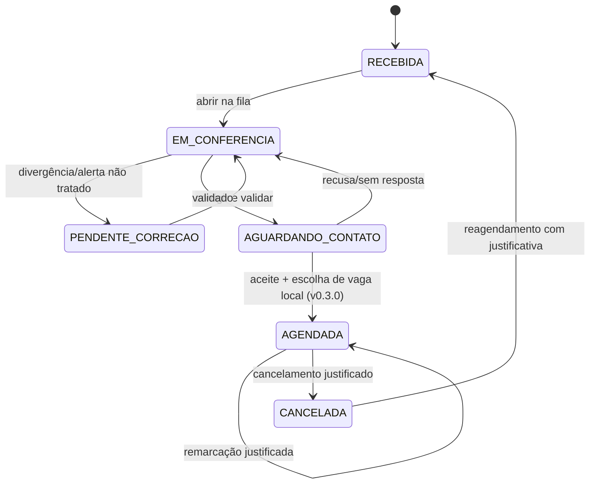
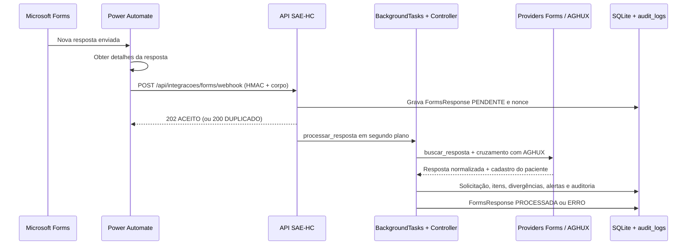
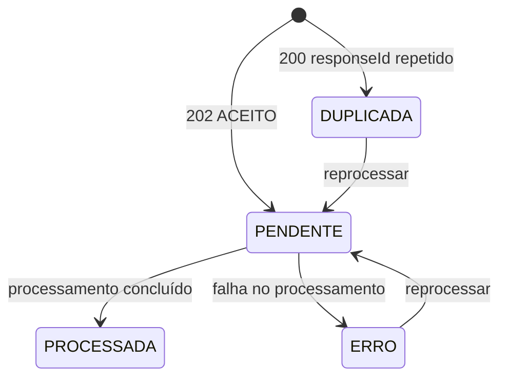
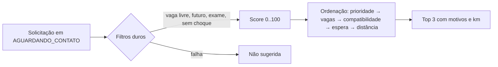

# Interfaces e Integrações — SAE-HC

## 1. Protótipos (descrição textual dos wireframes)

| Rota | Tela | Elementos principais |
| :--- | :--- | :--- |
| `/fila` | Fila de Marcação | Aviso de data de referência; cabeçalho com filtros (busca por nome/prontuário/protocolo/exame, status, tipo de exame, período); tabela compacta com colunas Posição, Prioridade, Paciente/prontuário, Exame(s), Status, Divergências e Tempo na fila; paginação de 20 em 20; clique na linha abre painel lateral. |
| `/painel` | Painel de Gestão | Cinco KPIs (pendentes, tempo médio de validação, agendados, gargalos, taxa de erro), filtros de período/tipo e gráficos de barras/linha em SVG; link para a fila. |
| `/relatorios` | Relatórios | Catálogo de relatórios, formulário de filtros, prévia tabular e botão "Exportar CSV". |
| `/criterios` | Critérios de Priorização | Grade com peso/ordem/atividade por critério, campo de justificativa, botão "Salvar nova versão" e histórico de versões. |
| `/equipe` | Equipe e Perfis | Lista de usuários locais, campo de login com botão "Consultar AD", perfil, lotação, situação ativo/inativo e histórico de alterações. |
| `/agendamentos` | Calendário de Agendamentos (v0.3.0) | Visão mês/semana do FullCalendar, cores por ocupação (`livre`, `parcial`, `lotado`), filtros de unidade/exame, painel lateral do paciente com todos os seus agendamentos, modal de sugestões com top 3 horários, botões de remarcar/cancelar e aba "Gestão de vagas" para Área Gestora/Admin TI. Aviso de ambiente de demonstração quando `VITE_USE_MOCKS=true`: a agenda começa em `referenciaEm` e nenhum endereço é usado. |
| `/integracoes` | Integrações (Forms → AGHUX) | Lista de eventos com Response ID, formulário, status, tentativas, recebido/processado, último erro e contadores de divergências/alertas; botões "Atualizar eventos" e "Reprocessar" (habilitado para `ERRO`/`DUPLICADA`). |
| `/acesso-negado` | Acesso negado | Explicação do perfil insuficiente e link para o início. |

O menu lateral agrupa **Operação** (Fila, Agendamentos), **Gestão** (Painel, Relatórios, Critérios, Equipe) e **Sistema** (Configurações, Integrações). Itens são filtrados pelo perfil do usuário; a versão SemVer permanece no rodapé. A tela `/integracoes` exige `AREA_GESTORA` ou `ADMIN_TI` (`meta.roles`); `/agendamentos` aceita `OPERADOR`, `CHEFIA`, `AREA_GESTORA`, `ADMIN_TI`, `COORDENACAO` e o grupo corporativo `GLO-SEC-HCPE-SETISD`, com `COORDENACAO` em somente leitura.

## 2. Painel lateral de conferência (SolicitacaoDrawer)

Três áreas fixas:
1. **Conferência:** colunas "Formulário" e "AGHUX" com os valores campo a campo; divergências destacadas.
2. **Alertas e ações:** alertas de validação; botões "Corrigir e validar", "Registrar contato", "Efetivar agendamento", "Justificar divergência".
3. **Histórico:** linha do tempo com autor, data/hora, ação e categoria de auditoria.

Bloqueios: "Corrigir e validar" exige tratamento das divergências; "Efetivar agendamento" exige aceite registrado e validação concluída; operador não vê controles de alteração de prioridade. Na v0.3.0, "Efetivar agendamento" abre o calendário com as sugestões do backend — o frontend nunca escolhe a vaga sozinho nem bypassa capacidade/confito.

### 2.1 Calendário e remarcação (v0.3.0)

- **Cores e legenda:** verde para vagas livres, âmbar para últimas vagas, vermelho para vaga esgotada ou encerrada; eventos de agendamento são coloridos por status (`ATIVO`, `CANCELADO`, `CONCLUIDO`).
- **Ocupação:** `ocupadas/livres` devem ser lidas do backend. Ao filtrar por `pacienteChave`, somente a lista de agendamentos é filtrada; a ocupação continua global.
- **Remarcação:** arrastar um evento ou usar o botão no painel abre um modal de justificativa obrigatória. A confirmação chama `POST /api/agendamentos/{id}/remarcar`; `409` indica vaga esgotada ou choque do mesmo paciente e `422` indica pré-condição clínica não satisfeita.
- **Sugestões:** o modal mostra até três horários com pontuação, motivos, vagas restantes e distância (`km` + origem). "Usar este horário" pré-seleciona a vaga e abre a remarcação/agendamento, sem salvar automaticamente.
- **Gestão de vagas:** visível apenas para `AREA_GESTORA`/`ADMIN_TI`; cria e ajusta `unidade`, exame, início, fim, capacidade e situação.
- **Privacidade:** a tela exibe cidade/UF e distância em km; CEP, logradouro, número, complemento e bairro nunca são exibidos nem enviados pelo frontend.

## 3. Máquina de estados da solicitação



## 4. Perfis e permissões

| Perfil | Fila | Conferir/agendar | Critérios | Equipe | Painel/Relatórios |
| :--- | :---: | :---: | :---: | :---: | :---: |
| `OPERADOR` | Sim | Sim | Não | Não | Não |
| `CHEFIA` | Sim | Sim (exceções) | Não | Não | Sim |
| `AREA_GESTORA` | Sim | Não | Sim | Sim | Sim |
| `COORDENACAO` | Não | Não | Não | Não | Sim (somente leitura) |
| `ADMIN_TI` | Não | Não | Não | Sim | Sim |

Para a agenda (v0.3.0): leitura para `OPERADOR`, `CHEFIA`, `AREA_GESTORA`, `ADMIN_TI`, `COORDENACAO` e `GLO-SEC-HCPE-SETISD`; escrita para todos exceto `COORDENACAO`; administração de vagas apenas para `AREA_GESTORA`, `ADMIN_TI` e `GLO-SEC-HCPE-SETISD`. Esses perfis são validados no backend; `meta.roles` no frontend apenas esconde controles.

## 5. Contratos de API

### 5.1 Integração Microsoft Forms → AGHUX (implementada em v0.2.0)

O Microsoft Forms **não possui webhook nativo documentado nem suporte oficial no Microsoft Graph**. Por isso, a integração usa a **abordagem híbrida**: no Power Automate, o gatilho **"Quando uma nova resposta for enviada"** é seguido da ação **"Obter detalhes da resposta"**, que envia o payload ao webhook da API. A API não oficial `forms.office.com/formapi` é apenas ponto de extensão (`FORMS_API`, hoje `NotImplementedError`), não uma fonte em produção.



**Segurança do webhook.** É a **única exceção pública** ao padrão default-private do framework: em vez de JWT, exige HMAC-SHA256 calculado sobre `timestamp . nonce . corpo_bruto` com `FORMS_WEBHOOK_SECRET`, enviado nos cabeçalhos `X-SAE-Timestamp` (Unix, em segundos), `X-SAE-Nonce` e `X-SAE-Signature` (`sha256=<hex>`). A tolerância de relógio é `WEBHOOK_MAX_SKEW_SECONDS` (padrão `300` s) e o nonce é gravado uma única vez em `webhook_nonces` para bloquear replay. Assinatura, timestamp ou nonce inválidos retornam `401`. Todos os demais routers de domínio seguem protegidos por `Depends(auth_handler.decode_token)`; os endpoints administrativos abaixo ainda exigem RBAC.

| Método | Rota | Acesso | Contrato |
| :--- | :--- | :--- | :--- |
| `POST` | `/api/integracoes/forms/webhook` | Público, assinado (HMAC) | Corpo `{ "formId", "responseId", "submittedAt"?, "resposta"? }`. `202` com `{ "status": "ACEITO", "responseId" }` e processamento via `BackgroundTasks`; `200` com `{ "status": "DUPLICADO", "responseId" }` para `responseId` já recebido; `401` para assinatura/timestamp/nonce inválidos; `400` se `formId` divergir do configurado; `422` se o corpo estiver malformado. O evento é gravado como `PENDENTE` e a resposta é imediata. |
| `GET` | `/api/integracoes/forms/eventos?limit=50` | JWT + RBAC: `GLO-SEC-HCPE-SETISD`, `AREA_GESTORA` ou `ADMIN_TI` | Retorna `Array<FormsEvento>` ordenado por `recebidoEm` decrescente; `limit` limitado a `1..200`. |
| `POST` | `/api/integracoes/forms/eventos/{responseId}/reprocessar` | JWT + RBAC: `GLO-SEC-HCPE-SETISD`, `AREA_GESTORA` ou `ADMIN_TI` | Retorna o mesmo `FormsEvento`; `404` se o evento não existir. Não cria novo evento. |

Respostas de erro seguem `{"detail": "..."}`. Os cabeçalhos de segurança HTTP do framework (`X-Content-Type-Options`, `X-Frame-Options`, `X-XSS-Protection`, `Cache-Control`, `Pragma`) continuam sendo aplicados pelo middleware.



### 5.2 Contratos de API de domínio (pendentes de implementação)

As rotas abaixo permanecem documentadas para entregas seguintes; o backend implantado cobre os endpoints da Seção 5.1 e, desde a v0.3.0, `POST /api/solicitacoes/{id}/validacao`, `POST /api/solicitacoes/{id}/contatos` e os endpoints de agendamento detalhados na Seção 5.3. Todas exigem `Depends(auth_handler.decode_token)` no `APIRouter` e verificação de perfil no backend. Respostas de erro seguem `{"detail": "..."}`.

| Método | Rota | Perfil | Descrição |
| :--- | :--- | :--- | :--- |
| `GET` | `/api/fila` | Operador, Chefia, Área Gestora | Lista solicitações ordenadas por pontuação e data de envio; aceita `busca`, `status`, `tipoExame`, `periodo`, `page` e `pageSize` (padrão `20`). Resposta paginada: `{ itens, total, pagina, porPagina, totalPaginas }`. |
| `GET` | `/api/solicitacoes/{id}` | Operador, Chefia, Área Gestora | Detalhe com campos comparados, alertas, divergências e agendamento. |
| `GET` | `/api/solicitacoes/{id}/historico` | Operador, Chefia, Área Gestora, Coordenação (leitura) | Trilha cronológica da solicitação. |
| `POST` | `/api/solicitacoes/{id}/validacao` | Operador, Chefia (implementado na v0.3.0) | Correção/validação com assinatura eletrônica; marca divergências como tratadas e muda o status para `AGUARDANDO_CONTATO`. |
| `POST` | `/api/solicitacoes/{id}/contatos` | Operador, Chefia (implementado na v0.3.0) | Registra aceite, recusa ou sem resposta; `201`, com `422` se a solicitação não estiver em `AGUARDANDO_CONTATO`. |
| `POST` | `/api/agendamentos` | Operador, Chefia (implementado na v0.3.0) | Efetiva a marcação na vaga escolhida; `201`, `422` sem aceite/divergências tratadas, `409` em conflito ou vaga esgotada. Substitui o contrato antes previsto em `POST /api/solicitacoes/{id}/agendamento`. |
| `POST` | `/api/solicitacoes/{id}/fila-excecao` | Área Gestora | Altera posição com justificativa obrigatória; `400` sem justificativa. |
| `GET` | `/api/painel/indicadores` | Chefia, Área Gestora, Coordenação | KPIs e séries do período. |
| `GET` | `/api/relatorios/{relatorioId}` | Chefia, Área Gestora, Coordenação | Linhas filtradas para prévia/CSV. |
| `GET` | `/api/criterios-priorizacao` | Todos os perfis internos | Critérios da versão vigente e histórico de versões. |
| `POST` | `/api/criterios-priorizacao/versoes` | Área Gestora | Salva nova versão com justificativa. |
| `GET` | `/api/admin/equipe` | Área Gestora, Admin TI | Usuários locais e perfis. |
| `POST` | `/api/admin/equipe` | Área Gestora, Admin TI | Cria vínculo local após validação no AD. |
| `PATCH` | `/api/admin/equipe/{id}` | Área Gestora, Admin TI | Altera perfil ou situação (soft delete). |
| `GET` | `/api/admin/ad-user-search/{username}` | Área Gestora, Admin TI | Consulta prévia no AD (endpoint do framework). |

### 5.3 Gestão de agendamentos e distância (implementado em v0.3.0)

Todos os endpoints abaixo exigem JWT no `APIRouter` e RBAC no backend. Grupos/perfis: `OPERADOR`, `CHEFIA`, `AREA_GESTORA`, `ADMIN_TI`, `COORDENACAO` (somente nos `GET`) e `GLO-SEC-HCPE-SETISD` (equiparado a `ADMIN_TI`, presente no login mock do framework). Erros seguem `{"detail": "..."}`: `401` sem token, `403` perfil insuficiente, `404` recurso inexistente, `409` conflito de paciente ou vaga esgotada e `422` pré-condição clínica não satisfeita.

| Método | Rota | Acesso | Contrato |
| :--- | :--- | :--- | :--- |
| `GET` | `/api/agendamentos/calendario?de=&ate=&unidade=&codigoExame=&pacienteChave=` | Leitura | Retorna `{ de, ate, slots: AgendaSlot[], agendamentos: Agendamento[] }`. `slots[].ocupadas` conta **todos** os agendamentos `ATIVO`; `pacienteChave` filtra apenas `agendamentos`. |
| `GET` | `/api/agendamentos/paciente/{pacienteChave}` | Leitura | Todos os status do paciente, ordenados por `dataHora` decrescente; inclui cancelados e concluídos. |
| `GET` | `/api/agendamentos/pacientes/buscar?q=` | Leitura | `Array<{ pacienteChave, pacienteNome, prontuario, agendamentosAtivos }>`; busca por prontuário, nome ou protocolo, sem CPF/CNS nem endereço. |
| `GET` | `/api/agendamentos/sugestoes/{solicitacaoId}?limite=3` | Leitura | `SugestaoAgendamento[]`; `limite` entre `1` e `20`. |
| `POST` | `/api/agendamentos` | Escrita | Corpo `{ solicitacaoId, slotId, autor }`; `201` com o agendamento criado. |
| `POST` | `/api/agendamentos/{id}/remarcar` | Escrita | Corpo `{ slotId, justificativa, autor }`; justificativa obrigatória; devolve a vaga anterior na mesma transação. |
| `POST` | `/api/agendamentos/{id}/cancelar` | Escrita | Corpo `{ justificativa, autor }`; justificativa obrigatória; libera a vaga na mesma transação. |
| `POST` | `/api/solicitacoes/{id}/validacao` | Escrita | Corpo `{ justificativas?: Record<string,string> }`; trata divergências ativas e muda o status para `AGUARDANDO_CONTATO`. |
| `POST` | `/api/solicitacoes/{id}/contatos` | Escrita | Corpo `{ canal, resultado, observacao?, operador }`; `resultado` em `ACEITE`, `RECUSA` ou `SEM_RESPOSTA`; `201`. |
| `GET` | `/api/admin/agenda/slots?de=&ate=&unidade=&codigoExame=` | `AREA_GESTORA` / `ADMIN_TI` / `GLO-SEC-HCPE-SETISD` | Lista vagas locais para gestão. |
| `POST` | `/api/admin/agenda/slots` | Idem | Cria vaga local; `201`; auditoria `CONFIGURACAO`. |
| `PATCH` | `/api/admin/agenda/slots/{id}` | Idem | Ajusta capacidade, situação, horário, unidade ou exame; auditoria `CONFIGURACAO`. |

Pré-condições de agendamento/remarcação: solicitação em `AGUARDANDO_CONTATO`, pelo menos um contato com `ACEITE`, nenhuma divergência ativa não tratada, vaga `DISPONIVEL` com `livres > 0`, início no futuro, exame compatível e nenhum agendamento `ATIVO` do mesmo `pacienteChave` no intervalo. Toda mutação registra `registrar_auditoria()` com estado anterior/posterior, IP de origem e categoria `NEGOCIO_CLINICO`.

A sugestão ordena por score `0..100`: prioridade (`35`), vagas (`15`), compatibilidade (`20`), tempo de espera (`20`) e distância (`10`, neutro quando indisponível). Filtros duros (capacidade, prazo, compatibilidade e conflito) não são ponderados — uma sugestão que viola algum deles nunca é devolvida.



### [SCHEMA] Contratos TypeScript da integração (implementados)

```typescript
// Corpo enviado pelo Power Automate (POST /api/integracoes/forms/webhook).
interface FormsWebhookPayload {
  formId: string;
  responseId: string;
  submittedAt?: string;
  resposta?: Record<string, unknown>;
}

// Resumo sem PHI devolvido pelos endpoints administrativos.
type StatusFormsEvento = 'PENDENTE' | 'PROCESSADA' | 'DUPLICADA' | 'ERRO';

interface FormsEvento {
  responseId: string;
  formId: string;
  status: StatusFormsEvento;
  tentativas: number;
  ultimoErro: string | null;
  recebidoEm: string;
  processadoEm: string | null;
  solicitacaoId: string | null;
  divergencias: number;
  alertas: number;
}
```

Os tipos vivem em `frontend/src/types/sae.ts`, o estado em `frontend/src/stores/integracoes.ts` e as chamadas em `frontend/src/services/sae.ts`, sempre pelo interceptor de `frontend/src/services/api.ts`.

### [SCHEMA] Contratos TypeScript da agenda (implementados em v0.3.0)

```typescript
interface AgendaSlot {
  id: string; unidade: string; codigoExame: string; nomeExame: string;
  inicio: string; fim: string; capacidade: number; ocupadas: number; livres: number;
  status: 'DISPONIVEL' | 'LOTADO' | 'ENCERRADO';
}
interface Agendamento {
  id: string; solicitacaoId: string; protocolo: string; pacienteChave: string;
  pacienteNome: string; prontuario: string; unidade: string; exame: string;
  slotId: string; dataHora: string;
  status: 'ATIVO' | 'CANCELADO' | 'CONCLUIDO';
  confirmadoPor: string; criadoEm: string; justificativa: string | null;
}
interface SugestaoAgendamento {
  slot: AgendaSlot; pontuacao: number; motivos: string[];
  distanciaKm: number | null; distanciaOrigem: 'OSM' | 'MOCK' | 'INDISPONIVEL';
}
interface CalendarioAgendamentos {
  de: string; ate: string; slots: AgendaSlot[]; agendamentos: Agendamento[];
}
interface PacienteAgendamentos {
  pacienteChave: string; pacienteNome: string; prontuario: string; agendamentosAtivos: number;
}
```

O tipo `Agendamento` da fila foi renomeado para `AgendamentoRegistro` para não colidir com o contrato da agenda. O estado da tela vive em `frontend/src/stores/agendamentos.ts` e as chamadas em `frontend/src/services/sae.ts`; quando `VITE_USE_MOCKS=true`, o adaptador gera slots determinísticos a partir de `REFERENCIA_EM`, turnos das `08:00–12:00` e `13:00–17:00`, capacidade `3..5`, distância mock de `12,5 km` e nenhum endereço de paciente.

### [SCHEMA] Resposta paginada da fila (mocks e API)

```typescript
interface ResultadoFila {
  itens: Solicitacao[]; // 20 por página, da maior para a menor pontuação
  total: number;        // 493 no export AGHUX atual
  pagina: number;       // 1-based
  porPagina: number;    // 20
  totalPaginas: number; // 25 no export AGHUX atual
}
```

`periodo` (`24`, `72`, `168`, `720` ou `todos`) é calculado em relação a `referenciaEm` (`2026-09-28T16:05:34.227`) enquanto `VITE_USE_MOCKS=true`. A busca inclui `prontuario` e `codigoSolicitacaoAghux`. Solicitações com mais de um `codigo_exame` no export aparecem uma única vez, com `itensExame[]`.

### [SCHEMA] Interface de integração alvo (não implementada)

```typescript
interface IAghuxApi {
  getPatientData(cns: string): Promise<PatientRecord>;
  checkScheduleConflict(cns: string, dateTime: string): Promise<boolean>;
  createAppointment(data: AppointmentRequest): Promise<Appointment>;
}

interface IExternalFormApi {
  receiveSubmissions(payload: FormSubmission[]): Promise<Solicitacao[]>;
}
```

`AghuxJsonProvider` implementa somente a busca por prontuário e por código da solicitação na fixture versionada. `getPatientData`, `checkScheduleConflict`, `createAppointment`, `receiveSubmissions`, os providers `AGHU` e `FORMS_API` e o agendamento real são contratos/pontos de extensão futuros, **não disponíveis nesta entrega**.

## 6. Hardware e integrações
- Impressoras térmicas e leitores de código de barras: **fora de escopo** nesta entrega.
- Integração Forms → AGHUX: **implementada em v0.2.0** pela abordagem híbrida da Seção 5.1 (Power Automate → webhook assinado), com cruzamento contra a fixture real do AGHUX e geração de divergências/alertas antes da entrada na fila.
- Calendário, vagas locais, remarcação, sugestão e distância: **implementados em v0.3.0** pela Seção 5.3. A distância usa Nominatim (geocoding) e OSRM (rota) com cache de sucessos, timeout e `User-Agent` configuráveis; falhas são sinalizadas como `INDISPONIVEL`, sem valores inventados e sem ficar em cache.
- Consulta real ao AGHU, confirmação efetiva da marcação no AGHUX, notificações ao paciente e pull por `forms.office.com/formapi`: **não implementados**; permanecem para entrega futura. As telas operacionais continuam lendo o adaptador de mocks (`VITE_USE_MOCKS`).
