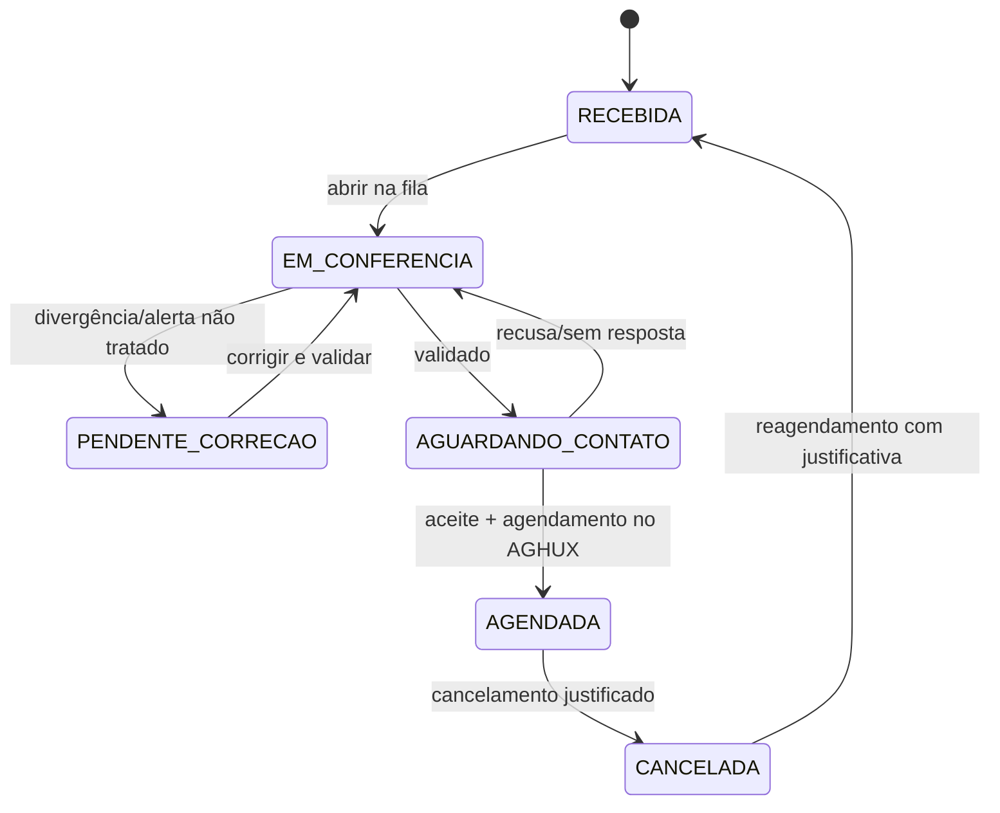
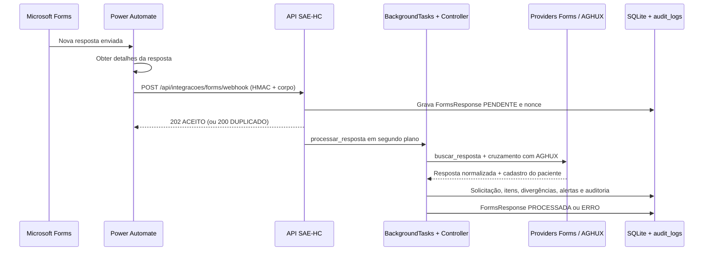
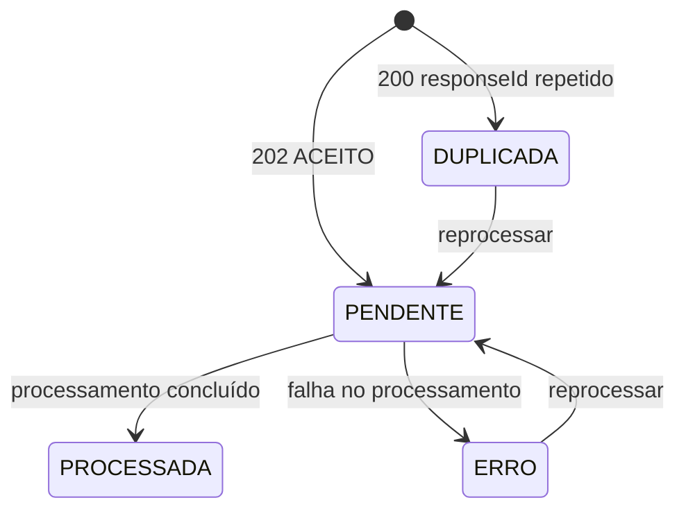

# Interfaces e Integrações — SAE-HC

## 1. Protótipos (descrição textual dos wireframes)

| Rota | Tela | Elementos principais |
| :--- | :--- | :--- |
| `/fila` | Fila de Marcação | Aviso de data de referência; cabeçalho com filtros (busca por nome/prontuário/protocolo/exame, status, tipo de exame, período); tabela compacta com colunas Posição, Prioridade, Paciente/prontuário, Exame(s), Status, Divergências e Tempo na fila; paginação de 20 em 20; clique na linha abre painel lateral. |
| `/painel` | Painel de Gestão | Cinco KPIs (pendentes, tempo médio de validação, agendados, gargalos, taxa de erro), filtros de período/tipo e gráficos de barras/linha em SVG; link para a fila. |
| `/relatorios` | Relatórios | Catálogo de relatórios, formulário de filtros, prévia tabular e botão "Exportar CSV". |
| `/criterios` | Critérios de Priorização | Grade com peso/ordem/atividade por critério, campo de justificativa, botão "Salvar nova versão" e histórico de versões. |
| `/equipe` | Equipe e Perfis | Lista de usuários locais, campo de login com botão "Consultar AD", perfil, lotação, situação ativo/inativo e histórico de alterações. |
| `/integracoes` | Integrações (Forms → AGHUX) | Lista de eventos com Response ID, formulário, status, tentativas, recebido/processado, último erro e contadores de divergências/alertas; botões "Atualizar eventos" e "Reprocessar" (habilitado para `ERRO`/`DUPLICADA`). |
| `/acesso-negado` | Acesso negado | Explicação do perfil insuficiente e link para o início. |

O menu lateral agrupa **Operação** (Fila), **Gestão** (Painel, Relatórios, Critérios, Equipe) e **Sistema** (Configurações, Integrações). Itens são filtrados pelo perfil do usuário; a versão SemVer permanece no rodapé. A tela `/integracoes` exige `AREA_GESTORA` ou `ADMIN_TI` (`meta.roles`).

## 2. Painel lateral de conferência (SolicitacaoDrawer)

Três áreas fixas:
1. **Conferência:** colunas "Formulário" e "AGHUX" com os valores campo a campo; divergências destacadas.
2. **Alertas e ações:** alertas de validação; botões "Corrigir e validar", "Registrar contato", "Efetivar agendamento", "Justificar divergência".
3. **Histórico:** linha do tempo com autor, data/hora, ação e categoria de auditoria.

Bloqueios: "Corrigir e validar" exige tratamento das divergências; "Efetivar agendamento" exige aceite registrado e validação concluída; operador não vê controles de alteração de prioridade.

## 3. Máquina de estados da solicitação



## 4. Perfis e permissões

| Perfil | Fila | Conferir/agendar | Critérios | Equipe | Painel/Relatórios |
| :--- | :---: | :---: | :---: | :---: | :---: |
| `OPERADOR` | Sim | Sim | Não | Não | Não |
| `CHEFIA` | Sim | Sim (exceções) | Não | Não | Sim |
| `AREA_GESTORA` | Sim | Não | Sim | Sim | Sim |
| `COORDENACAO` | Não | Não | Não | Não | Sim (somente leitura) |
| `ADMIN_TI` | Não | Não | Não | Sim | Sim |

## 5. Contratos de API

### 5.1 Integração Microsoft Forms → AGHUX (implementada em v0.2.0)

O Microsoft Forms **não possui webhook nativo documentado nem suporte oficial no Microsoft Graph**. Por isso, a integração usa a **abordagem híbrida**: no Power Automate, o gatilho **"Quando uma nova resposta for enviada"** é seguido da ação **"Obter detalhes da resposta"**, que envia o payload ao webhook da API. A API não oficial `forms.office.com/formapi` é apenas ponto de extensão (`FORMS_API`, hoje `NotImplementedError`), não uma fonte em produção.



**Segurança do webhook.** É a **única exceção pública** ao padrão default-private do framework: em vez de JWT, exige HMAC-SHA256 calculado sobre `timestamp . nonce . corpo_bruto` com `FORMS_WEBHOOK_SECRET`, enviado nos cabeçalhos `X-SAE-Timestamp` (Unix, em segundos), `X-SAE-Nonce` e `X-SAE-Signature` (`sha256=<hex>`). A tolerância de relógio é `WEBHOOK_MAX_SKEW_SECONDS` (padrão `300` s) e o nonce é gravado uma única vez em `webhook_nonces` para bloquear replay. Assinatura, timestamp ou nonce inválidos retornam `401`. Todos os demais routers de domínio seguem protegidos por `Depends(auth_handler.decode_token)`; os endpoints administrativos abaixo ainda exigem RBAC.

| Método | Rota | Acesso | Contrato |
| :--- | :--- | :--- | :--- |
| `POST` | `/api/integracoes/forms/webhook` | Público, assinado (HMAC) | Corpo `{ "formId", "responseId", "submittedAt"?, "resposta"? }`. `202` com `{ "status": "ACEITO", "responseId" }` e processamento via `BackgroundTasks`; `200` com `{ "status": "DUPLICADO", "responseId" }` para `responseId` já recebido; `401` para assinatura/timestamp/nonce inválidos; `400` se `formId` divergir do configurado; `422` se o corpo estiver malformado. O evento é gravado como `PENDENTE` e a resposta é imediata. |
| `GET` | `/api/integracoes/forms/eventos?limit=50` | JWT + RBAC: `GLO-SEC-HCPE-SETISD`, `AREA_GESTORA` ou `ADMIN_TI` | Retorna `Array<FormsEvento>` ordenado por `recebidoEm` decrescente; `limit` limitado a `1..200`. |
| `POST` | `/api/integracoes/forms/eventos/{responseId}/reprocessar` | JWT + RBAC: `GLO-SEC-HCPE-SETISD`, `AREA_GESTORA` ou `ADMIN_TI` | Retorna o mesmo `FormsEvento`; `404` se o evento não existir. Não cria novo evento. |

Respostas de erro seguem `{"detail": "..."}`. Os cabeçalhos de segurança HTTP do framework (`X-Content-Type-Options`, `X-Frame-Options`, `X-XSS-Protection`, `Cache-Control`, `Pragma`) continuam sendo aplicados pelo middleware.



### 5.2 Contratos de API de domínio (pendentes de implementação)

As rotas abaixo continuam documentadas para entregas seguintes; o backend implantado nesta entrega cobre apenas os endpoints da Seção 5.1. Todas exigem `Depends(auth_handler.decode_token)` no `APIRouter` e verificação de perfil no backend. Respostas de erro seguem `{"detail": "..."}`.

| Método | Rota | Perfil | Descrição |
| :--- | :--- | :--- | :--- |
| `GET` | `/api/fila` | Operador, Chefia, Área Gestora | Lista solicitações ordenadas por pontuação e data de envio; aceita `busca`, `status`, `tipoExame`, `periodo`, `page` e `pageSize` (padrão `20`). Resposta paginada: `{ itens, total, pagina, porPagina, totalPaginas }`. |
| `GET` | `/api/solicitacoes/{id}` | Operador, Chefia, Área Gestora | Detalhe com campos comparados, alertas, divergências e agendamento. |
| `GET` | `/api/solicitacoes/{id}/historico` | Operador, Chefia, Área Gestora, Coordenação (leitura) | Trilha cronológica da solicitação. |
| `POST` | `/api/solicitacoes/{id}/validacao` | Operador, Chefia | Correção/validação com assinatura eletrônica; `400` com divergências sem tratamento. |
| `POST` | `/api/solicitacoes/{id}/contatos` | Operador, Chefia | Registra aceite, recusa ou sem resposta. |
| `POST` | `/api/solicitacoes/{id}/agendamento` | Operador, Chefia | Efetiva a marcação; `422` sem aceite, `409` em conflito. |
| `POST` | `/api/solicitacoes/{id}/fila-excecao` | Área Gestora | Altera posição com justificativa obrigatória; `400` sem justificativa. |
| `GET` | `/api/painel/indicadores` | Chefia, Área Gestora, Coordenação | KPIs e séries do período. |
| `GET` | `/api/relatorios/{relatorioId}` | Chefia, Área Gestora, Coordenação | Linhas filtradas para prévia/CSV. |
| `GET` | `/api/criterios-priorizacao` | Todos os perfis internos | Critérios da versão vigente e histórico de versões. |
| `POST` | `/api/criterios-priorizacao/versoes` | Área Gestora | Salva nova versão com justificativa. |
| `GET` | `/api/admin/equipe` | Área Gestora, Admin TI | Usuários locais e perfis. |
| `POST` | `/api/admin/equipe` | Área Gestora, Admin TI | Cria vínculo local após validação no AD. |
| `PATCH` | `/api/admin/equipe/{id}` | Área Gestora, Admin TI | Altera perfil ou situação (soft delete). |
| `GET` | `/api/admin/ad-user-search/{username}` | Área Gestora, Admin TI | Consulta prévia no AD (endpoint do framework). |

### [SCHEMA] Contratos TypeScript da integração (implementados)

```typescript
// Corpo enviado pelo Power Automate (POST /api/integracoes/forms/webhook).
interface FormsWebhookPayload {
  formId: string;
  responseId: string;
  submittedAt?: string;
  resposta?: Record<string, unknown>;
}

// Resumo sem PHI devolvido pelos endpoints administrativos.
type StatusFormsEvento = 'PENDENTE' | 'PROCESSADA' | 'DUPLICADA' | 'ERRO';

interface FormsEvento {
  responseId: string;
  formId: string;
  status: StatusFormsEvento;
  tentativas: number;
  ultimoErro: string | null;
  recebidoEm: string;
  processadoEm: string | null;
  solicitacaoId: string | null;
  divergencias: number;
  alertas: number;
}
```

Os tipos vivem em `frontend/src/types/sae.ts`, o estado em `frontend/src/stores/integracoes.ts` e as chamadas em `frontend/src/services/sae.ts`, sempre pelo interceptor de `frontend/src/services/api.ts`.

### [SCHEMA] Resposta paginada da fila (mocks e API)

```typescript
interface ResultadoFila {
  itens: Solicitacao[]; // 20 por página, da maior para a menor pontuação
  total: number;        // 493 no export AGHUX atual
  pagina: number;       // 1-based
  porPagina: number;    // 20
  totalPaginas: number; // 25 no export AGHUX atual
}
```

`periodo` (`24`, `72`, `168`, `720` ou `todos`) é calculado em relação a `referenciaEm` (`2026-09-28T16:05:34.227`) enquanto `VITE_USE_MOCKS=true`. A busca inclui `prontuario` e `codigoSolicitacaoAghux`. Solicitações com mais de um `codigo_exame` no export aparecem uma única vez, com `itensExame[]`.

### [SCHEMA] Interface de integração alvo (não implementada)

```typescript
interface IAghuxApi {
  getPatientData(cns: string): Promise<PatientRecord>;
  checkScheduleConflict(cns: string, dateTime: string): Promise<boolean>;
  createAppointment(data: AppointmentRequest): Promise<Appointment>;
}

interface IExternalFormApi {
  receiveSubmissions(payload: FormSubmission[]): Promise<Solicitacao[]>;
}
```

`AghuxJsonProvider` implementa somente a busca por prontuário e por código da solicitação na fixture versionada. `getPatientData`, `checkScheduleConflict`, `createAppointment`, `receiveSubmissions`, os providers `AGHU` e `FORMS_API` e o agendamento real são contratos/pontos de extensão futuros, **não disponíveis nesta entrega**.

## 6. Hardware e integrações
- Impressoras térmicas e leitores de código de barras: **fora de escopo** nesta entrega.
- Integração Forms → AGHUX: **implementada em v0.2.0** pela abordagem híbrida da Seção 5.1 (Power Automate → webhook assinado), com cruzamento contra a fixture real do AGHUX e geração de divergências/alertas antes da entrada na fila.
- Consulta real ao AGHU, agendamento efetivo, notificações ao paciente e pull por `forms.office.com/formapi`: **não implementados**; permanecem para entrega futura. As telas operacionais continuam lendo o adaptador de mocks (`VITE_USE_MOCKS`).
