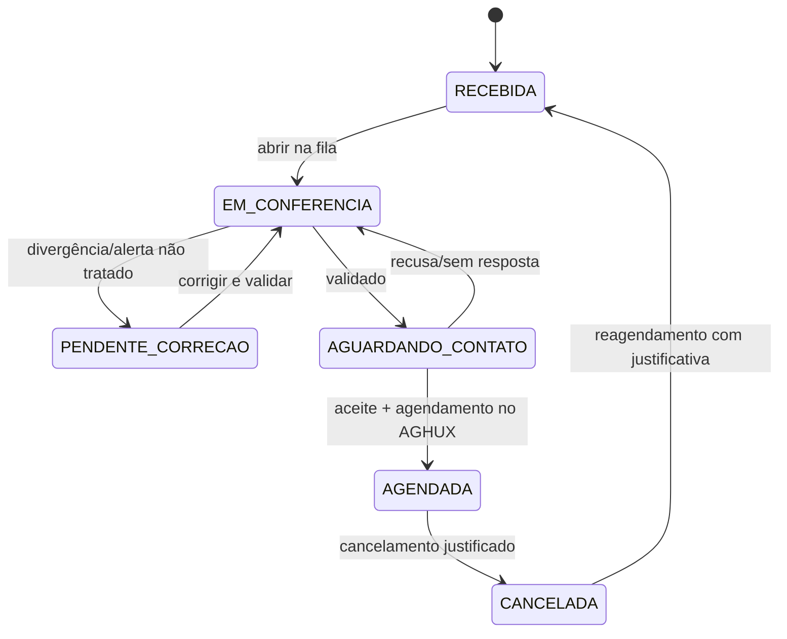

# Interfaces e Integrações — SAE-HC

## 1. Protótipos (descrição textual dos wireframes)

| Rota | Tela | Elementos principais |
| :--- | :--- | :--- |
| `/fila` | Fila de Marcação | Aviso de data de referência; cabeçalho com filtros (busca por nome/prontuário/protocolo/exame, status, tipo de exame, período); tabela compacta com colunas Posição, Prioridade, Paciente/prontuário, Exame(s), Status, Divergências e Tempo na fila; paginação de 20 em 20; clique na linha abre painel lateral. |
| `/painel` | Painel de Gestão | Cinco KPIs (pendentes, tempo médio de validação, agendados, gargalos, taxa de erro), filtros de período/tipo e gráficos de barras/linha em SVG; link para a fila. |
| `/relatorios` | Relatórios | Catálogo de relatórios, formulário de filtros, prévia tabular e botão "Exportar CSV". |
| `/criterios` | Critérios de Priorização | Grade com peso/ordem/atividade por critério, campo de justificativa, botão "Salvar nova versão" e histórico de versões. |
| `/equipe` | Equipe e Perfis | Lista de usuários locais, campo de login com botão "Consultar AD", perfil, lotação, situação ativo/inativo e histórico de alterações. |
| `/acesso-negado` | Acesso negado | Explicação do perfil insuficiente e link para o início. |

O menu lateral agrupa **Operação** (Fila), **Gestão** (Painel, Relatórios, Critérios, Equipe) e **Sistema** (Configurações). Itens são filtrados pelo perfil do usuário; a versão SemVer permanece no rodapé.

## 2. Painel lateral de conferência (SolicitacaoDrawer)

Três áreas fixas:
1. **Conferência:** colunas "Formulário" e "AGHUX" com os valores campo a campo; divergências destacadas.
2. **Alertas e ações:** alertas de validação; botões "Corrigir e validar", "Registrar contato", "Efetivar agendamento", "Justificar divergência".
3. **Histórico:** linha do tempo com autor, data/hora, ação e categoria de auditoria.

Bloqueios: "Corrigir e validar" exige tratamento das divergências; "Efetivar agendamento" exige aceite registrado e validação concluída; operador não vê controles de alteração de prioridade.

## 3. Máquina de estados da solicitação



## 4. Perfis e permissões

| Perfil | Fila | Conferir/agendar | Critérios | Equipe | Painel/Relatórios |
| :--- | :---: | :---: | :---: | :---: | :---: |
| `OPERADOR` | Sim | Sim | Não | Não | Não |
| `CHEFIA` | Sim | Sim (exceções) | Não | Não | Sim |
| `AREA_GESTORA` | Sim | Não | Sim | Sim | Sim |
| `COORDENACAO` | Não | Não | Não | Não | Sim (somente leitura) |
| `ADMIN_TI` | Não | Não | Não | Sim | Sim |

## 5. Contratos de API (para a entrega de backend)

Todas as rotas abaixo exigem `Depends(auth_handler.decode_token)` no `APIRouter` e verificação de perfil no backend. Respostas de erro seguem `{"detail": "..."}`.

| Método | Rota | Perfil | Descrição |
| :--- | :--- | :--- | :--- |
| `GET` | `/api/fila` | Operador, Chefia, Área Gestora | Lista solicitações ordenadas por pontuação e data de envio; aceita `busca`, `status`, `tipoExame`, `periodo`, `page` e `pageSize` (padrão `20`). Resposta paginada: `{ itens, total, pagina, porPagina, totalPaginas }`. |
| `GET` | `/api/solicitacoes/{id}` | Operador, Chefia, Área Gestora | Detalhe com campos comparados, alertas, divergências e agendamento. |
| `GET` | `/api/solicitacoes/{id}/historico` | Operador, Chefia, Área Gestora, Coordenação (leitura) | Trilha cronológica da solicitação. |
| `POST` | `/api/solicitacoes/{id}/validacao` | Operador, Chefia | Correção/validação com assinatura eletrônica; `400` com divergências sem tratamento. |
| `POST` | `/api/solicitacoes/{id}/contatos` | Operador, Chefia | Registra aceite, recusa ou sem resposta. |
| `POST` | `/api/solicitacoes/{id}/agendamento` | Operador, Chefia | Efetiva a marcação; `422` sem aceite, `409` em conflito. |
| `POST` | `/api/solicitacoes/{id}/fila-excecao` | Área Gestora | Altera posição com justificativa obrigatória; `400` sem justificativa. |
| `GET` | `/api/painel/indicadores` | Chefia, Área Gestora, Coordenação | KPIs e séries do período. |
| `GET` | `/api/relatorios/{relatorioId}` | Chefia, Área Gestora, Coordenação | Linhas filtradas para prévia/CSV. |
| `GET` | `/api/criterios-priorizacao` | Todos os perfis internos | Critérios da versão vigente e histórico de versões. |
| `POST` | `/api/criterios-priorizacao/versoes` | Área Gestora | Salva nova versão com justificativa. |
| `GET` | `/api/admin/equipe` | Área Gestora, Admin TI | Usuários locais e perfis. |
| `POST` | `/api/admin/equipe` | Área Gestora, Admin TI | Cria vínculo local após validação no AD. |
| `PATCH` | `/api/admin/equipe/{id}` | Área Gestora, Admin TI | Altera perfil ou situação (soft delete). |
| `GET` | `/api/admin/ad-user-search/{username}` | Área Gestora, Admin TI | Consulta prévia no AD (endpoint do framework). |

### [SCHEMA] Resposta paginada da fila (mocks e API)

```typescript
interface ResultadoFila {
  itens: Solicitacao[]; // 20 por página, da maior para a menor pontuação
  total: number;        // 493 no export AGHUX atual
  pagina: number;       // 1-based
  porPagina: number;    // 20
  totalPaginas: number; // 25 no export AGHUX atual
}
```

`periodo` (`24`, `72`, `168`, `720` ou `todos`) é calculado em relação a `referenciaEm` (`2026-09-28T16:05:34.227`) enquanto `VITE_USE_MOCKS=true`. A busca inclui `prontuario` e `codigoSolicitacaoAghux`. Solicitações com mais de um `codigo_exame` no export aparecem uma única vez, com `itensExame[]`.

### [SCHEMA] Interface de integração (TypeScript)

```typescript
interface IAghuxApi {
  getPatientData(cns: string): Promise<PatientRecord>;
  checkScheduleConflict(cns: string, dateTime: string): Promise<boolean>;
  createAppointment(data: AppointmentRequest): Promise<Appointment>;
}

interface IExternalFormApi {
  receiveSubmissions(payload: FormSubmission[]): Promise<Solicitacao[]>;
}
```

## 6. Hardware e integrações
- Impressoras térmicas e leitores de código de barras: **fora de escopo** nesta entrega.
- Integração real com AGHU/AGHUX e com o formulário externo: **entrega futura** (Fase 4 de `SPEC.md`); nas telas atuais os dados vêm do adaptador de mocks.
