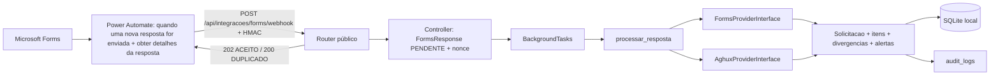
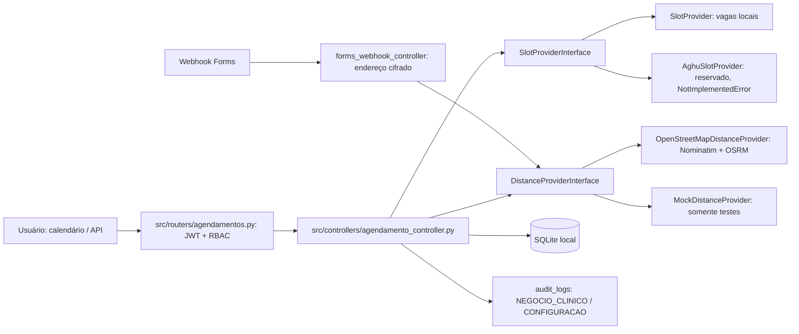

# Arquitetura e Segurança — SAE-HC

## 1. Stack Técnica
- **Backend:** Python 3.12+, FastAPI, SQLAlchemy 2.0, PostgreSQL (AGHU) e SQLite local (`data/app.db`), Alembic. A Fase 4 acrescentou **`cryptography>=42`** (AES-GCM de CPF/CNS) e a Fase 5 usa **`httpx>=0.27`** (já presente no projeto) para Nominatim/OSRM — nenhum pacote backend novo é instalado na v0.7.0.
- **Frontend:** Vue 3 (Composition API + TypeScript), Vite, Pinia, Vue Router, Tailwind CSS via `@tailwindcss/vite`, Heroicons e vue-toastification. A v0.3.0 adicionou **FullCalendar Vue 3 v6** (`@fullcalendar/core`, `@fullcalendar/vue3`, `@fullcalendar/daygrid`, `@fullcalendar/timegrid`, `@fullcalendar/interaction`) para as visões mês/semana; a v0.4.0 reaproveita essa stack, a v0.5.0 a mantém e a v0.6.0 a reutiliza no gestor de vagas, sem pacote premium Scheduler.
- **Componentes reutilizáveis do framework:** `Card`, `Button`, `Modal`, `DataTable`, `ProfileDropdown`, `LoadingIndicator`; interceptadores de Axios em `frontend/src/services/api.ts` devem ser preservados. A v0.4.0 acrescenta `ColumnMenu`, `ModalVagasDia` e `PainelPropostas`; a v0.5.0 reescreve `PainelPropostas` como tabela de fila e amplia `GestorVagas` com edição completa da disponibilidade do exame; a v0.6.0 acrescenta `CalendarioVagas` e redesenha `GestorVagas` com linha de exames, seleção de dia, remoção e cópia semanal (o `Modal` passa a aceitar largura `2xl`).
- As **únicas dependências npm autorizadas nesta entrega** continuam sendo os cinco pacotes FullCalendar v6 acima; gráficos do painel seguem desenhados em SVG/CSS.

## 2. Arquitetura em Camadas
O fluxo do backend permanece unidirecional: **SQL Template → Resource → Provider → Controller → Router**. A Fase 4 começou com `src/routers/integracoes.py`: o roteador administrativo declara `dependencies=[Depends(auth_handler.decode_token)]` e o roteador público do webhook é registrado separadamente, protegido por HMAC. A Fase 5 acrescenta `src/routers/agendamentos.py`, com três `APIRouter`s protegidos por JWT no construtor (`/api/agendamentos`, `/api/solicitacoes` para validação/contato e `/api/admin/agenda` para vagas). Além de `/api/login` e `/api/health`, a única exceção pública documentada ao default-private é `POST /api/integracoes/forms/webhook`; os demais routers de domínio continuam exigindo JWT.

No frontend, o fluxo é **View → Store (Pinia) → Service → Adaptador (mock ou `api.ts`)**:
- `frontend/src/types/sae.ts`: contratos TypeScript compartilhados.
- `frontend/src/mocks/fixtures.ts`: mapeia o fixture AGHUX para `Solicitacao` e mantém o estado mutável em memória.
- `frontend/src/mocks/dadosAghux.json`: fixture estático com 493 solicitações do CSV de apoio (576 itens) e 30 solicitações simuladas recentes; `referenciaEm` é `2026-11-25T16:05:34.227`.
- `scripts/importar_dados_aghux.py`: importador em Python stdlib (`csv`, `json`, `datetime`), sem novas dependências; o CSV usa aspas em dois níveis e é decodificado com `csv.reader` duas vezes. Ao reimportar, preserva as solicitações `SIM-*` já presentes no fixture.
- `scripts/gerar_solicitacoes_simuladas.py`: gerador em Python stdlib com semente fixa (`20261125`) que substitui o lote `SIM-*` por 30 solicitações fictícias com datas de 16 a 25/11/2026, derivando unidades, exames, solicitantes e cidades do próprio export; não cria CPF/CNS/endereço. O importador chama sua rotina de mesclagem para não apagar o cenário.
- `frontend/src/config/tempo.ts`: data de referência do fixture (`2026-11-25T16:05:34.227`, reancorada a partir do export original `2026-09-28T16:05:34.227`) usada como "agora" nos mocks para prazos, filtros, tempo na fila e navegação dos calendários (`initialDate`/`now`, inclusive o botão "Hoje"); com a API real, `agoraIso()` usa o relógio local do navegador.
- `frontend/src/services/sae.ts`: expõe as mesmas funções para mocks ou API real; aplica filtros (inclusive `unidadeSolicitante`), ordenação e paginação de 20 em 20 e, desde a v0.4.0, as funções da agenda, das vagas e das propostas; na v0.5.0 inclui `listarPropostasAgendamento()` e `gerarPropostasAgendamento()` com retorno ordenado e ocupação contabilizada no próprio loop; na v0.6.0 inclui `removerSlotAdmin()` e `copiarSemanaAdmin()` com os mesmos contratos da API; na v0.7.0 inclui `moverPropostaAgendamento()` para arrastar e soltar propostas de horário no calendário.
- `frontend/src/stores/*.ts`: estado, carregamento e erro consumidos pelas views, incluindo `stores/agendamentos.ts` (calendário, busca sob demanda, paciente, sugestões, propostas e mutações).
- `frontend/src/components/agendamentos/*.vue`: calendário FullCalendar, popup de vagas do dia, painel de propostas, painel do paciente, modais de sugestão/remarcação e gestão de vagas; `ColumnMenu.vue` controla a visibilidade das colunas da fila.

### Adaptador de mocks
- Variável: `VITE_USE_MOCKS` em `frontend/.env.example`. Padrão: `true` (mocks ativos); `false` direciona as chamadas para o backend.
- O adaptador simula latência, ordenação pela pontuação dos critérios ativos, paginação de 20 em 20, persistência em memória das alterações de critérios/equipe e registro de eventos no histórico.
- Dados de origem: as solicitações vêm do export do AGHUX em `Documentos de Apoio/`; nomes já vêm anonimizados e o export não contém CPF/CNS. A pasta de documentos de apoio não é versionada nem necessária em tempo de execução — o fixture JSON gerado é suficiente.
- A agenda em mocks usa slots determinísticos a partir de `REFERENCIA_EM` (30 dias úteis, turnos `08:00–12:00` e `13:00–17:00`, capacidade `3..5` por unidade/exame), ocupação sempre recalculada sobre agendamentos `ATIVO` e propostas `PROPOSTO`, distância fixa de `12,5 km` e nenhum endereço de paciente. Mutações validam capacidade, exame específico e conflito antes de alterar o estado em memória. A simulação decrementa a ocupação de cada vaga escolhida durante o loop, bloqueia outro horário do mesmo paciente na mesma data e não reabre vagas fechadas manualmente pela chefia.
- Trocar para o backend não exige alterar views ou stores — apenas a variável e, para as demais telas, a implementação dos endpoints pendentes em `05-interfaces.md`.

### Integração Microsoft Forms → AGHUX (v0.2.0)

O Microsoft Forms não oferece webhook nativo documentado nem suporte oficial via Microsoft Graph; a API não oficial `forms.office.com/formapi` é apenas ponto de extensão (`FORMS_API`, com `NotImplementedError`). O caminho implantado é o híbrido:

**Provedores** (fábricas em `src/dependencies.py`):

| Interface | Implementação | Comportamento |
| :--- | :--- | :--- |
| `FormsProviderInterface` | `MockFormsProvider` (padrão) | Usa o payload do webhook quando presente e completa campos ausentes; determinístico para desenvolvimento/testes. |
| `FormsProviderInterface` | `PowerAutomateFormsProvider` | Normaliza exclusivamente o payload da ação "Obter detalhes da resposta"; não inventa valores e falha sem payload. |
| `FormsProviderInterface` | `FormsApiProvider` | Reservado ao pull via API não oficial; `NotImplementedError`. |
| `AghuxProviderInterface` | `AghuxJsonProvider` (padrão) | Lê `frontend/src/mocks/dadosAghux.json` via `AGHUX_FIXTURE_PATH` (493 solicitações do export + 30 simuladas) e indexa prontuário e código da solicitação. |
| `AghuxProviderInterface` | `AghuProvider` | Reservado ao PostgreSQL do AGHU; `NotImplementedError`. |

**Segurança do webhook.** HMAC-SHA256 sobre `timestamp . nonce . corpo_bruto` (`FORMS_WEBHOOK_SECRET`), cabeçalhos `X-SAE-Timestamp`, `X-SAE-Nonce` e `X-SAE-Signature` (`sha256=<hex>`), janela `WEBHOOK_MAX_SKEW_SECONDS` (padrão `300` s) e nonce único em `webhook_nonces` (anti-replay). Falhas retornam `401`. O evento é gravado como `PENDENTE` e respondido de imediato; o processamento corre em `BackgroundTasks` e termina em `PROCESSADA`, `DUPLICADA` ou `ERRO`. Os endpoints administrativos exigem JWT e os grupos/perfis `GLO-SEC-HCPE-SETISD`, `AREA_GESTORA` ou `ADMIN_TI`; a tela `/integracoes` fica no grupo **Sistema** com as mesmas restrições.

**Configuração (`.env.example` / `src/config.py`):**

| Variável | Padrão / finalidade |
| :--- | :--- |
| `FORMS_WEBHOOK_SECRET` | Vazio; segredo HMAC compartilhado com o Power Automate, obrigatório em produção. |
| `WEBHOOK_MAX_SKEW_SECONDS` | `300`; tolerância máxima do timestamp do webhook. |
| `FORMS_PROVIDER_TYPE` | `MOCK`; opções `MOCK`, `POWER_AUTOMATE` e `FORMS_API` (reservado). |
| `FORMS_API_BASE_URL` | `https://forms.office.com/formapi/api`; usada apenas pelo ponto de extensão. |
| `FORMS_FORM_ID` | Vazio; quando preenchido, o `formId` do webhook precisa corresponder. |
| `FORMS_FIELD_MAP` | Mapa padrão de apelidos das perguntas; pode ser sobrescrito por JSON. |
| `AGHUX_PROVIDER_TYPE` | `JSON`; opções `JSON` e `AGHU` (reservado). |
| `AGHUX_FIXTURE_PATH` | `frontend/src/mocks/dadosAghux.json`; fonte do cruzamento atual. |
| `PHI_ENCRYPTION_KEY` | Vazio; base64 de 32 bytes, obrigatória em produção. |

Em `ENV=production`, segredos com valor padrão (`JWT_SECRET`, `FORMS_WEBHOOK_SECRET`) disparam erro crítico e os provedores `MOCK`/`JSON` geram aviso crítico em `src/config.py`.

**Criptografia e PHI.** `src/helpers/crypto_helper.py` usa AES-GCM (`cryptography`) com nonce de 96 bits e prefixo `v1:`; `hash_phi()` gera HMAC-SHA256 para deduplicação e `mask_phi()` mantém apenas os últimos 4 dígitos (`***.8909`). Em produção a chave vem de `PHI_ENCRYPTION_KEY` (base64 de 32 bytes); em desenvolvimento é derivada de `JWT_SECRET` apenas para testes. CPF/CNS nunca aparecem em claro em payload, auditoria (`to_dict_seguro()` remove as chaves sensíveis), logs ou respostas da API; um formulário sem CPF/CNS não inventa valores.

**Priorização.** Urgência clínica e idade permanecem neutras (`5`); o tempo de espera deriva de `recebida_em` (`min(10, round(horas/144))`) e a complexidade vem da sigla do exame, pela mesma regra dos mocks. Pesos `40/25/20/15`, pontuação `round(soma/10)` limitada a `0..100`, com limites `ALTA >= 70` e `MEDIA >= 40`.

**Persistência.** A migração Alembic `c4f1a7d9e2b3` (revises `8a2efbe37bb6`) cria `forms_responses`, `webhook_nonces`, `solicitacoes`, `solicitacao_itens_exame`, `divergencias` e `alertas`. A migração `e7c1a9d4b3f2` (revises `c4f1a7d9e2b3`) cria `agenda_slots`, `agendamentos`, `contatos_paciente` e `paciente_enderecos` e adiciona `solicitacoes.paciente_chave`. Todas as entidades editáveis usam `deleted_at`; `audit_logs` é somente inserção.

### Gestão de agendamentos, propostas, vagas e distância (v0.7.0)

| Interface | Implementação | Comportamento |
| :--- | :--- | :--- |
| `SlotProviderInterface` | `SlotProvider` (padrão) | Lê/cria/ajusta/remove (soft delete) vagas em `agenda_slots` na sessão SQLite; calcula `ocupadas` a partir de agendamentos `ATIVO` e propostas `PROPOSTO`, inclusive de outros pacientes. A cópia semanal reusa `listar()` e `criar()` no controller, sem novo método no provedor. |
| `SlotProviderInterface` | `AghuSlotProvider` | Reservado ao AGHU; `NotImplementedError`. Nenhuma vaga real do AGHUX é prometida nesta entrega. |
| `DistanceProviderInterface` | `OpenStreetMapDistanceProvider` (padrão) | Nominatim para geocodificar o endereço e OSRM para a rota até o hospital; `httpx` com timeout, `User-Agent`, cache em memória por hash do endereço com TTL (somente sucessos). Logs registram apenas o hash, nunca o endereço. Falha → `INDISPONIVEL`, sem coordenadas inventadas e sem cachear a indisponibilidade. |
| `DistanceProviderInterface` | `MockDistanceProvider` | Distância determinística (`MOCK_DISTANCE_KM`, padrão `12,5`) apenas com `DISTANCE_PROVIDER_TYPE=MOCK`; em produção essa configuração é rejeitada. |

**Configuração adicional** (`.env.example` seção 7 e `src/config.py`): `DISTANCE_PROVIDER_TYPE` (`OSM`/`MOCK`), `OSM_NOMINATIM_URL`, `OSM_OSRM_URL`, `OSM_USER_AGENT`, `HOSPITAL_LATITUDE`, `HOSPITAL_LONGITUDE`, `DISTANCE_TIMEOUT_SECONDS`, `DISTANCE_CACHE_TTL_HOURS`, `MOCK_DISTANCE_KM`, `AGENDA_SUGGESTION_HORIZON_DAYS`, `AGENDA_SUGGESTION_LIMIT` e os pesos `AGENDA_WEIGHT_PRIORIDADE` (`35`), `AGENDA_WEIGHT_VAGAS` (`15`), `AGENDA_WEIGHT_COMPATIBILIDADE` (`20`), `AGENDA_WEIGHT_ESPERA` (`20`) e `AGENDA_WEIGHT_DISTANCIA` (`10`). Em produção, `User-Agent` placeholder, coordenadas vazias ou `DISTANCE_PROVIDER_TYPE=MOCK` geram erro/aviso crítico na inicialização.

**Regras no controller, não no frontend.** Agendar exige solicitação em `AGUARDANDO_CONTATO`, `AGUARDANDO_CONFIRMACAO` ou `AGUARDANDO_REAGENDAMENTO` (`AGENDADA` apenas na remarcação), contato com `ACEITE`, divergências tratadas, vaga livre e futura, exame específico da solicitação e ausência de agendamento `ATIVO` ou proposta `PROPOSTO` do mesmo `pacienteChave` no intervalo. A simulação de 30 dias cria propostas `PROPOSTO` que reservam vaga; a vaga ocupada por uma proposta gerada na própria execução é contada antes de alocar a solicitação seguinte, evitando concentrar todos os pacientes no primeiro horário. `GET /api/agendamentos/propostas` e o campo `propostas` da simulação devolvem a fila pendente ordenada por pontuação, `recebida_em` e protocolo, sem endereço ou PHI. Somente `POST /api/agendamentos/{id}/confirmar` passa a proposta para `ATIVO` e a solicitação para `AGENDADA`. Não confirmação/cancelamento de proposta exigem justificativa e devolvem a solicitação para `AGUARDANDO_REAGENDAMENTO`. A edição de vagas pela Chefia aceita `situacao` ou `status` e rejeita capacidade menor que a ocupação atual. A remoção de vaga usa soft delete e só é permitida sem agendamentos `ATIVO`/`PROPOSTO`; a cópia semanal normaliza origem/destino para a segunda-feira da semana, preserva dia da semana/horário/unidade/exame/capacidade/situação e ignora vagas já existentes no destino. Ambas passam pelo RBAC do `admin_router` e registram auditoria `CONFIGURACAO` com IP e estados anterior/posterior. Remarcar/cancelar devolvem a vaga antiga na mesma transação e registram auditoria `NEGOCIO_CLINICO` com IP e estados anterior/posterior. A sugestão usa filtros duros e score `0..100`; distância é desempate e nunca supera prioridade clínica.

## 3. Conformidade LGPD e Privacidade
- CPF/CNS criptografados com AES-GCM no backend (v0.2.0); no frontend de mocks, nenhum CPF/CNS é exibido ou inventado, pois o export de apoio não contém esses campos. O provedor `PowerAutomateFormsProvider` também não inventa valores; apenas o `MockFormsProvider` completa campos não sensíveis ausentes.
- Endereço do formulário (CEP, logradouro, número, complemento, bairro) é cifrado com AES-GCM em `paciente_enderecos`; cidade/UF e a distância em km podem aparecer na tela, mas o endereço completo nunca aparece em API, auditoria, log ou relatório. `to_dict_seguro()` remove chaves de endereço mesmo quando vierem de um payload inesperado; a auditoria registra apenas `enderecoInformado` (booleano).
- Coleta mínima de dados; painel de conferência é o único local com dados completos simulados e a API de eventos devolve somente resumo sem PHI. A busca de pacientes da agenda devolve apenas `pacienteChave` (HMAC), nome, prontuário e contador de agendamentos ativos.
- Trilha de auditoria imutável em `audit_logs` (`usuario`, `categoria`, `acao`, `recurso`, `dados_anteriores`, `dados_novos`, `ip_origem`), com categorias `SEGURANCA`, `NEGOCIO_CLINICO`, `CONFIGURACAO`.

## 4. Acessos (RBAC híbrido)
1. **Autenticação:** AD/LDAP Ebserh (Mock em desenvolvimento) valida identidade e senha corporativas.
2. **Autorização:** `USUARIO_PERFIL` no banco local define `AREA_GESTORA`, `OPERADOR`, `CHEFIA`, `COORDENACAO` ou `ADMIN_TI`; usuário inativo não entra mesmo com senha correta do AD.
3. O frontend usa `meta.roles` nas rotas e filtra o menu, mas a autoridade é sempre validada no backend.
4. Endpoints administrativos de integrações (`/api/integracoes/forms/eventos` e reprocessamento) exigem JWT e um dos grupos/perfis `GLO-SEC-HCPE-SETISD`, `AREA_GESTORA` ou `ADMIN_TI`; a tela `/integracoes` está visível apenas para `AREA_GESTORA`/`ADMIN_TI`.
4.1. Agendamentos (v0.7.0): leitura para `OPERADOR`, `CHEFIA`, `AREA_GESTORA`, `ADMIN_TI`, `COORDENACAO` e `GLO-SEC-HCPE-SETISD`; escrita — incluindo gerar, confirmar, cancelar e mover (arrastar/soltar) propostas — para todos exceto `COORDENACAO`; administração de vagas (`/api/admin/agenda/slots` e `/api/admin/agenda/copiar-semana`) para `CHEFIA`, `AREA_GESTORA`, `ADMIN_TI` e `GLO-SEC-HCPE-SETISD`. A tela `/agendamentos` usa as mesmas regras em `meta.roles` e esconde ações para `COORDENACAO`, mas o backend é a fonte de verdade.
5. `POST /api/integracoes/forms/webhook` é a única exceção pública: a identidade do chamador é substituída por HMAC-SHA256, timestamp e nonce válidos.

## 5. Guardrails para IA (SDD)

### Escopo Positivo (o que fazer)
- Documentar funções complexas com JSDoc/TSDoc.
- Tratar erros com mensagens padronizadas (`{"detail": "..."}` no backend) e estados de erro explícitos no frontend.
- Criar testes para cada nova funcionalidade de backend (`pytest`); validar o frontend com `npm run build` e checklist manual nesta entrega.
- Executar o auditor arquitetural ao final: `python -c "import audit_framework as a; a.ENDC=''; a.FrameworkAuditor('.').run()"` (o arquivo `audit_framework.py` não é alterado nesta entrega).

### Escopo Negativo (o que NÃO fazer - Anti-Patterns)
- **No Hard Deletes:** proibido `DELETE` físico; usar `deleted_at`.
- **No Secrets in Code:** nenhuma credencial ou chave no código; usar `.env`/`frontend/.env.example`, inclusive `FORMS_WEBHOOK_SECRET` e `PHI_ENCRYPTION_KEY`.
- **No Refactoring Unasked:** não alterar infraestrutura ou configuração global sem instrução explícita no `SPEC.md`.
- **No New Dependencies:** não instalar bibliotecas não listadas neste documento. As únicas dependências acrescentadas até aqui são `cryptography>=42` no backend (v0.2.0) e os cinco pacotes FullCalendar v6 no frontend (v0.3.0); `httpx>=0.27` já estava no projeto. Pacote premium Scheduler e bibliotecas de mapas/métricas não são autorizadas.
- **No Manual Reprioritization:** operador nunca altera posição na fila; Área Gestora só com justificativa e auditoria.
- **No Fake PHI:** nunca inventar CPF/CNS; quando ausentes, permanecem nulos e mascarados, sem exposição em logs ou respostas.
- **No Unimplemented Promises:** `AGHU` e `FORMS_API` são pontos de extensão reservados; não documentar agendamento real no AGHU, notificações, pull oficial do Forms ou tag de produção como entregues. A v0.7.0 confirma operacionalmente apenas na base local do SAE-HC; nenhuma proposta, confirmação ou configuração de vaga é enviada ao AGHUX.
- **No Fake Distance:** não estimar coordenadas ou quilometragem quando a geocodificação/rota falhar; registrar `INDISPONIVEL` e manter `distanciaKm` nulo.

## 6. Versão e verificação da entrega
- Versão `v0.7.0` em `src/version.py`, com fallback `0.7.0` em `frontend/src/config/version.ts` e exibição no rodapé do layout; **nenhuma tag de produção foi criada nesta entrega**.
- Suíte pytest com **51 testes aprovados**: HMAC válido/inválido, janela de skew, replay de nonce, idempotência de `responseId`, RBAC, reprocessamento, alerta sem correspondência no AGHUX, cripto de CPF, capacidade, conflito do mesmo paciente, transições de contato, simulação de propostas distribuída e ordenada, criação/edição/remoção de vagas pela Chefia, cópia semanal idempotente, geração reproduzível do cenário recente, confirmação/não confirmação, movimento de proposta (arrastar e soltar) com validação de vaga, exame e RBAC, cards de proposta com drag-and-drop, remarcação/cancelamento com devolução de vaga, sugestão com exame específico, busca sem PHI e não exposição de endereço.
- `npm run build` concluído sem erros de tipo; gráficos do painel continuam em SVG/CSS e as únicas dependências npm adicionadas são os cinco pacotes FullCalendar v6.
- Auditoria arquitetural **11/11 (100%, EXCELENTE)** executada pelo shim em memória `python -c "import audit_framework as a; a.ENDC=''; a.FrameworkAuditor('.').run()"`, sem alterar `audit_framework.py`.
