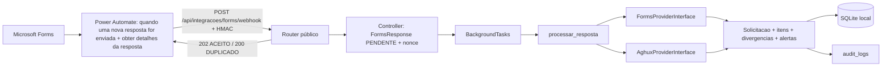

# Arquitetura e Segurança — SAE-HC

## 1. Stack Técnica
- **Backend:** Python 3.12+, FastAPI, SQLAlchemy 2.0, PostgreSQL (AGHU) e SQLite local (`data/app.db`), Alembic. A Fase 4 acrescenta a dependência **`cryptography>=42`** (AES-GCM de CPF/CNS), instalada via `uv`, e coloca em operação o roteador de integrações.
- **Frontend:** Vue 3 (Composition API + TypeScript), Vite, Pinia, Vue Router, Tailwind CSS via `@tailwindcss/vite`, Heroicons e vue-toastification.
- **Componentes reutilizáveis do framework:** `Card`, `Button`, `Modal`, `DataTable`, `ProfileDropdown`, `LoadingIndicator`; interceptadores de Axios em `frontend/src/services/api.ts` devem ser preservados.
- **Nenhuma dependência npm nova** é adicionada nesta entrega; gráficos do painel seguem desenhados em SVG/CSS. A única dependência externa nova é a do backend, listada acima.

## 2. Arquitetura em Camadas
O fluxo do backend permanece unidirecional: **SQL Template → Resource → Provider → Controller → Router**. A Fase 4 começou com `src/routers/integracoes.py`: o roteador administrativo declara `dependencies=[Depends(auth_handler.decode_token)]` e o roteador público do webhook é registrado separadamente, protegido por HMAC. Além de `/api/login` e `/api/health`, a única exceção pública documentada ao default-private é `POST /api/integracoes/forms/webhook`; os demais routers de domínio continuam exigindo JWT.

No frontend, o fluxo é **View → Store (Pinia) → Service → Adaptador (mock ou `api.ts`)**:
- `frontend/src/types/sae.ts`: contratos TypeScript compartilhados.
- `frontend/src/mocks/fixtures.ts`: mapeia o fixture AGHUX para `Solicitacao` e mantém o estado mutável em memória.
- `frontend/src/mocks/dadosAghux.json`: fixture estático gerado a partir do CSV de apoio (576 itens → 493 solicitações).
- `scripts/importar_dados_aghux.py`: importador em Python stdlib (`csv`, `json`, `datetime`), sem novas dependências; o CSV usa aspas em dois níveis e é decodificado com `csv.reader` duas vezes.
- `frontend/src/config/tempo.ts`: data de referência do export (`2026-09-28T16:05:34.227`) usada como "agora" nos mocks para prazos, filtros e tempo na fila.
- `frontend/src/services/sae.ts`: expõe as mesmas funções para mocks ou API real; aplica filtros, ordenação e paginação de 20 em 20.
- `frontend/src/stores/*.ts`: estado, carregamento e erro consumidos pelas views.

### Adaptador de mocks
- Variável: `VITE_USE_MOCKS` em `frontend/.env.example`. Padrão: `true` (mocks ativos); `false` direciona as chamadas para o backend.
- O adaptador simula latência, ordenação pela pontuação dos critérios ativos, paginação de 20 em 20, persistência em memória das alterações de critérios/equipe e registro de eventos no histórico.
- Dados de origem: as solicitações vêm do export do AGHUX em `Documentos de Apoio/`; nomes já vêm anonimizados e o export não contém CPF/CNS. A pasta de documentos de apoio não é versionada nem necessária em tempo de execução — o fixture JSON gerado é suficiente.
- Trocar para o backend não exige alterar views ou stores — apenas a variável e, para as demais telas, a implementação dos endpoints pendentes em `05-interfaces.md`.

### Integração Microsoft Forms → AGHUX (v0.2.0)

O Microsoft Forms não oferece webhook nativo documentado nem suporte oficial via Microsoft Graph; a API não oficial `forms.office.com/formapi` é apenas ponto de extensão (`FORMS_API`, com `NotImplementedError`). O caminho implantado é o híbrido:

**Provedores** (fábricas em `src/dependencies.py`):

| Interface | Implementação | Comportamento |
| :--- | :--- | :--- |
| `FormsProviderInterface` | `MockFormsProvider` (padrão) | Usa o payload do webhook quando presente e completa campos ausentes; determinístico para desenvolvimento/testes. |
| `FormsProviderInterface` | `PowerAutomateFormsProvider` | Normaliza exclusivamente o payload da ação "Obter detalhes da resposta"; não inventa valores e falha sem payload. |
| `FormsProviderInterface` | `FormsApiProvider` | Reservado ao pull via API não oficial; `NotImplementedError`. |
| `AghuxProviderInterface` | `AghuxJsonProvider` (padrão) | Lê `frontend/src/mocks/dadosAghux.json` via `AGHUX_FIXTURE_PATH` (576 itens / 493 solicitações) e indexa prontuário e código da solicitação. |
| `AghuxProviderInterface` | `AghuProvider` | Reservado ao PostgreSQL do AGHU; `NotImplementedError`. |

**Segurança do webhook.** HMAC-SHA256 sobre `timestamp . nonce . corpo_bruto` (`FORMS_WEBHOOK_SECRET`), cabeçalhos `X-SAE-Timestamp`, `X-SAE-Nonce` e `X-SAE-Signature` (`sha256=<hex>`), janela `WEBHOOK_MAX_SKEW_SECONDS` (padrão `300` s) e nonce único em `webhook_nonces` (anti-replay). Falhas retornam `401`. O evento é gravado como `PENDENTE` e respondido de imediato; o processamento corre em `BackgroundTasks` e termina em `PROCESSADA`, `DUPLICADA` ou `ERRO`. Os endpoints administrativos exigem JWT e os grupos/perfis `GLO-SEC-HCPE-SETISD`, `AREA_GESTORA` ou `ADMIN_TI`; a tela `/integracoes` fica no grupo **Sistema** com as mesmas restrições.

**Configuração (`.env.example` / `src/config.py`):**

| Variável | Padrão / finalidade |
| :--- | :--- |
| `FORMS_WEBHOOK_SECRET` | Vazio; segredo HMAC compartilhado com o Power Automate, obrigatório em produção. |
| `WEBHOOK_MAX_SKEW_SECONDS` | `300`; tolerância máxima do timestamp do webhook. |
| `FORMS_PROVIDER_TYPE` | `MOCK`; opções `MOCK`, `POWER_AUTOMATE` e `FORMS_API` (reservado). |
| `FORMS_API_BASE_URL` | `https://forms.office.com/formapi/api`; usada apenas pelo ponto de extensão. |
| `FORMS_FORM_ID` | Vazio; quando preenchido, o `formId` do webhook precisa corresponder. |
| `FORMS_FIELD_MAP` | Mapa padrão de apelidos das perguntas; pode ser sobrescrito por JSON. |
| `AGHUX_PROVIDER_TYPE` | `JSON`; opções `JSON` e `AGHU` (reservado). |
| `AGHUX_FIXTURE_PATH` | `frontend/src/mocks/dadosAghux.json`; fonte do cruzamento atual. |
| `PHI_ENCRYPTION_KEY` | Vazio; base64 de 32 bytes, obrigatória em produção. |

Em `ENV=production`, segredos com valor padrão (`JWT_SECRET`, `FORMS_WEBHOOK_SECRET`) disparam erro crítico e os provedores `MOCK`/`JSON` geram aviso crítico em `src/config.py`.

**Criptografia e PHI.** `src/helpers/crypto_helper.py` usa AES-GCM (`cryptography`) com nonce de 96 bits e prefixo `v1:`; `hash_phi()` gera HMAC-SHA256 para deduplicação e `mask_phi()` mantém apenas os últimos 4 dígitos (`***.8909`). Em produção a chave vem de `PHI_ENCRYPTION_KEY` (base64 de 32 bytes); em desenvolvimento é derivada de `JWT_SECRET` apenas para testes. CPF/CNS nunca aparecem em claro em payload, auditoria (`to_dict_seguro()` remove as chaves sensíveis), logs ou respostas da API; um formulário sem CPF/CNS não inventa valores.

**Priorização.** Urgência clínica e idade permanecem neutras (`5`); o tempo de espera deriva de `recebida_em` (`min(10, round(horas/144))`) e a complexidade vem da sigla do exame, pela mesma regra dos mocks. Pesos `40/25/20/15`, pontuação `round(soma/10)` limitada a `0..100`, com limites `ALTA >= 70` e `MEDIA >= 40`.

**Persistência.** A migração Alembic `c4f1a7d9e2b3` (revises `8a2efbe37bb6`) cria `forms_responses`, `webhook_nonces`, `solicitacoes`, `solicitacao_itens_exame`, `divergencias` e `alertas`. Todas as entidades editáveis usam `deleted_at`; `audit_logs` é somente inserção.

## 3. Conformidade LGPD e Privacidade
- CPF/CNS criptografados com AES-GCM no backend (v0.2.0); no frontend de mocks, nenhum CPF/CNS é exibido ou inventado, pois o export de apoio não contém esses campos. O provedor `PowerAutomateFormsProvider` também não inventa valores; apenas o `MockFormsProvider` completa campos não sensíveis ausentes.
- Coleta mínima de dados; painel de conferência é o único local com dados completos simulados e a API de eventos devolve somente resumo sem PHI.
- Trilha de auditoria imutável em `audit_logs` (`usuario`, `categoria`, `acao`, `recurso`, `dados_anteriores`, `dados_novos`, `ip_origem`), com categorias `SEGURANCA`, `NEGOCIO_CLINICO`, `CONFIGURACAO`.

## 4. Acessos (RBAC híbrido)
1. **Autenticação:** AD/LDAP Ebserh (Mock em desenvolvimento) valida identidade e senha corporativas.
2. **Autorização:** `USUARIO_PERFIL` no banco local define `AREA_GESTORA`, `OPERADOR`, `CHEFIA`, `COORDENACAO` ou `ADMIN_TI`; usuário inativo não entra mesmo com senha correta do AD.
3. O frontend usa `meta.roles` nas rotas e filtra o menu, mas a autoridade é sempre validada no backend.
4. Endpoints administrativos de integrações (`/api/integracoes/forms/eventos` e reprocessamento) exigem JWT e um dos grupos/perfis `GLO-SEC-HCPE-SETISD`, `AREA_GESTORA` ou `ADMIN_TI`; a tela `/integracoes` está visível apenas para `AREA_GESTORA`/`ADMIN_TI`.
5. `POST /api/integracoes/forms/webhook` é a única exceção pública: a identidade do chamador é substituída por HMAC-SHA256, timestamp e nonce válidos.

## 5. Guardrails para IA (SDD)

### Escopo Positivo (o que fazer)
- Documentar funções complexas com JSDoc/TSDoc.
- Tratar erros com mensagens padronizadas (`{"detail": "..."}` no backend) e estados de erro explícitos no frontend.
- Criar testes para cada nova funcionalidade de backend (`pytest`); validar o frontend com `npm run build` e checklist manual nesta entrega.
- Executar o auditor arquitetural ao final: `python -c "import audit_framework as a; a.ENDC=''; a.FrameworkAuditor('.').run()"` (o arquivo `audit_framework.py` não é alterado nesta entrega).

### Escopo Negativo (o que NÃO fazer - Anti-Patterns)
- **No Hard Deletes:** proibido `DELETE` físico; usar `deleted_at`.
- **No Secrets in Code:** nenhuma credencial ou chave no código; usar `.env`/`frontend/.env.example`, inclusive `FORMS_WEBHOOK_SECRET` e `PHI_ENCRYPTION_KEY`.
- **No Refactoring Unasked:** não alterar infraestrutura ou configuração global sem instrução explícita no `SPEC.md`.
- **No New Dependencies:** não instalar bibliotecas não listadas neste documento. A única exceção desta entrega é `cryptography>=42` no backend; nenhuma dependência npm foi adicionada.
- **No Manual Reprioritization:** operador nunca altera posição na fila; Área Gestora só com justificativa e auditoria.
- **No Fake PHI:** nunca inventar CPF/CNS; quando ausentes, permanecem nulos e mascarados, sem exposição em logs ou respostas.
- **No Unimplemented Promises:** `AGHU` e `FORMS_API` são pontos de extensão reservados; não documentar agendamento real no AGHU, notificações, pull oficial do Forms ou tag de produção como entregues.

## 6. Versão e verificação da entrega
- Versão `v0.2.0` em `src/version.py`, com fallback `0.2.0` em `frontend/src/config/version.ts` e exibição no rodapé do layout; **nenhuma tag de produção foi criada**.
- Suíte pytest com **18 testes aprovados** (9 anteriores + 9 em `tests/test_integracao_forms.py`): HMAC válido/inválido, janela de skew, replay de nonce, idempotência de `responseId`, RBAC, reprocessamento, alerta sem correspondência no AGHUX e cripto de CPF.
- `npm run build` concluído sem erros de tipo; gráficos continuam em SVG/CSS e `frontend/package.json` não ganhou dependências.
- Auditoria arquitetural **11/11 (100%, EXCELENTE)** executada pelo shim em memória `python -c "import audit_framework as a; a.ENDC=''; a.FrameworkAuditor('.').run()"`, sem alterar `audit_framework.py`.
